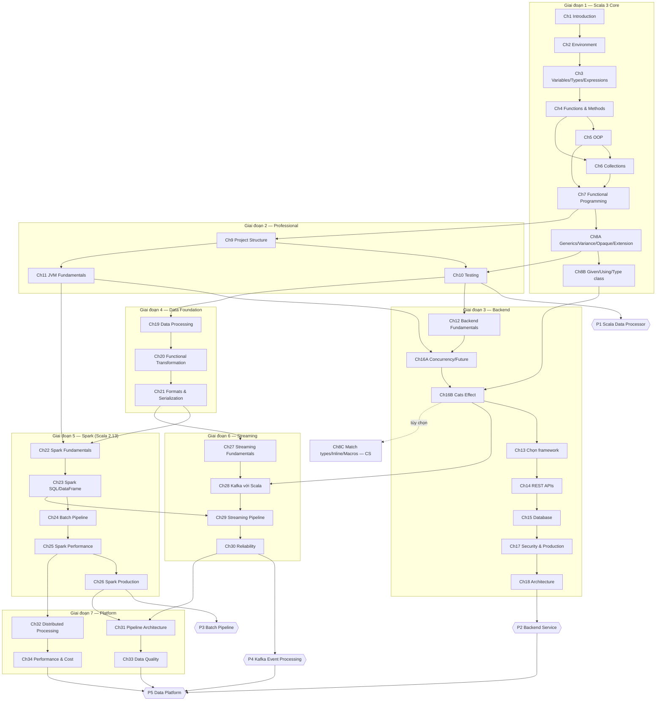

# Sơ đồ Prerequisite giữa các chương

Sơ đồ dưới đây dùng Mermaid (GitHub, GitLab, IntelliJ, VS Code đều hiển thị được).
Mũi tên `A --> B` nghĩa là **phải học A trước B**.

## Bảng prerequisite dạng văn bản

| Chương | Cần học trước | Lý do |
|---|---|---|
| Ch6 Collections | Ch4, Ch5 | `map/filter` nhận function (Ch4); phần tử thường là case class (Ch5) |
| Ch7 FP | Ch5, Ch6 | ADT dựng từ sealed trait/enum (Ch5); Option/Either dùng API giống collection (Ch6) |
| Ch8B Given/Using | Ch8A | Type class cần generics và variance |
| Ch10 Testing | Ch8A, Ch9 | Test generic code; test cần cấu trúc project sbt |
| Ch16B Cats Effect | Ch8B, Ch16A | Cats dùng type class rất nhiều; cần hiểu Future để thấy vì sao cần IO |
| Ch13 Framework | Ch16B | So sánh framework chủ yếu là so sánh mô hình effect/concurrency |
| Ch22 Spark | Ch11, Ch21 | Spark là ứng dụng JVM phân tán; serialization & schema là cốt lõi |
| Ch28 Kafka | Ch16B, Ch27 | Consumer là chương trình chạy lâu, xử lý concurrency và resource |
| Ch29 Streaming Pipeline | Ch23 | So sánh với Spark Structured Streaming |

## Các lộ trình rút gọn

- **Chỉ Backend:** Ch1–11 → Ch12 → Ch16A → Ch16B → Ch13–15 → Ch17–18 → P2.
  Nên thêm Ch27–28 (event-driven backend).
- **Chỉ Data Engineering:** Ch1–11 (Ch8B mức NB) → Ch19–21 → Ch22–26 → Ch27–30 → Ch31–34 → P1, P3, P4.
  Nên thêm Ch16A (concurrency nền tảng) và Ch15 phần SQL.
- **Full (BE + DE):** theo thứ tự trong [05-learning-order-and-schedule.md](05-learning-order-and-schedule.md).
