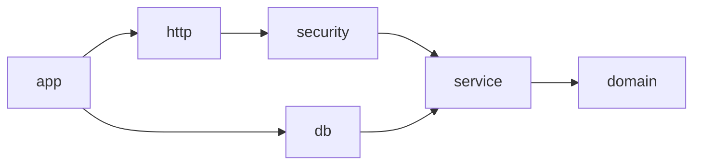

> Phiên bản: Scala 3.9.0 · JDK 21 · Cats Effect 3.7.1 · http4s 0.23.38 · Tapir 1.13.33 · Doobie 1.0.0-RC13 · PostgreSQL 18.6 · Flyway 13.10.3 · JDBC 42.7.14 · HikariCP 7.0.2 · circe 0.14.17 · sttp-apispec 0.11.10 · password4j 1.8.4 · jwt-circe 11.0.4 · log4cats 2.8.0 · logback 1.6.5 · munit 1.2.4 · munit-cats-effect 2.2.0. Trạng thái: Claude đã chạy sbt + PostgreSQL thật — vòng 1: 37/37 pass; vòng 2 (sau review chéo): **47/47 pass** và `app/assembly` thành công; Docker chưa kiểm chứng. Phiên bản cụ thể và nguồn: P2/evidence/versions.json, kiểm tra 17/10/2026.

# Chương 18 — Backend Architecture qua Project 2

[Ch14](ch14-rest-apis.md) đặt hợp đồng HTTP, [Ch15](../06-database/ch15-database-engineering.md) bảo vệ dữ liệu,
[Ch17](ch17-security-production.md) bảo vệ người dùng. Chương này ghép chúng thành
[Project 2](../14-projects/p2-backend-service/README.md), rồi dùng chính project để kiểm tra các quyết định kiến trúc.
Claude đã review vòng 1; bản sửa vòng 2 chờ kiểm tra lại. Xem trạng thái kiểm chứng chi tiết trong README của P2.

## 1. Mục tiêu học tập

- Phân biệt phân tầng code, module build và tiến trình triển khai; giải thích vì sao chọn modular monolith.
- Dùng dependency inversion để domain không biết HTTP, JWT hay PostgreSQL; kiểm tra bằng compiler và test kiến trúc.
- Đặt transaction theo use case; không để lỗi `Left` sau một phần thao tác ghi âm thầm commit dữ liệu dở.
- Mô hình hóa checkout bằng hàm thuần, tính tiền có kiểm tra overflow và giá do server quyết định.
- Đo cache trước khi chọn; xử lý TTL, invalidation và race khi đang nạp dữ liệu.
- Ghép timeout, retry có điều kiện và bulkhead; quan sát lỗi bằng request id, metrics và readiness thật.

## 2. Kiến thức tiên quyết

Cần biết `Either`, opaque type, enum, `IO`, `Ref`, `Resource`, `ConnectionIO`, `transact`, endpoint Tapir,
JWT và `SELECT FOR UPDATE`. Ôn Ch14/15/17 và Ch16B trước khi chạy. Đây là backend, không có bài frontend.
Để chạy unit test cần Scala CLI/JDK; tải dependency lần đầu cần Internet, chạy test sau khi đã có cache không cần dịch vụ bên ngoài.
Test PostgreSQL cần quyền tạo subprocess ngoài sandbox; Docker là một cách triển khai riêng.

## 3. Lý thuyết

### 3.1. Layered architecture, modular monolith và dependency inversion

**Vấn đề → vì sao:** đặt SQL trong endpoint khiến đổi JSON kéo theo đổi transaction, và unit test phải bật database.
Layered architecture (kiến trúc phân tầng) chia trách nhiệm để thay đổi có phạm vi. Phân tầng bằng tên thư mục chưa ngăn được import sai.

**Cách hoạt động:** P2 là một modular monolith: sáu module build, một JVM, một database. Mũi tên dưới đây nghĩa là “phụ thuộc vào”:



`domain` chứa giá trị/quy tắc/port; `service` điều phối use case; `db` và `http` là adapter;
`security` quản lý mật khẩu/token; `app` là composition root (nơi ghép phụ thuộc và quản lý vòng đời).
Dependency inversion (đảo chiều phụ thuộc): service gọi `Store[F]` do tầng bên trong định nghĩa;
`PgStore` bên ngoài cài port ấy. Service không tự khởi tạo `PgStore`.

**Thay thế → ưu/nhược:** một module đơn giảm cấu hình khi ứng dụng nhỏ; package discipline dễ bị phá do compiler nhìn thấy mọi lớp.
Microservice tách quyền triển khai nhưng thêm mạng, phân tán transaction, vận hành và tương thích hợp đồng.
Modular monolith giữ transaction nội bộ và build kiểm tra dependency, đổi lại vẫn có cùng lịch triển khai và chung tài nguyên JVM.

**Khi dùng → lỗi thường gặp:** chọn P2 cho nhóm nhỏ cùng domain đơn hàng. Chỉ tách dịch vụ khi có nhu cầu độc lập rõ ràng.
Đừng áp dụng Clean Architecture như yêu cầu mỗi lớp phải có một interface hay DTO giống hệt nhau qua năm tầng.
Ở đây chỉ có port tại biên cần thay implementation; `Line` và `Product` được HTTP codec ánh xạ từ bên ngoài.
`ArchitectureSuite` kiểm tra import; biên dịch domain riêng chứng minh nó không cần thư viện HTTP/DB.
Scala CLI gom toàn bộ source là đường chạy thay thế; Claude đã kiểm tra đồ thị sbt ở vòng 1 và sẽ chạy lại sau bản sửa vòng 2.

### 3.2. Domain modeling và Functional Core / Imperative Shell

**Vấn đề → vì sao:** tổng tiền do client gửi có thể bị sửa; cộng `Int`/`Long` không kiểm tra có thể quay vòng.
Một `Long` vừa là user id vừa là tiền dễ bị truyền nhầm.

**Cách hoạt động:** opaque `UserId`, `OrderId`, `Money` kế thừa ý tưởng Ch14. `Checkout.merge` kiểm tra từng dòng trước khi gộp,
gộp bằng `Long`; `Checkout.price` nhận bản chụp sản phẩm đã khóa, kiểm tra active/kho và tính bằng `multiplyExact`/`addExact`.
Đây là Functional Core (lõi hàm thuần): cùng đầu vào → cùng kết quả, không SQL, không đồng hồ, không đọc biến môi trường.
Imperative Shell (vỏ tương tác) lấy dữ liệu, chạy core, ghi kết quả. `IO` mô tả tương tác thay vì giấu nó trong constructor.

**Thay thế → ưu/nhược:** đẩy toàn bộ logic vào stored procedure bảo vệ mọi caller nhưng tăng công cụ cần debug;
service chứa validation thuần dễ test hơn nhưng DB vẫn phải có `CHECK`, FK, unique để bảo vệ đường ghi khác.
Thiết kế P2 dùng cả hai mức, không tạo entity có `save()` tự mở kết nối.

**Khi dùng → lỗi thường gặp:** core phù hợp quy tắc tính tiền, transition và ownership. Không đưa timeout hay HTTP status vào domain.
Không gọi domain là “thuần” nếu nó đọc `System.currentTimeMillis`, global cache hay database ngầm.
`Product` dùng ID `Long` để giữ lab vừa sức; mở rộng opaque `ProductId` là một cải tiến hợp lý, không phải điều kiện để áp dụng kiến trúc này.

### 3.3. Transaction boundaries theo use case

**Vấn đề → vì sao:** mỗi repository tự `transact` sẽ biến “tạo đơn + ghi chi tiết + trừ kho” thành nhiều commit.
Lỗi bước cuối có thể để lại đơn đã ghi nhưng kho chưa trừ. `Either.Left` là giá trị bình thường; Doobie không tự rollback vì thấy `Left`.

**Cách hoạt động:** port Ch14 được tổng quát hóa từ `OrderRepository` trả `IO[A]` thành `OrderRepository[F]` trả `F[A]`,
giữ tám thao tác và ý nghĩa. `PgStore extends Store[ConnectionIO]`; mọi truy vấn còn ở dạng mô tả.
`Shop.checkout` ghép đọc khóa → kiểm tra → tạo order → items → decrement, rồi gọi `TransactionRunner.run` đúng một lần.
`Database.runner` là chỗ diễn giải bằng `transact`. Tất cả lỗi domain được quyết định trước bước ghi đầu tiên;
lỗi SQL sau khi ghi tiếp tục là failed effect để rollback. Không bắt lỗi unique rồi dùng tiếp transaction đã abort;
đăng ký dùng `ON CONFLICT ... DO NOTHING RETURNING`.

`getOrder` đọc snapshot bình thường, không lấy row lock: GET của owner hay request bị từ chối 403 đều không tranh khóa ghi.
`lockOrder` dùng `FOR UPDATE` chỉ trong `Shop.status`/`PgStore.updateStatus`; hủy chỉ hoàn kho khi trạng thái thực sự chuyển từ Pending sang Cancelled.
Retry cùng trạng thái không hoàn thêm lần nữa. Các đường khóa nhiều sản phẩm dùng ID tăng dần để giảm deadlock.
Giá trong `order_items` là giá lúc mua, không join giá hiện tại để tính lại hóa đơn.

**Thay thế → ưu/nhược:** UPDATE kho có điều kiện có thể tránh lượt đọc, nhưng nhiều món và snapshot giá cần thiết kế thêm;
SERIALIZABLE phát hiện xung đột rộng hơn nhưng caller phải xử lý serialization failure.
`FOR UPDATE` dễ giải thích, đổi lại giữ khóa và connection trong suốt use case. Không chạy Argon2 hay gọi mạng khi đang giữ khóa.

**Khi dùng → lỗi thường gặp:** dùng một transaction khi các thao tác cần cùng bất biến trong một DB.
Gửi email trong transaction không khiến email rollback: bài mini project dùng transactional outbox.
P2 chưa có idempotency key cho POST checkout; timeout sau commit là kết quả chưa chắc chắn, tuyệt đối không tự retry POST.
Claude đã chạy test PostgreSQL (rollback/oversell/hủy đồng thời): 37 test pass ở vòng 1, 47 test pass ở vòng 2 với sbt.
Vòng 2 thêm hồi quy giữ row lock ở connection khác nhưng GET vẫn trả; test DB mới chờ lead chạy, không suy ra pass từ việc compile.

### 3.4. Cache: số đo, TTL và invalidation

**Vấn đề → vì sao:** đọc catalog lặp lại tốn độ trễ; cache giá/kho sai có thể tạo đơn sai.
Cần định nghĩa dữ liệu nào được phép cũ trước khi thêm cache.

**Cách hoạt động:** `TtlCache` dùng đồng hồ monotonic, TTL 2 giây trong app, tối đa 1000 key; khi đầy thì xóa map để giữ cách cài đặt dễ đọc.
Chỉ `GET /products/{id}` dùng cache; checkout luôn đọc PostgreSQL trong transaction. Ghi sản phẩm, xóa mềm, checkout và đổi trạng thái
invalidate sau khi thành công. Generation (thế hệ) tăng khi invalidate: kết quả load bắt đầu ở thế hệ cũ không được chèn ngược vào cache.
Một request đã đọc trước thay đổi vẫn có thể hoàn tất bằng dữ liệu cũ; cơ chế này ngăn nó làm bẩn lần đọc sau.

**Thay thế → ưu/nhược:** không cache là đơn giản nhất; cache từng request không có vấn đề đồng bộ giữa request;
Redis chia sẻ nhiều instance nhưng thêm mạng, vận hành, cơ chế phát invalidation. P2 tiết kiệm lượt đọc bằng RAM, đổi lại cache chỉ nhất quán trong một instance,
không single-flight (các cache miss cùng lúc có thể load trùng), và miss được cache cả `None` trong TTL.

**Khi dùng → lỗi thường gặp:** chỉ bật khi hit rate và độ trễ đo được có ích. P2 dùng upstream mô phỏng `IO.sleep(10ms)` để đo overhead/hit,
không gọi đó là benchmark PostgreSQL hay kết quả production. Xem số đo thực tế mục 9.
Nhiều instance hoặc thay DB từ ngoài app có thể thấy dữ liệu cũ tới TTL; stock trên catalog là thông tin tham khảo.
Nếu cần read-after-write trên mọi instance, bỏ cache trường stock, dùng version hoặc invalidation phân tán.
Đừng invalidation trước commit: reader có thể nạp lại dữ liệu cũ giữa invalidate và commit.

### 3.5. Resilience: timeout, retry và bulkhead

**Vấn đề → vì sao:** một dependency chậm giữ connection/thread, làm các request còn lại xếp hàng và quá hạn.
Retry không giới hạn khuếch đại tải khi hệ thống đang lỗi.

**Cách hoạt động:** request API có deadline 5 giây; Hikari connection timeout 2 giây, JDBC connect timeout 2 giây/socket timeout 5 giây.
Readiness dùng `SET LOCAL statement_timeout='800ms'; SELECT 1` và effect timeout 1 giây.
`Bulkhead` thử lấy 1 trong 32 permit, hết thì trả 503 ngay; `guarantee` trả permit cả khi lỗi/cancel.
Đây là bulkhead (vách ngăn tải đồng thời), không phải circuit breaker (bộ ngắt tạm thời theo lịch sử lỗi).
P2 chọn bulkhead tự viết bằng Cats Effect để không thêm dependency resilience.

`Resilience.retryRead` giới hạn số lần, backoff gấp đôi. Chỉ `Shop.product` áp dụng cho `SQLTransientException`, tối đa hai retry,
20/40 ms; mỗi lượt đọc là transaction mới. Không retry lỗi input, unique, mật khẩu sai hoặc checkout.
Phân loại JDBC còn tùy driver: lời giải bài 3 chỉ nhận SQLSTATE 40001/40P01 và đi qua cause chain.

**Thay thế → ưu/nhược:** circuit breaker giảm lời gọi vào dependency đang chết nhưng thêm trạng thái half-open;
queue hữu hạn làm mượt tải nhưng tăng latency. Bulkhead đơn giản và test được, đổi lại trả lỗi cả khi dependency chưa chết mà chỉ bận.
Readiness và metrics đi ngoài bulkhead để vẫn chẩn đoán lúc quá tải.

**Khi dùng → lỗi thường gặp:** giới hạn tải theo RAM/pool và số instance thực tế, không sao chép con số 32 vào production.
`IO.timeout` yêu cầu hủy, không thể ép JDBC blocking dừng tức khắc; response có thể vượt deadline trong khi chờ cleanup.
Timeout không chứng minh transaction chưa commit. Dùng timeout driver/DB bổ sung; kiểm tra trạng thái theo idempotency key trước khi retry một lệnh ghi.

### 3.6. Separation of concerns cho bảo mật

**Vấn đề → vì sao:** middleware tự parse `Bearer` khác Tapir từng làm token thu hồi vẫn đi lọt ở Ch17.
Nếu public register nhận role từ JSON, ai cũng có thể tự thành admin.

**Cách hoạt động:** Tapir parse auth một lần; `serverSecurityLogic` xác minh HS256/issuer/audience/subject/exp/jti,
kiểm tra revocation trong DB và lấy role hiện tại từ tài khoản. JWT không chứa password/hash/role có thể lỗi thời.
Register chỉ tạo Customer; `BootstrapAdmin` là lệnh quản trị riêng, không nâng quyền email đã tồn tại.
Argon2id chạy trước transaction đăng ký; bootstrap insert và promotion Admin cùng một transaction để rollback toàn bộ nếu promotion lỗi.
Login không tìm thấy account vẫn verify dummy hash; policy chuẩn hóa bằng `Locale.ROOT` để không phụ thuộc locale máy.
Rate limit theo remote IP nằm trong logic login, nên path có slash cuối/encoding dùng chung quota.
Map tối đa 10000 bucket; key mới kích hoạt dọn bucket đã hồi đầy, đầy map thì trả 429 cho key mới.
Body bị giới hạn 64 KiB trước decode JSON, kể cả stream không có Content-Length; quá giới hạn trả Problem 413.

**Thay thế → ưu/nhược:** session server-side dễ thu hồi; JWT xác minh độc lập được nhưng P2 vẫn đọc DB cho role/revocation,
vì ưu tiên chính sách thu hồi ngay. Điều đó làm mất lợi ích “không đọc DB mỗi request”, đổi lại trạng thái quyền có hiệu lực ngay.

**Khi dùng → lỗi thường gặp:** một instance lab dùng rate limit RAM; nhiều instance cần kho quota chung/gateway.
Không tin `X-Forwarded-For` trực tiếp từ Internet; P2 dùng địa chỉ kết nối nên sau reverse proxy mọi client có thể chung quota.
Danh sách revocation được dọn khi logout; hệ lớn cần job cleanup độc lập. HTTP demo nên đặt sau TLS terminator khi triển khai.

### 3.7. Observability và vòng đời tài nguyên

**Vấn đề → vì sao:** chỉ có stack trace không biết request nào lỗi; liveness phụ thuộc DB gây restart cả cụm khi DB chết.

**Cách hoạt động:** `RequestId` bọc logger và error handler; logger không ghi body và che header nhạy cảm theo http4s.
Tapir đặt `exceptionHandler(None)` để lỗi bất ngờ đi qua handler chung, log đầy đủ phía server và trả Problem 500 có request id.
Decode failure lấy status/header Tapir đã chọn, không hardcode 400 cho lỗi thiếu token 401.
`/metrics` có request count, duration summary (`# TYPE`, `_sum`, `_count` cùng label status) và login failure riêng;
không gắn user id/token/path tự do làm label. `_sum / _count` cho thời gian trung bình, chưa có percentile.
`/health` và `/health/live` cho tiến trình; `/health/ready` thử DB thật có timeout.
`Resource` mở pool trước server, đóng server trước pool; Ember chờ request đang chạy tối đa 10 giây, Compose cho 20 giây trước kill.

**Thay thế → ưu/nhược:** distributed tracing giúp theo dõi nhiều dịch vụ nhưng cần collector/context propagation;
P2 một JVM dùng request id/log/metrics đủ cho lab, chưa có histogram/trace hay dashboard.
Duration hiện đo đến lúc tạo response; không đại diện tải streaming. Metrics/health nên được giới hạn truy cập tại mạng vận hành.

**Khi dùng → lỗi thường gặp:** xem RED (rate/errors/duration) cùng connection pool trước khi tăng retry/cache.
Không log secret cấu hình hay body login; `Secret` và `DbConfig` che `toString`.
Đóng `Resource` trong test chứng minh finalizer và socket được đóng, không thay thế kiểm thử SIGTERM trong container.
SIGKILL không chạy finalizer; graceful shutdown Docker còn chờ môi trường có daemon.

## 4. Thuật ngữ tiếng Anh

| Thuật ngữ | Nghĩa trong P2 |
|---|---|
| Layer / module | Tầng trách nhiệm / đơn vị compiler-build; không đồng nghĩa tiến trình |
| Port / adapter | Hợp đồng do tầng trong sở hữu / cách kết nối SQL, HTTP ở tầng ngoài |
| Dependency inversion | Chính sách phụ thuộc abstraction, adapter thực hiện abstraction ấy |
| Composition root | `Main`: ghép các implementation và vòng đời |
| Transaction boundary | Một use case được `transact` đúng một lần |
| Invalidation / TTL | Làm cache mất hiệu lực / thời gian tối đa giữ entry |
| Bulkhead / backoff | Giới hạn việc đồng thời / tăng khoảng nghỉ giữa các retry |
| Observability | Suy ra trạng thái bên trong từ log, metrics, trace |

## 5. Ví dụ đơn giản

Đọc [Checkout.scala](../14-projects/p2-backend-service/domain/src/main/scala/vn/scalaeng/p2/domain/Checkout.scala):

```scala
val merged = lines.groupMapReduce(_.productId)(_.quantity.toLong)(_ + _)
```

Trước phép gộp, hàm đã kiểm tra từng quantity trong 1..1000. Sau phép gộp, tổng mỗi sản phẩm vẫn phải ≤1000.
Hai dòng mua 2 và 3 cùng sản phẩm trở thành một dòng mua 5; input `Int.MaxValue` bị từ chối trước khi tính.
Core nhận `Product(price=10, stock=3)` và yêu cầu quantity 2 sẽ tính 20 VND; test xác nhận cả overflow lẫn thiếu kho.

## 6. Ví dụ thực tế (Backend)

An đăng nhập, gửi `POST /api/v1/users/1/orders` với `lines=[{productId:1,quantity:2}]`.
API đọc token → DB lấy Principal → service kiểm tra An là user 1 → khóa sản phẩm → core tính giá → insert order/items/trừ kho → commit → invalidate cache → serialize.
ID user trong path không phải bằng chứng quyền sở hữu: thay 1 thành user khác sẽ bị service chặn.
Quản trị có thể quản lý catalog và chuyển đơn Paid/Shipped; khách hàng chỉ được hủy Pending.

Hai khách mua sản phẩm còn một món: transaction thứ hai đợi khóa; sau khi thứ nhất commit, nó đọc stock mới rồi trả OutOfStock.
Xem test thật được chuẩn bị trong `PostgresSuite`; không dùng kết quả adapter RAM làm bằng chứng chống oversell SQL.

## 7. Code đầy đủ

- [P2 README và lệnh chạy](../14-projects/p2-backend-service/README.md).
- [Domain + port](../14-projects/p2-backend-service/domain/src/main/scala/vn/scalaeng/p2/domain/Ports.scala).
- [Shop/use case](../14-projects/p2-backend-service/service/src/main/scala/vn/scalaeng/p2/service/Shop.scala).
- [Cache, retry, bulkhead](../14-projects/p2-backend-service/service/src/main/scala/vn/scalaeng/p2/service/Resilience.scala).
- [Doobie adapter](../14-projects/p2-backend-service/db/src/main/scala/vn/scalaeng/p2/db/PgStore.scala),
  [migration](../14-projects/p2-backend-service/db/src/main/resources/db/migration/V1__shop.sql).
- [Security](../14-projects/p2-backend-service/security/src/main/scala/vn/scalaeng/p2/security/AuthService.scala),
  [HTTP](../14-projects/p2-backend-service/http/src/main/scala/vn/scalaeng/p2/http/Api.scala),
  [composition root](../14-projects/p2-backend-service/app/src/main/scala/vn/scalaeng/p2/app/Main.scala).
- [Bằng chứng và script tái chạy](../14-projects/p2-backend-service/evidence/).

## 8. Giải thích code

`Store[F]` nối port đơn hàng Ch14 với account/catalog cần cho checkout. Nó chưa phải thiết kế microservice;
chia nhỏ port theo use case sẽ hữu ích khi một adapter bắt đầu phải thực hiện nhiều thao tác không liên quan.
`TransactionRunner[F]` là interpreter tối thiểu, giữ `transact` ngoài adapter; test có thể dùng `F=IO`, production dùng `ConnectionIO`.

`Shop` chỉ gọi interpreter tại biên public use case. `AuthService` băm/verify ngoài DB transaction; đọc role/revocation khi xác thực.
`PgStore.listUsers/products` dùng CTE và count trong cùng statement; trang rỗng vẫn giữ total, sort có ID phụ.
Xóa sản phẩm là soft delete để không làm mất lịch sử đơn.
`ArchitectureSuite` phát hiện import xuyên tầng; compiler domain riêng phát hiện cả các kiểu phụ thuộc chưa import.
Sbt `.dependsOn` kiểm tra mọi module khi lead chạy; đó là phần còn phải xác nhận ngoài sandbox.

## 9. Output mong đợi

Chỉ trích output chạy thật đã lưu trong [evidence](../14-projects/p2-backend-service/evidence/).
Chạy từ root repo bằng PowerShell:

```powershell
$env:COURSIER_CACHE = "$PWD/.cache/coursier"
scala-cli.bat test 14-projects/p2-backend-service --server=false
scala-cli.bat test solutions/ch18-code --server=false
scala-cli.bat run 14-projects/p2-backend-service --server=false --main-class vn.scalaeng.p2.service.ArchitectureDemo
```

Ngày 17/10/2026, **Claude chạy `RUN_DB_TESTS=1 sbt.bat -batch test`: 37/37 pass với PostgreSQL thật**, exit 0 (bản vòng 1). Vòng 2: **47/47 pass** (PostgresSuite 13, BootstrapAdminSuite 4, PostgresHttpSuite 1 chạy SQL thật), `sbt app/assembly` thành công.
Đoạn trích thật từ [review T07](../.team/reviews/T07-ch18-p2-review.md), được lưu lại trong
[sbt-postgres-review-round1.txt](../14-projects/p2-backend-service/evidence/sbt-postgres-review-round1.txt):

```text
vn.scalaeng.p2.db.PostgresSuite: finished 21.928s
Test run vn.scalaeng.p2.db.PostgresSuite finished: 0 failed, 0 ignored, 12 total 21.951s
vn.scalaeng.p2.app.PostgresHttpSuite: finished 15.967s
Test run vn.scalaeng.p2.app.PostgresHttpSuite finished: 0 failed, 0 ignored, 1 total 15.968s
```

Scala CLI vòng 2: **29 test P2 pass + 6 test lời giải pass, 0 fail, 0 cảnh báo compiler; 18 test DB assume-skip**.
Chi tiết nằm ở [summary.json](../14-projects/p2-backend-service/evidence/summary.json),
[tests.txt](../14-projects/p2-backend-service/evidence/tests.txt) và [solutions.txt](../14-projects/p2-backend-service/evidence/solutions.txt).
Compiler bật `-Werror`. Khi thiếu `RUN_DB_TESTS=1`, test DB tự assume-skip; munit vẫn tính chúng vào `total` dù ghi `0 ignored`.
Không dùng số total của lượt skip làm số pass; test DB sửa/thêm ở vòng 2 cần lead chạy lại.
Domain biên dịch riêng không có dependency ngoài Scala: exit 0.

Output thật từ demo (Windows/JDK 21; 20 lượt tuần tự, upstream mô phỏng bằng sleep 10 ms):

```text
20 reads, upstream=10ms: uncached calls=20 elapsed_ms=318
20 reads, upstream=10ms: cached calls=1 elapsed_ms=17
after invalidation: upstream calls=2
java.lang.IllegalArgumentException: permits phải dương
```

Tỷ lệ số lần gọi nguồn là 20→1; con số thời gian phụ thuộc scheduler/JIT/máy, không phải SLA và không phải PostgreSQL benchmark.
Dòng cuối là exception thực từ `Bulkhead.make(0)` được bắt rồi in, chứng minh constructor chặn cấu hình sai.
Probe Main thiếu cấu hình in tên bốn biến bắt buộc và dừng trước khi truy cập DB; Scala CLI trả exit 1 cho app exit khác 0
(trong code Main chọn ExitCode(2)). Compose `config --quiet` exit 0; build/start container vẫn chưa chạy.
Đoạn DB trên do Claude chạy ngoài sandbox; Docker build/up, SIGTERM container và `app/assembly` chưa kiểm chứng.

## 10. Lỗi thường gặp

**Sai API thư viện:** lần biên dịch P2 đầu dùng `jsonBody[Problem].contentType(...)`; compiler thật báo:

```text
value contentType is not a member of sttp.tapir.EndpointIO.Body[String, vn.scalaeng.p2.http.Problem]
```

Sửa bằng `CodecFormat` riêng và `.copy(codec = body.codec.format(problemFormat))`, đúng cách đã dùng Ch14.
Thông báo có trong [compile-initial.txt](../14-projects/p2-backend-service/evidence/compile-initial.txt).

**Trùng tên `Fixture` của munit:** test đặt case class `Fixture`, nhưng trong `CatsEffectSuite` tên đó trỏ tới type member của munit:

```text
Missing type parameter for ApiSuite.this.Fixture
```

Sửa tên thành `HttpFixture`. Đây là lỗi compiler từ lần chạy biên soạn, không phải output người học cần cố tạo lại.

**Transaction bị abort, overflow, bypass bảo mật:** xem thông báo/probe thật ở mục 10 Ch15 và Ch17.
P2 không lặp lại implementation sai: ON CONFLICT; số học có kiểm tra; revocation theo jti trong security logic; rate limit trong endpoint;
JWT bắt buộc exp/jti; handler chung. Test vòng 1 đã chạy với PostgreSQL thật như mục 9;
test hồi quy DB sửa/thêm trong vòng 2 chờ lead chạy lại, không xem compile/assume-skip là pass.

**Sai kỳ vọng timeout:** cancel JDBC cần chờ driver, nên timeout không bảo đảm kết thúc đúng mili giây và không chứng minh chưa commit.
Đây là lỗi thiết kế, không có thông báo compiler. Sau timeout checkout, điều tra bằng dữ liệu/transaction log trước khi gửi lại.

## 11. Cách debug

1. Xác định vấn đề nằm ở hợp đồng, core, use case hay adapter; chạy suite nhỏ tương ứng trước.
2. Với 401, kiểm tra issuer/audience/exp/jti, role DB và revocation; không ghi nguyên token vào log.
3. Với 409, đọc rule domain; với SQL exception, lấy SQLSTATE ở server. Không chuyển mọi exception thành 422.
4. Theo request id nối log với Problem 500; kiểm tra error rate và duration sum/count trước khi tăng timeout.
5. Với khóa chậm, xem `pg_stat_activity`/`pg_locks`, thời gian giữ transaction và thứ tự khóa; tránh gọi mạng trong transaction.
6. Với cache sai, tạm bỏ cache, kiểm tra TTL/generation, số instance và đường ghi ngoài app.

## 12. Bài tập (cơ bản → nâng cao)

1. Tách policy ownership thuần: owner và admin được phép; người khác nhận `DomainError.Forbidden`. Test đủ ba trường hợp.
2. Một cache dùng chung nhiều cửa hàng và hai tiền tệ. Thiết kế key gồm tenant, product id, currency chuẩn hóa; test không giao thoa.
3. Chỉ retry READ khi SQLSTATE là 40001 hoặc 40P01, kể cả exception bị bọc; không retry 23505 hay input sai.
4. Ghép retry ở bài 3 với deadline toàn cục 1500 ms. Dùng `TestControl` chứng minh mỗi retry không được “gia hạn” deadline.
5. Viết gauge in-flight bằng `Resource`; phải về 0 khi thành công, exception và cancellation.
6. Viết helper commit-then-invalidate: chỉ invalidate sau `Right`, không invalidate khi `Left` hoặc failed effect; test đủ ba nhánh.
   Giải thích cửa sổ commit thành công nhưng process chết trước invalidate.

## 13. Đáp án và lời giải

Xem [lời giải sáu bài](../solutions/ch18-solutions.md) và [code/test chạy được](../solutions/ch18-code/).
Các bài dùng lại domain/service của P2, không tạo bản sao giả lập của Cats Effect hay munit.

## 14. Câu hỏi kiểm tra

1. Layer, sbt module, JVM process có phải một không? Vì sao module db phụ thuộc vào port domain?
2. Vì sao `Left` không tự rollback? Tại bước nào có thể trả Left an toàn trong checkout hiện tại?
3. Generation ngăn race cache nào? Nó có khiến request đọc trước commit tự nhận dữ liệu mới không?
4. Vì sao JWT vẫn đọc DB? Đổi lại ta được và mất điều gì?
5. Timeout checkout có cho phép client gửi lại ngay không? Vì sao liveness không gọi DB?
6. Test HTTP dùng RAM và test PostgreSQL chứng minh các thuộc tính khác nhau thế nào?

Gợi ý: (1) các mức tổ chức khác nhau, chính sách sở hữu port; (2) Left là giá trị, quyết định trước ghi;
(3) ngăn fill cũ quay lại map, không sửa response đang chạy; (4) quyền/thu hồi tức thời đổi lấy lượt đọc;
(5) có thể đã commit, restart app không sửa DB chết; (6) hợp đồng/phân quyền so với SQL/lock/rollback.

## 15. Mini project

Mở rộng P2 với **transactional outbox**: trong cùng transaction checkout, ghi một `OrderCreated(eventId, orderId)` vào bảng outbox.
Worker đọc batch có khóa `SKIP LOCKED`, gửi event và đánh dấu đã gửi; consumer dedup theo eventId vì có thể gửi lại sau crash.
Viết test rollback cả order/outbox khi insert thất bại và test consumer nhận trùng không nhân đôi tác dụng.

Không được mô tả “exactly-once gửi mạng” chỉ vì order và outbox commit cùng nhau. Chưa triển khai phần mở rộng này trong P2;
đáp án bài tập 6 giải thích vì sao invalidation sau commit cũng có cửa sổ lỗi tương tự.

## 16. Nguồn tài liệu chính thức

Kiểm tra 17/10/2026; danh sách 30 POM release trả HTTP 200 cùng SHA-256 ở
[versions.json](../14-projects/p2-backend-service/evidence/versions.json), có script tải lại.
Đây là xác nhận phiên bản tồn tại; build/test mới xác nhận cách dùng API.

- [Doobie: quản lý ConnectionIO và transaction](https://typelevel.org/doobie/docs/14-Managing-Connections.html).
- [PostgreSQL 18: row locks và deadlocks](https://www.postgresql.org/docs/18/explicit-locking.html).
- [Tapir: error outputs, decode failures và exception](https://tapir.softwaremill.com/en/latest/server/errors.html).
- [Tapir: server logic và security logic](https://github.com/softwaremill/tapir/blob/master/doc/server/logic.md).
- [Cats Effect: Resource](https://typelevel.org/cats-effect/docs/std/resource), [TestControl](https://typelevel.org/cats-effect/docs/core/test-runtime).
- [sbt: multi-project builds](https://www.scala-sbt.org/1.x/docs/Multi-Project.html), [sbt-assembly 2.3.1](https://github.com/sbt/sbt-assembly/releases/tag/v2.3.1).
- [Official PostgreSQL container](https://hub.docker.com/_/postgres), [Temurin container](https://hub.docker.com/_/eclipse-temurin).
- [OWASP Password Storage](https://cheatsheetseries.owasp.org/cheatsheets/Password_Storage_Cheat_Sheet.html), [RFC 7519](https://www.rfc-editor.org/rfc/rfc7519).

## 17. Checklist tự đánh giá

- [ ] Vẽ được đồ thị phụ thuộc P2 và chỉ ra ai sở hữu port; domain compile riêng không có HTTP/DB.
- [ ] Theo dõi một request checkout từ auth tới commit; biết mọi ranh giới transaction.
- [ ] Giải thích và test overflow, thiếu kho, rollback và hủy idempotent.
- [ ] Đo cache và nói rõ nguồn dữ liệu mô phỏng; giải thích TTL, invalidation, race và nhiều instance.
- [ ] Test cancellation/bulkhead/retry; không retry write sau timeout khi chưa có idempotency.
- [ ] Readiness gọi DB thật; liveness độc lập; log có request id và không có mật khẩu/token.
- [ ] Chạy unit/HTTP/solution; chạy DB integration ngoài sandbox bằng RUN_DB_TESTS=1.
- [ ] Lead chạy lại sbt với DB sau sửa vòng 2, `app/assembly`, Docker/SIGTERM và kiểm tra lại review trước khi cập nhật hoàn thành.
