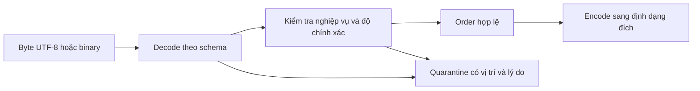

# Chương 21 — Data Formats và Serialization

> Phiên bản: Scala **3.9.0** · JDK **21** · circe-parser **0.14.17**, Commons CSV **1.14.1**, Avro **1.12.2**, parquet-avro **1.18.1**, Hadoop client-api/client-runtime **3.4.2**, slf4j-nop **2.0.17**, munit **1.2.4** · Trạng thái: đã biên dịch và chạy; đã review chéo bởi Claude; sbt **25/25** do reviewer chạy trước vòng sửa này; Scala CLI vòng 2 **27/27** lab và **12/12** lời giải. Chờ lead kiểm tra lại phần sửa sau review.

## 1. Mục tiêu học tập

Sau chương này, bạn có thể chọn định dạng cho dữ liệu đơn hàng dựa vào cách đọc thực tế; giữ nguyên tiền, thời gian và giá trị thiếu khi đổi định dạng; chứng minh một thay đổi schema có làm hỏng consumer cũ hay không. Bạn sẽ tự chạy JSONL, CSV, Avro và Parquet trên cùng một triệu bản ghi, đo kích thước và thời gian, rồi giải thích giới hạn của kết quả.

Đích đến là một hợp đồng dữ liệu có test, thay vì chỉ một file đọc được trên máy người viết.

## 2. Kiến thức tiên quyết

- Ch6–8: collection, iterator, `Option`, `Either`, ADT và case class.
- Ch9–11: build, munit, tài nguyên JVM và đo bằng `System.nanoTime`.
- [Project 1](../14-projects/p1-scala-data-processor/README.md): CSV/JSON parser tự viết, validation tích lũy lỗi và golden data. Chương này dùng thư viện cho I/O; không thay parser của P1.
- [Ingest lab Ch19](ingest-lab/project.scala): JSON Lines và CSV trong pipeline sự kiện; chương này chuyển trọng tâm sang hợp đồng lưu trữ, binary format và đọc cột. Không cần chạy hay sửa lab Ch19.

Không cần Spark, Docker, PostgreSQL hoặc dịch vụ mạng để chạy test sau khi tải dependency lần đầu. Nhánh Spark ở Ch22 dùng build **Scala 2.13** riêng; file dữ liệu là ranh giới trao đổi với Scala 3, không chia sẻ artifact `_2.13` trên classpath chương này.

### Vị trí trong lộ trình

Ch19 đã dùng thư viện để đọc JSONL/CSV theo luồng. Ch21 mở rộng sang hợp đồng dữ liệu, schema evolution và định dạng binary. Tiếp theo, Ch22 bắt đầu nhánh Spark dùng **Scala 2.13** để xử lý dữ liệu, gồm đọc Parquet/Avro.

Ranh giới giữa build Scala 3 của chương này và build Spark là **file Parquet/Avro**. Hai bên thống nhất schema và ý nghĩa dữ liệu; không chia sẻ class qua classpath hoặc trộn artifact `_3` với `_2.13`. Xem [compatibility matrix, mục 5](../00-roadmap/04-compatibility-matrix.md#5-kết-luận-kiến-trúc-phiên-bản). Chương này chưa kiểm chứng Spark đọc file lab.

## 3. Lý thuyết

### 3.1. Serialization và schema nằm ở đâu trong pipeline?

Một `Order` trong bộ nhớ chứa object, reference và `Instant`. Process khác không thể dùng trực tiếp các reference đó. **Serialization** chuyển giá trị thành byte để lưu hoặc truyền. **Deserialization** đọc byte và khôi phục giá trị theo một hợp đồng.

Schema mô tả tên trường và kiểu dữ liệu. Quy tắc nghiệp vụ quyết định giá trị nào được chấp nhận. Hai lớp này cần tách rõ: JSON có `amountMinor = -1` vẫn đúng cú pháp nhưng đơn hàng sai nghiệp vụ. Tương tự, một `Instant` có sáu chữ số phần lẻ vẫn hợp lệ trong Java nhưng không vừa hợp đồng millisecond của lab.

Pipeline kiểm tra theo thứ tự sau:



Kiểm tra schema lúc đọc (*schema-on-read*) giúp tiếp nhận nguồn linh hoạt. Đổi lại, mỗi reader phải có quy tắc kiểu rõ ràng. Kiểm tra schema lúc ghi (*schema-on-write*) phát hiện lỗi trước khi phát hành dữ liệu, nhưng producer phải tuân thủ hợp đồng từ đầu. Pipeline có thể kết hợp hai cách: giữ raw để điều tra, validate rồi ghi dữ liệu chuẩn hóa. Lỗi thiết kế thường gặp là để mỗi consumer tự đoán kiểu tiền và timezone.

Với JSONL, encode một `Order` thành JSON gọn rồi thêm newline. Decode làm theo chiều ngược lại; mỗi dòng phải là một JSON object hoàn chỉnh. Hai hàm sau còn gọi `Order.checked` để kiểm tra nghiệp vụ. Chúng dùng circe qua `asJson` và `decode[Order]`, không tự nối chuỗi JSON.

Trích [TextOrders.scala](formats-lab/src/main/scala/vn/scalaeng/formats/TextOrders.scala):

```scala
def writeJson(path: Path, rows: Iterator[Order], gzip: Boolean): Unit =
  withWriter(path, gzip) { out =>
    rows.foreach { row =>
      out.write(Order.checked(row).asJson.noSpaces)
      out.newLine()
    }
  }

def scanJson(path: Path, gzip: Boolean, consume: Order => Unit): Unit =
  withReader(path, gzip) { in =>
    in.lines().iterator().asScala.foreach { line =>
      consume(Order.checked(decode[Order](line).fold(throw _, identity)))
    }
  }
```

`withWriter` và `withReader` lo UTF-8, gzip nếu được chọn, và đóng stream. Mục 5 ghép hai hàm trên thành một round-trip có kiểm tra kết quả cho từng `Order`.

### 3.2. Chọn JSON, CSV, Avro hay Parquet

Câu hỏi đầu tiên là consumer sẽ đọc gì. API thường cần cả đơn hàng; báo cáo tổng tiền chỉ cần vài cột. Cách truy cập này quyết định định dạng phù hợp hơn việc chọn file nhỏ nhất.

| Định dạng | Cách hoạt động | Ưu điểm | Đánh đổi / lỗi thiết kế | Khi nên dùng |
|---|---|---|---|---|
| JSON / JSONL | Object có tên trường; JSONL đặt một JSON value trên mỗi dòng | Dễ xem, nested object, phù hợp API và log | Lặp tên trường; JSON không tự áp đặt schema nghiệp vụ; không coi số tiền là `Double` | Ingest sự kiện, debug, trao đổi với hệ thống web/backend |
| CSV | Record gồm các trường văn bản; dialect quy định delimiter, quote, header | Công cụ phổ biến, xuất dữ liệu đối tác dễ | Không có kiểu/null chuẩn chung; `split(",")` làm hỏng quote và xuống dòng trong trường | Trao đổi bảng đơn giản có hợp đồng dialect rõ |
| Avro Object Container File | Header mang writer schema; record theo hàng, chia block có codec | Hợp đồng kiểu rõ, schema resolution, xử lý đầy đủ sự kiện | Binary khó nhìn; raw Avro datum bên ngoài container vẫn cần writer schema | Lưu/chuyển sự kiện, migration có nhiều phiên bản producer |
| Parquet | Row group chia thành column chunk, rồi page; footer chỉ vị trí và schema | Đọc ít cột, encoding/nén theo cột; phù hợp phân tích | Footer/metadata và thư viện phức tạp; quá nhiều file bé gây overhead | Bảng phân tích batch, tổng tiền theo ngày, chia sẻ dữ liệu với Spark |

JSONL có thể dùng ở vùng raw, Avro ở luồng sự kiện có nhiều phiên bản, Parquet ở vùng phân tích, còn CSV dùng trao đổi với đối tác. Mỗi lần chuyển đổi phải giữ nguyên ý nghĩa dữ liệu.

JSON thông thường có thể là một mảng nhiều dòng; reader JSONL không đọc được mọi file `.json`. JSONL của lab dùng UTF-8 và escape newline bên trong chuỗi. CSV dùng RFC 4180, UTF-8 và header đúng thứ tự. Commons CSV xử lý quote; một record CSV có thể trải qua nhiều dòng vật lý. [RFC 8259](https://www.rfc-editor.org/rfc/rfc8259), [RFC 4180](https://www.rfc-editor.org/rfc/rfc4180).

**Ghi và đọc Avro.** Writer cần schema để encode từng `GenericRecord`. Header container giữ schema đó cho reader. `record` và `order` là hai hàm mapping giữa `Order` và `GenericRecord`; phần tiền/thời gian được giải thích ở mục 3.5.

Trích [AvroOrders.scala](formats-lab/src/main/scala/vn/scalaeng/formats/AvroOrders.scala):

```scala
def write(path: Path, rows: Iterator[Order], compressed: Boolean): Unit =
  Using.resource(DataFileWriter[GenericRecord](GenericDatumWriter[GenericRecord](schema))) { writer =>
    writer.setCodec(if compressed then CodecFactory.deflateCodec(6) else CodecFactory.nullCodec())
    writer.create(schema, path.toFile)
    rows.foreach(o => writer.append(record(Order.checked(o))))
  }

def scan(path: Path, consume: Order => Unit): Unit =
  Using.resource(DataFileReader[GenericRecord](path.toFile, GenericDatumReader[GenericRecord](schema))) { reader =>
    while reader.hasNext do consume(order(reader.next()))
  }
```

`setCodec` chọn deflate level 6 hoặc null codec, tức không nén block Avro. `Using.resource` đóng file cả khi xử lý record thất bại. Khi schema reader khác schema writer, dùng cách truyền reader schema riêng ở mục 3.3.

**Ghi và đọc Parquet.** Lab dùng cùng schema Avro để dựng record, nhưng writer tổ chức dữ liệu thành cột trong file Parquet. `LocalOutputFile` mở đường ghi local bằng Java NIO. Codec GZIP/UNCOMPRESSED được chọn trong writer, không bọc gzip bên ngoài cả file.

Trích [ParquetOrders.scala](formats-lab/src/main/scala/vn/scalaeng/formats/ParquetOrders.scala):

```scala
def write(path: Path, rows: Iterator[Order], compressed: Boolean): Unit =
  val builder = AvroParquetWriter.builder[GenericRecord](LocalOutputFile(path))
    .withConf(PlainParquetConfiguration())
    .withSchema(AvroOrders.schema)
    .withDataModel(GenericData.get())
    .withWriteMode(ParquetFileWriter.Mode.OVERWRITE)
    .withRowGroupSize(8L * 1024 * 1024)
    .withPageSize(64 * 1024)
    .withCompressionCodec(if compressed then CompressionCodecName.GZIP else CompressionCodecName.UNCOMPRESSED)
  Using.resource(builder.build()) { writer =>
    rows.foreach(o => writer.write(AvroOrders.record(Order.checked(o))))
  }
```

Đọc file local đi qua `scan`, rồi `scanFile`. Lệnh `read()` trả `null` khi hết record; đó là dấu kết thúc reader, khác với trường `note` có giá trị null.

Trích [ParquetOrders.scala](formats-lab/src/main/scala/vn/scalaeng/formats/ParquetOrders.scala):

```scala
def scan(path: Path, consume: Order => Unit): Unit =
  scanFile(LocalInputFile(path), consume)

private[formats] def scanFile(file: InputFile, consume: Order => Unit): Unit =
  Using.resource(AvroParquetReader.builder[GenericRecord](file, PlainParquetConfiguration())
    .withDataModel(GenericData.get()).build()) { reader =>
    var record = reader.read()
    while record != null do
      consume(AvroOrders.order(record))
      record = reader.read()
  }
```

Trong full read, `AvroOrders.order` khôi phục đủ sáu trường và validate. Nếu chỉ cần một cột, cấu hình projection trước khi mở reader như mục 3.6.

### 3.3. Schema evolution: phải nói rõ chiều đọc

Producer và consumer thường được nâng cấp ở thời điểm khác nhau. Dữ liệu lịch sử cũng còn schema cũ. Vì vậy, “v2 đọc được” chưa đủ: cần nói rõ dữ liệu do phiên bản nào ghi và phiên bản nào đọc.

- **Backward compatibility:** reader mới đọc được dữ liệu do writer cũ ghi: `S1 → S2`.
- **Forward compatibility:** reader cũ đọc được dữ liệu do writer mới ghi: `S2 → S1`.
- **Full compatibility:** cả hai chiều trên. Đây là kiểm tra **giữa hai phiên bản**; transitive compatibility cần kiểm tra với tất cả phiên bản còn lưu/đang chạy.

Thí nghiệm dùng fullname `vn.scalaeng.formats.evolution.Event`. Các schema v2 là những biến thể độc lập từ cùng v1, không phải chuỗi thay đổi liên tiếp. Các JSON dưới đây được xuất từ chính các `Schema` trong [Evolution.scala](formats-lab/src/main/scala/vn/scalaeng/formats/Evolution.scala) bằng [ChapterExamples.scala](formats-lab/src/main/scala/vn/scalaeng/formats/ChapterExamples.scala). Bản xuất được lưu ở [verification/schemas](formats-lab/verification/schemas/v1.avsc); cách xuống dòng trong bài giúp nhìn từng trường.

**V1:** `label` bắt buộc và không có default.

```json
{
  "type":"record",
  "name":"Event",
  "namespace":"vn.scalaeng.formats.evolution",
  "fields":[
    {"name":"id","type":"int"},
    {"name":"label","type":"string"}
  ]
}
```

**V2 thêm default** ([schema xuất](formats-lab/verification/schemas/v2-default.avsc)): reader mới cần `source`; nếu writer cũ chưa có trường đó, reader dùng `"web"`.

```json
{
  "type":"record",
  "name":"Event",
  "namespace":"vn.scalaeng.formats.evolution",
  "fields":[
    {"name":"id","type":"int"},
    {"name":"label","type":"string"},
    {"name":"source","type":"string","default":"web"}
  ]
}
```

**V2 đổi tên có alias** ([schema xuất](formats-lab/verification/schemas/v2-alias.avsc)): reader mới nhận tên cũ `label` cho trường `name`. Schema reader cũ vẫn chưa biết tên mới.

```json
{
  "type":"record",
  "name":"Event",
  "namespace":"vn.scalaeng.formats.evolution",
  "fields":[
    {"name":"id","type":"int"},
    {"name":"name","type":"string","aliases":["label"]}
  ]
}
```

**V2 cho phép null** ([schema xuất](formats-lab/verification/schemas/v2-nullable.avsc)): union cho phép cả null và string. Default null xử lý trường thiếu lúc đọc, không thay string hiện có bằng null.

```json
{
  "type":"record",
  "name":"Event",
  "namespace":"vn.scalaeng.formats.evolution",
  "fields":[
    {"name":"id","type":"int"},
    {"name":"label","type":["null","string"],"default":null}
  ]
}
```

Để kiểm tra schema, Avro nhận **reader trước, writer sau**. Đảo hai tham số là đổi chiều kiểm tra.

Trích [Evolution.scala](formats-lab/src/main/scala/vn/scalaeng/formats/Evolution.scala):

```scala
def read(path: Path, readerSchema: Schema): GenericRecord =
  Using.resource(DataFileReader[GenericRecord](path.toFile, GenericDatumReader[GenericRecord](null, readerSchema)))(_.next())

def compatible(reader: Schema, writer: Schema): Boolean =
  SchemaCompatibility.checkReaderWriterCompatibility(reader, writer).getType ==
    SchemaCompatibility.SchemaCompatibilityType.COMPATIBLE
```

`GenericDatumReader(null, readerSchema)` để `DataFileReader` lấy writer schema từ header container. Reader schema vẫn được truyền tường minh. Ví dụ sau ghi file v1 thật rồi đọc bằng v2 có default:

Trích [ChapterExamples.scala](formats-lab/src/main/scala/vn/scalaeng/formats/ChapterExamples.scala):

```scala
def readOldWithNew(dir: Path): GenericRecord =
  val path = dir.resolve("old.avro")
  Evolution.write(path, Evolution.v1, Evolution.sample(Evolution.v1))
  require(Evolution.compatible(reader = Evolution.added, writer = Evolution.v1))
  val upgraded = Evolution.read(path, readerSchema = Evolution.added)
  require(upgraded.get("source").toString == "web")
  upgraded
```

`source` trong kết quả phải là `"web"`, dù file cũ không chứa trường này. Test còn kiểm tra tám thay đổi theo cả hai chiều, thay vì suy từ case class Scala:

| Thay đổi từ v1 sang v2 | Backward | Forward | Vì sao trong thí nghiệm |
|---|---|---|---|
| Thêm `source: string`, default `"web"` | Có | Có | Reader mới điền default khi đọc v1; reader cũ bỏ trường mới |
| Thêm `source` không default | Không | Có | Reader mới thiếu dữ liệu bắt buộc khi đọc v1 |
| Xóa `label` | Có | Không | Reader mới bỏ trường thừa; reader cũ thiếu `label` và không có default |
| `id: int → long` | Có | Không | Promotion một chiều; reader int không nhận writer long dù giá trị thử là 7 |
| `id: int → string` | Không | Không | Không tự chuyển số thành chuỗi |
| `label → name`, reader mới có alias `label` | Có | Không | Alias thuộc reader mới; reader cũ không biết tên `name` |
| Đổi tên không alias/default | Không | Không | Cả hai reader đều thiếu tên trường mình đòi hỏi |
| `label: string → [null,string]`, default null | Có | Không | Reader mới nhận string; writer mới có thể gửi null mà reader cũ không nhận |

Default là quy tắc **đọc trường thiếu**. Nó không làm trường bắt buộc trở thành optional khi ghi. Nullable là quyền ghi giá trị null; đây là thuộc tính khác với có default. Lab đặt null trước trong `["null","string"]` với default null để quy ước dễ đọc.

Bảng trên phụ thuộc schema gốc. Chẳng hạn, nếu `label` **ở schema cũ đã có default**, kết quả forward khi xóa trường có thể khác. Alias ở v2 cũng không sửa được schema v1 đã triển khai.

Khi consumer cũ còn chạy, một lựa chọn là thêm trường mới có default rồi **dual-write**: ghi cả tên cũ và tên mới với cùng giá trị. Sau đó nâng consumer, backfill dữ liệu lịch sử, cuối cùng mới ngừng tên cũ. Cách này tốn thêm trường và một giai đoạn chuyển tiếp. Bài tập 5 kiểm chứng bước bridge; default rỗng vẫn cần fallback, chưa thay thế việc backfill ý nghĩa dữ liệu.

Compatibility cấu trúc cũng chưa đủ. Đổi đơn vị `amountVnd` sang USD nhưng giữ kiểu `long` có thể qua checker và vẫn làm sai số tiền. Hợp đồng phải ghi đơn vị, currency, precision, timezone và ý nghĩa default. [Avro specification — schema resolution, defaults và aliases](https://avro.apache.org/docs/1.12.0/specification/). Bảng kết quả được kiểm chứng với Avro 1.12.2.

### 3.4. Nullable fields: thiếu, null và rỗng

Một đơn hàng không có ghi chú khác với đơn hàng có ghi chú là chuỗi rỗng. Nếu đổi cả hai thành ô CSV rỗng, lần đọc sau không thể phục hồi trạng thái ban đầu. Trước khi viết codec, hãy chọn cách biểu diễn:

| Cách biểu diễn | Ưu điểm | Nhược điểm / điều kiện |
|---|---|---|
| JSON missing / null | Tự nhiên cho dữ liệu optional | Decoder `Option` của lab gộp cả hai thành `None`; PATCH có thể cần ADT riêng |
| CSV dùng sentinel như `\N` | Ít cột | Phải quy định escape cho chuỗi thật bằng sentinel; không được tự đoán |
| CSV `notePresent` + `note` | Phân biệt None, chuỗi rỗng, `\N` và mọi nội dung | Thêm một cột vật lý; phải validate tag |
| Avro union / Parquet optional | Có biểu diễn null trong schema | Null khác missing/default khi tiến hóa schema; cần kiểm tra reader |

**JSON lưu trữ.** `Order` chỉ cần biết có ghi chú hay không. Decoder dùng `Option[String]`: missing và null đều thành `None`; chuỗi rỗng thành `Some("")`; số hoặc object bị từ chối. Toàn bộ decoder circe như sau:

Trích [Order.scala](formats-lab/src/main/scala/vn/scalaeng/formats/Order.scala):

```scala
given Decoder[Order] = Decoder.instance { c =>
  for
    id <- c.get[Long]("id")
    user <- c.get[String]("userId")
    amount <- c.get[Long]("amountMinor")
    currency <- c.get[String]("currency")
    text <- c.get[String]("occurredAt")
    instant <- Decoder.decodeString.emap(s => Try(Instant.parse(s)).toEither.left.map(_.getMessage))
      .decodeJson(io.circe.Json.fromString(text))
    note <- c.get[Option[String]]("note")
  yield Order(id, user, amount, currency, instant, note)
}
```

Encoder của `Order` ghi `None` thành JSON null. Vì vậy round-trip giữ giá trị `Order`, nhưng không giữ khác biệt cú pháp giữa input thiếu trường và input null. Khi cần giữ khác biệt đó, phải đổi model.

**JSON cập nhật từng phần.** Với PATCH, missing có thể là giữ nguyên, null là xóa, chuỗi rỗng là gán giá trị mới. ADT `Presence` trong lời giải giữ ba trạng thái này bằng cách đọc `JsonObject` trước:

Trích [Exercises.scala](../solutions/ch21-code/src/main/scala/vn/scalaeng/solutions/ch21/Exercises.scala):

```scala
enum Presence:
  case Missing, ExplicitNull
  case Value(text: String)

object Presence:
  def note(json: Json): Either[String, Presence] =
    json.asObject.toRight("expected JSON object").flatMap { obj =>
      obj("note") match
        case None => Right(Missing)
        case Some(value) if value.isNull => Right(ExplicitNull)
        case Some(value) => value.asString.map(Value.apply).toRight("note must be string or null")
    }
```

`obj("note")` trả `None` khi thiếu trường. Nếu có trường, code mới xét `isNull` rồi `asString`. `asString` vẫn nhận chuỗi rỗng. Đây là lý do không dùng decoder `Option[String]` cho nghiệp vụ PATCH có ba trạng thái. Chi phí là consumer phải xử lý thêm nhánh.

**CSV.** Lab chọn hai cột để tránh mất thông tin: `notePresent=false,note=""` biểu diễn `None`; tag true giữ nguyên nội dung, kể cả rỗng và chuỗi thật `\N`. JSON, Avro và Parquet có sáu trường logic; CSV có bảy cột vật lý vì thêm tag. Writer dùng `isDefined` cho tag và `getOrElse("")` cho payload:

Trích [TextOrders.scala](formats-lab/src/main/scala/vn/scalaeng/formats/TextOrders.scala):

```scala
def writeCsv(path: Path, rows: Iterator[Order], gzip: Boolean): Unit =
  withWriter(path, gzip) { text =>
    Using.resource(CSVPrinter(text, csv)) { out =>
      rows.foreach { raw =>
        val o = Order.checked(raw)
        out.printRecord(List(o.id.toString, o.userId, o.amountMinor.toString, o.currency,
          o.occurredAt.toString, o.note.isDefined.toString, o.note.getOrElse("")).asJava)
      }
    }
  }
```

Reader chỉ nhận tag đúng `true` hoặc `false`. Tag false mà payload không rỗng là dữ liệu mâu thuẫn, nên bị từ chối:

Trích [TextOrders.scala](formats-lab/src/main/scala/vn/scalaeng/formats/TextOrders.scala):

```scala
def scanCsv(path: Path, gzip: Boolean, consume: Order => Unit): Unit =
  csvRecords(path, gzip) { records =>
    records.foreach { r =>
      require(r.size() == headers.length, s"expected ${headers.length} CSV fields, got ${r.size()}")
      val present = r.get("notePresent") match
        case "true" => true
        case "false" => false
        case other => throw IllegalArgumentException(s"invalid notePresent: $other")
      require(present || r.get("note").isEmpty, "absent note must have empty payload")
      consume(Order.checked(Order(r.get("id").toLong, r.get("userId"), r.get("amountMinor").toLong,
        r.get("currency"), Instant.parse(r.get("occurredAt")), Option.when(present)(r.get("note")))))
    }
  }
```

Commons CSV xử lý delimiter, quote và CRLF. Test giữ được `None`, `Some("")`, `Some("\\N")`, tiếng Việt, dấu phẩy, quote và CRLF trong note. Không thay null tiền bằng 0: 0 là một giá trị nghiệp vụ khác “chưa biết”.

### 3.5. Type conversion: tiền, decimal và thời gian

**Tiền cần đơn vị.** Nếu chỉ lưu số 1230, consumer không biết đó là 1230 đồng hay 12.30 USD. Hợp đồng `Order` dùng `amountMinor: Long` không âm cùng `currency`. Trong lab, USD có scale 2 nên `12.30` thành 1230 cent; VND có scale 0 nên `12000` thành 12000 đồng. Không suy ra currency từ máy người chạy.

`Money.parse` trong lời giải chọn scale theo currency trước khi chuyển đổi. Regex giới hạn input thành số thập phân không âm; currency ngoài USD/VND bị từ chối.

Trích [Exercises.scala](../solutions/ch21-code/src/main/scala/vn/scalaeng/solutions/ch21/Exercises.scala):

```scala
object Money:
  def parse(text: String, currency: String): Either[String, Long] =
    for
      scale <- Map("USD" -> 2, "VND" -> 0).get(currency).toRight("unsupported currency")
      _ <- Either.cond(text.matches("[0-9]+(?:\\.[0-9]+)?"), (), "expected unsigned decimal")
      amount <- Conversions.minor(text, scale)
    yield amount
```

Phép đổi thật nằm ở `Conversions.minor`. Hàm dựng `BigDecimal` từ chuỗi, dịch dấu thập phân rồi dùng `longValueExact` để từ chối mất phần lẻ và overflow. `Double` hoặc `.toLong` không cung cấp cùng bảo đảm này.

Trích [Order.scala](formats-lab/src/main/scala/vn/scalaeng/formats/Order.scala):

```scala
object Conversions:
  def minor(text: String, scale: Int): Either[String, Long] =
    if scale < 0 || scale > 9 then Left("scale must be in 0..9")
    else Try(BigDecimal(text).bigDecimal.movePointRight(scale).longValueExact())
      .toEither.left.map(_.getMessage)
```

Không tự nhân 100 cho mọi currency. Hàm chuyển đổi thấp tầng chỉ bảo đảm tính chính xác; regex/currency ở `Money` và validation của `Order` chịu trách nhiệm cho quy tắc tiền không âm.

**Decimal cố định.** Khi cần phạm vi rộng hơn Long cùng scale cố định, có thể chọn `DECIMAL(precision,scale)`. Precision là tổng số chữ số; scale là số chữ số phần lẻ. Avro decimal dùng bytes/fixed cho unscaled integer; Parquet có logical type DECIMAL. Đổi storage sang decimal cần thỏa thuận cả precision và scale với consumer.

Trích [Exercises.scala](../solutions/ch21-code/src/main/scala/vn/scalaeng/solutions/ch21/Exercises.scala):

```scala
object DecimalWire:
  val logical: LogicalTypes.Decimal = LogicalTypes.decimal(12, 2)
  val schema: Schema = logical.addToSchema(Schema.create(Schema.Type.BYTES))
  private val codec = AvroConversions.DecimalConversion()

  def roundTrip(text: String): Either[String, BigDecimal] =
    Try {
      val value = java.math.BigDecimal(text).setScale(2, RoundingMode.UNNECESSARY)
      require(value.precision() <= 12, "precision exceeds 12")
      val bytes = codec.toBytes(value, schema, logical)
      BigDecimal(codec.fromBytes(bytes, schema, logical))
    }.toEither.left.map(_.getMessage)
```

`logical.addToSchema` gắn logical type `decimal` precision 12, scale 2 lên kiểu vật lý bytes. `setScale(2, UNNECESSARY)` từ chối rounding; giới hạn precision được kiểm tra trước encode. Test có số âm, zero, giá trị biên và overflow.

Đây là **round-trip conversion bytes** của bài tập 3, chưa phải file decimal end-to-end. File lab vẫn lưu `amountMinor: Long` cùng currency và đã có file round-trip thật. Nếu migrate sang decimal, không tự giảm scale để dữ liệu vừa schema. [Avro decimal API](https://avro.apache.org/docs/1.12.0/api/java/org/apache/avro/Conversions.DecimalConversion.html), [Parquet logical types](https://parquet.apache.org/docs/file-format/types/logicaltypes/).

**Thời gian cần độ chính xác và timezone.** `Instant` là thời điểm trên trục UTC. `LocalDateTime` chỉ là giờ đồng hồ địa phương nên chưa xác định một thời điểm duy nhất. Lab yêu cầu offset ở input và chuẩn hóa về `Instant`. JSON/CSV ghi ISO-8601; Avro dùng long epoch millis với logical type `timestamp-millis`; Parquet nhận cùng schema:

Trích [AvroOrders.scala](formats-lab/src/main/scala/vn/scalaeng/formats/AvroOrders.scala):

```scala
val schema: Schema = Schema.Parser().parse("""{
  "type":"record","name":"Order","namespace":"vn.scalaeng.formats.wire",
  "fields":[
    {"name":"id","type":"long"},
    {"name":"userId","type":"string"},
    {"name":"amountMinor","type":"long"},
    {"name":"currency","type":"string"},
    {"name":"occurredAt","type":{"type":"long","logicalType":"timestamp-millis"}},
    {"name":"note","type":["null","string"],"default":null}
  ]} """)
```

Logical type mô tả ý nghĩa của long, không tự đổi object trong mapping hiện tại. `AvroOrders.record` ghi `occurredAt.toEpochMilli`; `AvroOrders.order` đọc bằng `Instant.ofEpochMilli`. `Order.checked` từ chối timestamp có phần lẻ nhỏ hơn millisecond trước khi writer đổi sang long, tránh mất dữ liệu âm thầm.

Một thời điểm gần nửa đêm có ngày UTC khác ngày Việt Nam. Vì vậy ngày báo cáo phải dùng zone nghiệp vụ tường minh:

Trích [Order.scala](formats-lab/src/main/scala/vn/scalaeng/formats/Order.scala):

```scala
/** Offset is mandatory: a wall clock without zone is not an instant. */
def instant(text: String): Either[String, Instant] =
  Try(OffsetDateTime.parse(text).toInstant).toEither.left.map(_.getMessage)

def businessDay(instant: Instant, zone: ZoneId): java.time.LocalDate =
  instant.atZone(zone).toLocalDate
```

Ở đây `Conversions.instant` kiểm tra offset; validation độ chính xác millis nằm ở `Order.validate` hoặc `TimestampWire.parse` trong lời giải. Test dùng `ZoneId.of("Asia/Ho_Chi_Minh")`: input `2026-10-01T00:30:00+07:00` thành `2026-09-30T17:30:00Z`, còn ngày báo cáo là 2026-10-01.

Một `Instant` không giữ zone ban đầu. Nếu cần tái hiện timezone xuất xứ, phải lưu thêm zone/offset. Input không offset cần chính sách xử lý giờ trùng hoặc giờ không tồn tại khi DST; lab chọn từ chối input đó. Muốn giữ microsecond phải đổi schema, mapping và test đồng bộ. [Java time](https://docs.oracle.com/en/java/javase/21/docs/api/java.base/java/time/package-summary.html).

### 3.6. Đọc một cột Parquet có nghĩa gì?

Báo cáo tổng tiền không cần user, thời gian hay note. Nếu đọc đủ `Order` rồi mới lấy `amountMinor`, chương trình đã tốn công đọc và dựng các trường không dùng. **Projection** là yêu cầu reader chỉ đọc schema cần cho truy vấn.

Với CSV/JSONL, reader vẫn đi qua record văn bản; gzip cần giải nén luồng trước đó. Avro có thể bỏ việc dựng trường không yêu cầu nhưng vẫn đi qua block theo hàng. Parquet đặt các cột ở chunk riêng, nên footer có thể chỉ reader đến chunk cần dùng. [Parquet file layout](https://parquet.apache.org/docs/file-format/).

Schema projection dưới đây chỉ có `amountMinor`. Cấu hình `AVRO_REQUESTED_PROJECTION` và `parquet.avro.read.schema` được đặt **trước khi build reader**, rồi truyền qua `conf`:

Trích [ParquetOrders.scala](formats-lab/src/main/scala/vn/scalaeng/formats/ParquetOrders.scala):

```scala
private[formats] def sumFile(file: InputFile): Long =
  val conf = PlainParquetConfiguration()
  val projection = """{"type":"record","name":"Order","namespace":"vn.scalaeng.formats.wire",
    "fields":[{"name":"amountMinor","type":"long"}]}"""
  conf.set(AvroReadSupport.AVRO_REQUESTED_PROJECTION, projection)
  conf.set("parquet.avro.read.schema", projection)
  Using.resource(AvroParquetReader.builder[GenericRecord](file, conf)
    .withDataModel(GenericData.get()).build()) { reader =>
    var total = 0L
    var record = reader.read()
    while record != null do
      total += record.get("amountMinor").asInstanceOf[Long]
      record = reader.read()
    total
  }
```

`file` ở đây là một `InputFile`; hàm public `sum(path)` bọc đường dẫn bằng `LocalInputFile`. Không có bước dựng đủ `Order` ở đường này. Vì thế phép đo full read và projection cũng khác phần decode/validation; không được quy toàn bộ chênh lệch thời gian cho I/O.

Encoding, chẳng hạn dictionary, khác compression codec. Parquet `UNCOMPRESSED` vẫn có encoding, nên file nhỏ hơn CSV chưa chứng minh lợi ích đến từ nén. Không gzip bọc ngoài cả file để thay codec page: cách bọc đó làm mất lợi ích seek trực tiếp đến footer/chunk.

Row group lớn giảm metadata nhưng cần nhiều bộ nhớ. Row group nhỏ giúp chia việc và lọc, đổi lại thêm overhead. Lab đặt target 8 MiB, page 64 KiB để chạy với heap 512 MiB; đây chưa phải cấu hình tối ưu cho warehouse. Nếu luôn đọc cả event với độ trễ thấp, Avro/JSONL có thể đơn giản hơn. Mục 9.4 dùng phép đếm byte qua API để kiểm tra reader có bỏ bớt cột thật hay không.

### 3.7. Chốt thư viện và đánh đổi trên Windows

Một dependency có tên Parquet chưa đủ để biết ứng dụng sẽ gọi filesystem nào. Đường ghi qua Hadoop FileSystem có yêu cầu môi trường khác đường ghi qua Java NIO. Vì vậy phải kiểm chứng đúng API và đúng tổ hợp version mà bài dùng.

Lab gọi **thư viện Java từ Scala 3** cho Avro/Parquet. Nó dùng `LocalInputFile`/`LocalOutputFile` và `PlainParquetConfiguration`. Đường này đã đọc/ghi thành công trên Windows qua NIO, không cần đặt `HADOOP_HOME` hoặc thuộc tính JVM `hadoop.home.dir`; bản chạy kiểm chứng ở mục 7 giữ cả hai ở trạng thái unset. Không cài winutils cho lab. Kết quả không chứng minh HDFS, S3 hoặc `HadoopInputFile` hoạt động; những đường đó cần kiểm chứng riêng.

Classpath vẫn cần `hadoop-client-api` và `hadoop-client-runtime` 3.4.2, gồm runtime shaded. Một số lớp, chữ ký và codec của nhánh parquet-hadoop cần chúng dù đường local không gọi Hadoop FileSystem. Đánh đổi là tải dependency và classpath nặng hơn đáng kể. Cách NIO phù hợp lab local; nó không loại bỏ toàn bộ dependency Hadoop.

Metadata và POM đã được kiểm tra trực tiếp từ `repo1.maven.org` ngày **17/10/2026, UTC+7**. [Bằng chứng nguồn](formats-lab/verification/sources.txt) giữ URL và phiên bản metadata trả về. Đây là pin đã chạy thử, không phải khẳng định tất cả đều mới nhất. Avro 1.12.2 và Hadoop 3.4.2 là pin trực tiếp thay phiên bản phụ thuộc mặc định trong parent POM Parquet; test xác nhận đúng tổ hợp này, chưa phải mọi API.

circe-parser và munit có artifact `_3` riêng đã kiểm tra. Avro/Parquet Java không có suffix Scala trong dependency của lab. Không dùng vulcan hay tuyên bố đã thử thư viện đó. Nhánh Spark ở Ch22 dùng Scala 2.13 với build riêng.

`slf4j-nop` làm log framework yên trong lab. Khi triển khai, chọn backend logging phù hợp để quan sát lỗi. Một phương án khác là DuckDB JDBC để kiểm chứng Parquet bằng SQL; lab đã chạy được Java API trực tiếp nên không cần thêm engine native. [Mã nguồn API Parquet 1.18.1](https://github.com/apache/parquet-java/tree/apache-parquet-1.18.1/parquet-avro/src/main/java/org/apache/parquet/avro), [Hadoop client artifacts](https://repo1.maven.org/maven2/org/apache/hadoop/hadoop-client-api/3.4.2/).

## 4. Thuật ngữ tiếng Anh

| Thuật ngữ | Ý nghĩa trong chương |
|---|---|
| Wire format | Cách byte được biểu diễn để truyền/lưu ngoài process |
| Writer / reader schema | Schema dùng lúc ghi / schema consumer yêu cầu khi đọc |
| Schema evolution | Thay đổi hợp đồng dữ liệu khi nhiều phiên bản còn cùng tồn tại |
| Backward / forward / full compatibility | Reader mới đọc writer cũ / reader cũ đọc writer mới / cả hai |
| Nullable | Kiểu cho phép một giá trị null; khác với có default |
| Precision / scale | Tổng số chữ số / số chữ số ở phần thập phân |
| Logical type | Ý nghĩa bổ sung cho kiểu vật lý, ví dụ long là timestamp-millis |
| Row group / column chunk / page | Nhóm hàng / phần dữ liệu của một cột trong nhóm / đơn vị page của Parquet |
| Projection | Chỉ yêu cầu những trường/cột cần dùng ở bước đọc |
| Quarantine | Nơi lưu record bị loại cùng vị trí, nguyên nhân và raw để điều tra |
| Round-trip | Ghi rồi đọc lại, kiểm tra giá trị và ý nghĩa được giữ nguyên |

## 5. Ví dụ đơn giản

Bắt đầu bằng một đơn hàng trước khi thử một triệu hàng. Ví dụ dưới đây lặp ba lần, mỗi lần ghi **một** `Order` sang JSONL và CSV rồi đọc lại. Dữ liệu lần lượt có note vắng mặt, rỗng và chuỗi thật `\N`. So sánh cả `Order` giúp phát hiện mất thông tin mà kiểm tra số hàng có thể bỏ sót.

Trích [ChapterExamples.scala](formats-lab/src/main/scala/vn/scalaeng/formats/ChapterExamples.scala):

```scala
def textRoundTrip(dir: Path): Unit =
  // Each pass writes one Order, including absent, empty and literal sentinel notes.
  for note <- List(None, Some(""), Some("\\N")) do
    val order = Order(1, "U-1", 1230, "USD", Instant.EPOCH, note)
    val json = dir.resolve("one.jsonl")
    TextOrders.writeJson(json, Iterator.single(order), gzip = false)
    val jsonRows = Vector.newBuilder[Order]
    TextOrders.scanJson(json, gzip = false, consume = o => { jsonRows += o; () })
    require(jsonRows.result() == Vector(order))
    val csv = dir.resolve("one.csv")
    TextOrders.writeCsv(csv, Iterator.single(order), gzip = false)
    val csvRows = Vector.newBuilder[Order]
    TextOrders.scanCsv(csv, gzip = false, consume = o => { csvRows += o; () })
    require(csvRows.result() == Vector(order))
```

Ở JSONL, `None` được encode thành null; chuỗi rỗng và `\N` vẫn là chuỗi. Ở CSV, cột `notePresent` bảo toàn khác biệt này như mục 3.4. `Iterator.single` cấp một record cho writer; reader gọi callback cho mỗi record đọc được.

Từ **gốc repository**, chạy ví dụ bằng:

```powershell
scala-cli.bat run 08-data-processing/formats-lab --main-class vn.scalaeng.formats.ChapterExamples -- 08-data-processing/formats-lab/out/chapter-examples
```

`ChapterExamples` còn xuất bốn schema JSON ở mục 3.3 và gọi `Demo` để round-trip tám biến thể codec trên cùng ba đơn hàng. Output thật ở mục 9. Cách chạy test thông thường và ghi chú sandbox nằm ở mục 7.

Để kiểm tra riêng tiền và timezone, xem `Conversions` trong [Order.scala](formats-lab/src/main/scala/vn/scalaeng/formats/Order.scala) cùng các test `money conversion`, `timezone conversion` trong [FormatsSuite.scala](formats-lab/src/test/scala/vn/scalaeng/formats/FormatsSuite.scala). Các test này kiểm tra độ chính xác trước I/O.

## 6. Ví dụ thực tế: hợp đồng và benchmark một triệu đơn hàng

### 6.1. Tái lập schema evolution

```powershell
scala-cli.bat run 08-data-processing/formats-lab --server=false --suppress-outdated-dependency-warning --main-class vn.scalaeng.formats.EvolutionMain -- 08-data-processing/formats-lab/out/evolution
```

Mỗi biến thể tạo riêng file `*-v1.avro` và `*-v2.avro`, đọc bằng schema đối diện, giữ file để bạn tự kiểm tra. V2 nullable cố ý ghi null; nếu chỉ thử string, dữ liệu mẫu có thể đọc được bằng reader cũ dù **schema không forward compatible**. Một test thành công trên một giá trị không chứng minh mọi giá trị hợp lệ đều đọc được.

### 6.2. Tái lập phép đo

```powershell
scala-cli.bat run 08-data-processing/formats-lab --server=false --suppress-outdated-dependency-warning --java-opt -Xmx512m --main-class vn.scalaeng.formats.Benchmark -- 08-data-processing/formats-lab/out/benchmark 1000000 3
```

Cùng `Order.generated(1000000)` cho mọi định dạng: id 1..1.000.000, 10.000 user lặp, amountMinor 100..100099 theo chu kỳ, USD, thời gian tăng mỗi giây từ mốc cố định; note có tiếng Việt/quote, 20% null, nội dung lặp. Đây là dữ liệu dễ nén, không đại diện cho payload entropy cao.

Benchmark dùng một lượt warm-up 10.000 hàng cho mọi biến thể, rồi ba lượt đo với thứ tự trộn theo seed cố định. Mỗi lượt thực hiện ghi → đóng file → đọc đầy đủ → đọc một cột. Đường ghi bao gồm sinh iterator, validate, encode và đóng stream; đường đọc đầy đủ gồm decode `Order`, validation, count, tổng tiền và checksum thứ tự của **mọi trường**. Đường đọc cột chỉ lấy amount và cộng, không validate các trường khác. Mọi lượt phải khớp digest và tổng trước khi nhận số đo; nếu lệch, chương trình dừng bằng `require`.

`System.nanoTime` đo bên trong JVM, **không tính download/compile/startup CLI**. JSONL/CSV có bản plain và gzip (mức mặc định JDK); Avro có null codec và deflate level 6; Parquet có UNCOMPRESSED và GZIP với dictionary mặc định. Các codec/cấu trúc khác nhau nên đây là phép đo các cách lưu thực tế, không phải so sánh thuật toán nén ở cùng tham số.

Để thấy rõ số đo được lấy ở đâu, đọc các đoạn trích sau trong `Benchmark`. Hàm `timed` dùng đồng hồ monotonic; hàm `median` sắp xếp rồi lấy phần tử giữa. `main` yêu cầu số lượt dương và lẻ để luôn có một phần tử giữa.

Trích [Benchmark.scala](formats-lab/src/main/scala/vn/scalaeng/formats/Benchmark.scala):

```scala
private def timed[A](f: => A): (A, Double) =
  val start = System.nanoTime()
  val result = f
  (result, (System.nanoTime() - start).toDouble / 1000000)

private def number(n: Double): String = String.format(Locale.ROOT, "%.3f", Double.box(n))
private def median(values: Seq[Double]): Double = values.sorted.apply(values.size / 2)
```

Warm-up không nằm trong bộ thu số đo. Nó tải class/codec cho từng format và kiểm tra tổng trên tối đa 10.000 hàng trước:

Trích [Benchmark.scala](formats-lab/src/main/scala/vn/scalaeng/formats/Benchmark.scala):

```scala
// Small unmeasured round loads classes and codecs for every format.
Format.values.foreach { f =>
  val path = dir.resolve(f.fileName)
  f.write(path, Order.generated(math.min(n, 10000)))
  val warm = Digest.of(consume => f.scan(path, consume))
  require(f.sum(path) == warm.amount)
}
```

Sau warm-up mới khởi tạo `results` và `raw`. Mỗi lượt trộn thứ tự format bằng seed cố định; ba vùng `timed` lần lượt bao ghi, full read và đọc amount. `require` loại kết quả sai trước khi ghi mẫu:

Trích [Benchmark.scala](formats-lab/src/main/scala/vn/scalaeng/formats/Benchmark.scala):

```scala
val results = mutable.Map.empty[Format, Vector[(Long, Double, Double, Double)]]
val raw = new StringBuilder("round,format,bytes,write_ms,full_read_ms,amount_read_ms\n")
for round <- 1 to rounds do
  // Fixed seed, different ordering per round; only one format executes at a time.
  Random(2100L + round).shuffle(Format.values.toList).foreach { f =>
    val path = dir.resolve(f.fileName)
    val (_, writeMs) = timed(f.write(path, Order.generated(n)))
    val (digest, fullMs) = timed(Digest.of(consume => f.scan(path, consume)))
    require(digest == expected, s"full read mismatch: $f $digest != $expected")
    val (amount, columnMs) = timed(f.sum(path))
    require(amount == expected.amount, s"column read mismatch: $f")
    val bytes = Files.size(path)
    results.update(f, results.getOrElse(f, Vector.empty) :+ (bytes, writeMs, fullMs, columnMs))
    val line = s"$round,$f,$bytes,${number(writeMs)},${number(fullMs)},${number(columnMs)}"
    raw.append(line).append('\n')
    println(line)
  }
```

Cuối cùng, mỗi cột thời gian được lấy median **riêng** từ các mẫu của format đó; byte lấy ở lượt cuối. Xem các lệnh `median(samples.map(...))` trong [Benchmark.scala](formats-lab/src/main/scala/vn/scalaeng/formats/Benchmark.scala). Chương trình giữ toàn bộ raw CSV để có thể kiểm tra một lượt chậm bất thường, thay vì chỉ đưa ra median.

Máy đo: Intel Core i7-9750H @ 2.60 GHz, 12 logical processors, Windows 11 build 26200, amd64; JVM thực chạy Scala CLI là OpenJDK **21.0.12.1+1-LTS**, heap tối đa **536.870.912 byte**. JVM này khác `java` trên PATH; thông tin runtime nằm trong transcript. Không lấy được RAM vật lý qua CIM do sandbox từ chối truy cập; không suy ra RAM hệ thống từ heap. File nằm trên filesystem local của workspace; không xác minh loại ổ đĩa.

**Bảng số đo thật và bằng chứng projection:** xem mục 9 cùng [transcript benchmark](formats-lab/verification/benchmark.txt). `raw.csv` và `summary.md` được sinh trong `out/benchmark/`; bản sao bàn giao nằm ở `verification/`. File dữ liệu lớn trong `out/` được ignore; chạy lệnh trên để tái tạo.

Các giới hạn cần giữ khi đọc kết quả:

- Đọc ngay sau ghi dùng cache hệ điều hành; không phải cold disk, không có `fsync` hay bảo đảm durability.
- Warm-up ngắn; JIT/GC và tải hệ thống ảnh hưởng các lượt. Median ba mẫu giúp bớt ảnh hưởng một lượt, chưa phải nghiên cứu thống kê hay JMH benchmark.
- Full read có tạo object và validation; column read làm ít việc hơn. Chênh lệch thời gian gồm cả I/O, parsing, allocation, validation, không chỉ layout.
- Đọc tất cả rồi tính tổng khác với workload filter/join; không dùng bảng để dự báo network/object store hoặc cluster Spark.
- Checksum 64-bit có thể collision; test round-trip nhỏ so sánh từng `Order`, còn benchmark dùng count + tổng + checksum để phát hiện lỗi thực dụng.

## 7. Code đầy đủ

Từ **gốc repository**, chuyển vào lab và chọn một trong hai cách test sau. Hai build dùng cùng pin dependency.

```powershell
cd 08-data-processing/formats-lab
scala-cli test .
```

Hoặc, ngay trong thư mục lab:

```powershell
sbt test
```

Reviewer Claude đã chạy `sbt.bat -batch test`: **25/25 pass** trước vòng sửa này, theo [review T06](../.team/reviews/T06-ch21-data-formats-review.md). Vòng 2 thêm hai test cho ví dụ trong bài và đã chạy lại Scala CLI: **27/27 pass**. sbt với hai test mới cần lead chạy lại.

**Ghi chú môi trường Codex/Windows:** sandbox chặn Bloop nên bắt buộc thêm `--server=false`. Có thể đặt cache trong repo để tránh ghi ngoài workspace. `--suppress-outdated-dependency-warning` chỉ ẩn gợi ý nâng dependency; compiler vẫn bật `-deprecation -feature -Wunused:all -Werror`. Lệnh Codex đã dùng, tính từ gốc repo:

```powershell
$env:COURSIER_CACHE = Join-Path $PWD '.cache/coursier'
scala-cli.bat test 08-data-processing/formats-lab --server=false --suppress-outdated-dependency-warning
scala-cli.bat test solutions/ch21-code --server=false --suppress-outdated-dependency-warning
```

Nếu đang đứng trong lab, dùng `Join-Path $PWD '../../.cache/coursier'` cho cache và thay đường dẫn lab bằng `.`. Các lệnh run ở mục 5–6 cũng thêm cờ sandbox khi chạy trong Codex. Với Windows đã có công cụ trên PATH, `scala-cli.bat` và `sbt.bat` là tên launcher tương ứng.

| File trong `formats-lab/` | Trách nhiệm |
|---|---|
| [project.scala](formats-lab/project.scala), [build.sbt](formats-lab/build.sbt), [build.properties](formats-lab/project/build.properties) | Pin cùng phiên bản cho Scala CLI/sbt; build một module |
| [Order.scala](formats-lab/src/main/scala/vn/scalaeng/formats/Order.scala) | Wire model, JSON codec, validation, generator, conversion |
| [TextOrders.scala](formats-lab/src/main/scala/vn/scalaeng/formats/TextOrders.scala) | JSONL/CSV, header/tag hiện diện, gzip, đóng resource |
| [AvroOrders.scala](formats-lab/src/main/scala/vn/scalaeng/formats/AvroOrders.scala) | Schema và mapping generic record; Avro file và projection |
| [ParquetOrders.scala](formats-lab/src/main/scala/vn/scalaeng/formats/ParquetOrders.scala) | NIO writer/reader, codec và projection thật |
| [Evolution.scala](formats-lab/src/main/scala/vn/scalaeng/formats/Evolution.scala) | Tám biến thể schema và file ghi/đọc hai chiều |
| [Benchmark.scala](formats-lab/src/main/scala/vn/scalaeng/formats/Benchmark.scala) | Tám biến thể lưu, digest, warm-up, raw và median |
| [ProjectionProbe.scala](formats-lab/src/main/scala/vn/scalaeng/formats/ProjectionProbe.scala) | Đếm byte trả qua API reader; không đo byte đĩa vật lý |
| [ChapterExamples.scala](formats-lab/src/main/scala/vn/scalaeng/formats/ChapterExamples.scala) | Ví dụ một Order JSONL/CSV, file v1 → reader v2, xuất schema và in môi trường Windows |
| [FormatsSuite.scala](formats-lab/src/test/scala/vn/scalaeng/formats/FormatsSuite.scala) | Round-trip, schema evolution, conversion, CSV header, empty, precision, projection |
| [verify-sources.py](formats-lab/verify-sources.py) | Tải metadata/POM từ repo1 và kiểm tra version có tồn tại |
| [verify-docs.py](formats-lab/verify-docs.py) | Kiểm tra link tài liệu chính thức, lưu HTTP status trong verification |
| [verify-chapter-snippets.py](formats-lab/verify-chapter-snippets.py) | Đối chiếu mọi khối Scala với source liên tục và mọi schema JSON với bản xuất từ chương trình |

Các khối Scala là trích đoạn liên tục từ source trên hoặc source lời giải; chỉ bỏ phần thụt đầu dòng chung khi đưa vào Markdown. Chúng cần imports và ngữ cảnh object trong file gốc. Chạy source đầy đủ bằng Scala CLI, thay vì ghép các đoạn trích thành một file mới. Bốn schema JSON được đối chiếu theo cấu trúc với bản xuất từ chương trình; [kết quả kiểm tra trích đoạn](formats-lab/verification/snippets-round2.txt) ghi file và dòng nguồn.

## 8. Giải thích code

Đọc code theo đường đi của một đơn hàng: decode → kiểm tra nghiệp vụ → chuyển sang wire record → ghi file → đọc lại. Mỗi bước giữ một trách nhiệm để dễ tìm nơi dữ liệu bị đổi sai.

**Kiểm tra sau decode.** Parse được một số âm chưa chứng minh số tiền hợp lệ. `Order.validate` trả danh sách tất cả lỗi nghiệp vụ để người gọi có đủ thông tin. `Order.checked` dùng danh sách đó để ném exception tại ranh giới lab; demo/benchmark dừng ngay khi input sai. Khi nguồn có record bẩn, cần cho các record còn lại tiếp tục: lời giải 6 chuyển từng record lỗi sang quarantine.

**Đóng tài nguyên trước khi coi file đã hoàn tất.** `Using.resource` đóng reader/writer ngay cả khi encode hoặc validation thất bại. Với Parquet, thao tác đóng writer còn hoàn thành footer mà reader cần để tìm cột. File đang ghi dở chưa phải kết quả có thể publish. Lab ghi vào thư mục thử nghiệm; nó chưa có giao thức publish nguyên tử nhiều file.

**Đọc header CSV thật.** Tên cột quyết định cách diễn giải dữ liệu. `csvRead` dùng `.setHeader()` không truyền danh sách tên để parser đọc header vật lý, sau đó so với hợp đồng. Nếu tự gán tên và bỏ dòng đầu, header bị đảo có thể không được phát hiện. Tiếp theo reader kiểm tra tag `notePresent`: chỉ nhận `true`/`false`, và false đòi payload rỗng. Đây là bước bảo toàn trạng thái vắng mặt, không phải việc quote của CSV.

**Tách mapping khỏi schema resolution.** `AvroOrders.record` đổi `Instant` thành long millis và `Option[String]` thành chuỗi/null cho `GenericRecord`. `AvroOrders.order` làm chiều ngược lại rồi validate. Trong thí nghiệm evolution, `DataFileReader` lấy writer schema từ header còn `Evolution.read` truyền reader schema riêng. Avro đối chiếu hai schema này để áp default, promotion hoặc alias. Mapping case class tự nó không thực hiện các quy tắc evolution.

**Yêu cầu cột trước khi đọc.** `ParquetOrders.sumFile` đặt projection vào cấu hình trước khi build reader, rồi chỉ cộng `amountMinor`. `scanFile` đọc đủ trường để dựng `Order`. Hai đường xử lý làm lượng công việc khác nhau, nên chênh lệch thời gian không chỉ đến từ I/O.

Để kiểm tra phần đọc byte, `CountingInputFile` bọc các hàm read và cộng số byte được trả qua API. Nếu reader đọc lại cùng vùng file, byte có thể được đếm lại. Vì vậy đây là **logical API bytes**; nó không đo số byte duy nhất trên đĩa hoặc I/O phần cứng.

**Giữ phép đo dùng cùng dữ liệu.** `Format` điều phối tám biến thể qua cùng generator và phép kiểm tra kết quả. Benchmark dùng iterator để tạo từng `Order`, giữ digest nhỏ thay vì một `Vector` chứa một triệu object. Digest kiểm tra count, tổng và checksum có thứ tự của mọi trường. Tổng Long an toàn với dataset sinh đã định nghĩa; với tiền tùy ý, phải kiểm tra overflow hoặc chọn `BigInt`/decimal.

## 9. Output mong đợi

Các output dưới đây được trích từ lần chạy thật ngày **17/10/2026 (UTC+7)** trong `formats-lab/verification/`. Không dùng con số thời gian làm assertion trong test.

### 9.1. Test và round-trip nhỏ

Vòng 2: lab **27 pass, 0 fail, 0 ignored**, lời giải **12 pass, 0 fail, 0 ignored**; không cảnh báo compiler với `-Werror`. Hai dòng tổng kết nguyên văn từ [tests-round2.txt](formats-lab/verification/tests-round2.txt) và [test-output-round2.txt](../solutions/ch21-code/test-output-round2.txt):

```text
Test run vn.scalaeng.formats.FormatsSuite finished: 0 failed, 0 ignored, 27 total 10.561s
Test run vn.scalaeng.solutions.ch21.ExercisesSuite finished: 0 failed, 0 ignored, 12 total 9.61s
```

Lệnh chạy `ChapterExamples` ở mục 5 đã kiểm tra JSONL/CSV, v1→v2 và in hai cấu hình Hadoop ở trạng thái unset; xem [examples-round2.txt](formats-lab/verification/examples-round2.txt). Chương trình cũng gọi `Demo` với đủ tám biến thể. Output `Demo` nguyên văn từ [demo.txt](formats-lab/verification/demo.txt):

```text
Json roundTrip=true amountMinor=306
JsonGzip roundTrip=true amountMinor=306
Csv roundTrip=true amountMinor=306
CsvGzip roundTrip=true amountMinor=306
Avro roundTrip=true amountMinor=306
AvroDeflate roundTrip=true amountMinor=306
Parquet roundTrip=true amountMinor=306
ParquetGzip roundTrip=true amountMinor=306
```

### 9.2. Schema evolution

Trích thực nghiệm schema đã chạy ngày 17/10/2026:

```text
add-default backward=true forward=true
  v1->v2 {"id": 7, "label": "paid", "source": "web"}
  v2->v1 {"id": 7, "label": "paid"}
int-long backward=true forward=false
  v1->v2 {"id": 7, "label": "paid"}
  v2->v1 AvroTypeException: Found long, expecting int
rename-alias backward=true forward=false
  v1->v2 {"id": 7, "name": "paid"}
  v2->v1 AvroTypeException: Found vn.scalaeng.formats.evolution.Event, expecting vn.scalaeng.formats.evolution.Event, missing required field label
nullable backward=true forward=false
  v1->v2 {"id": 7, "label": "paid"}
  v2->v1 AvroTypeException: Found null, expecting string
```

Đây là các đoạn trích không liền nhau từ [evolution.txt](formats-lab/verification/evolution.txt); file đầy đủ có cả tám biến thể. `id` hiển thị 7 ở cả int và long; test còn kiểm tra object reader mới là `java.lang.Long` để không nhầm JSON hiển thị với kiểu trong bộ nhớ.

### 9.3. Số đo một triệu đơn hàng

Thời gian là **median ba lượt**, đơn vị millisecond; kích thước là **byte của file ở lượt cuối**, gồm header/footer. Tham số máy, dữ liệu và cách tái lập nằm ở mục 6. Bảng lấy từ [benchmark-summary.md](formats-lab/verification/benchmark-summary.md); [24 mẫu gốc](formats-lab/verification/benchmark-raw.csv) và [transcript](formats-lab/verification/benchmark.txt) được giữ để xem biến thiên:

| Định dạng / codec | Byte | Ghi ms | Đọc đầy đủ ms | Đọc amountMinor ms |
|---|---:|---:|---:|---:|
| JSONL plain | 130390896 | 1688.645 | 2362.087 | 1136.395 |
| JSONL gzip | 13156809 | 2603.211 | 2423.098 | 1314.029 |
| CSV plain | 67790956 | 1519.403 | 2075.567 | 1149.925 |
| CSV gzip | 10738389 | 2703.487 | 2205.475 | 1126.027 |
| Avro null codec | 37332472 | 596.233 | 440.063 | 139.657 |
| Avro deflate level 6 | 9732283 | 1964.789 | 576.301 | 263.426 |
| Parquet UNCOMPRESSED | 34794470 | 759.499 | 445.263 | 66.632 |
| Parquet GZIP | 7867325 | 2347.409 | 494.407 | 74.063 |

Mọi lượt full read khớp `Digest(1000000,50099500000,7270001777214734632)`; mọi lượt projection khớp tổng **50099500000** minor units USD. Với dataset này, nén làm file nhỏ hơn nhưng tốn thêm thời gian ghi; full read của các bản nén cũng chậm hơn bản plain tương ứng. Parquet đọc amount nhanh hơn rõ so với full read ở cả hai codec. Để diễn giải kết quả, cần giữ các giới hạn ở mục 6: phần việc decode/validate khác nhau và bộ dữ liệu có độ lặp cao.

Lượt JSON đầu trong raw log có full read **4009.192 ms**, so với **2362.087** và **2320.762 ms** ở hai lượt sau. Đó là một lý do phải giữ raw, báo warm-up và median, thay vì chọn một lượt đẹp nhất để khẳng định tốc độ.

### 9.4. Đọc ít cột có giảm byte qua API không?

Chạy `ProjectionProbe` trên hai file cuối benchmark, kết quả trong [projection-plain.txt](formats-lab/verification/projection-plain.txt) và [projection.txt](formats-lab/verification/projection.txt):

| File | API byte khi full read | API byte khi đọc amountMinor |
|---|---:|---:|
| orders.parquet | 34758415 | 8007812 |
| orders.gzip.parquet | 7832135 | 1522363 |

Cả hai probe đều đọc đủ **1.000.000 hàng** ở đường full và đối chiếu tổng **50099500000** ở đường projection. Output nguyên văn cho GZIP:

```text
rows=1000000 amountMinor=50099500000 fullApiBytes=7832135 projectedApiBytes=1522363
```

Số đếm nhỏ hơn ở projection hỗ trợ kết luận rằng reader đã bỏ qua dữ liệu cột không cần dùng. Nó không đo physical disk byte, không loại cache, và không bao gồm mọi byte file chỉ vì file có metadata/những vùng không được API đọc. Phép đo này bổ sung bằng chứng cho layout columnar; thời gian ở bảng 9.3 vẫn là thời gian của toàn đường xử lý.

## 10. Lỗi thường gặp

Thông báo sau được lấy nguyên văn từ exception runtime trong [evolution.txt](formats-lab/verification/evolution.txt), bỏ tiền tố thụt dòng của chương trình demo:

| Tình huống đã tái hiện | Thông báo thật | Cách xử lý |
|---|---|---|
| Thêm source bắt buộc, reader mới mở v1 | `AvroTypeException: Found vn.scalaeng.formats.evolution.Event, expecting vn.scalaeng.formats.evolution.Event, missing required field source` | Thêm default có nghĩa hoặc backfill rồi rollout hợp đồng mới |
| Writer long, reader int | `AvroTypeException: Found long, expecting int` | Đọc bằng long; không trông chờ giá trị nhỏ sẽ được narrow |
| Writer int, reader string | `AvroTypeException: Found int, expecting string` | Migration tường minh, version trường hoặc event |
| Writer nullable gửi null, reader string | `AvroTypeException: Found null, expecting string` | Nâng reader trước; kiểm tra nghiệp vụ cho null |

Các rủi ro còn lại được test bằng assertion thay vì bịa thông báo compiler: CSV header bị đảo, note sai kiểu JSON, overflow tiền, input thời gian thiếu offset và mất phần lẻ timestamp. Thông báo khác giữa JDK/library có thể khác; hãy lưu exception từ lần chạy của chính bạn.

## 11. Cách debug

1. Xác nhận Scala/JDK/dependency đúng pin; so [project.scala](formats-lab/project.scala) với POM trong `verification/`. Phân biệt JDK trên PATH với JVM Scala CLI chọn.
2. Xác định lỗi lớp byte, decode kiểu, hay validation nghiệp vụ. Giữ số record và raw trong quarantine, không sửa input rồi bỏ mất bằng chứng.
3. Với Avro, lấy writer schema của chính file; đối chiếu fullname, tên trường, union, default, logical type với reader schema. Chạy `EvolutionMain` cho thay đổi tương tự.
4. Với CSV, kiểm tra dialect/header và record logic; đừng đếm newline vật lý làm số record khi field có newline.
5. Với tiền/thời gian, in có kiểm soát currency, scale, offset và đơn vị epoch; so trước/sau bằng giá trị kiểu chuẩn hóa.
6. Với Parquet, xác nhận projection được cấu hình trước reader. Dùng `ProjectionProbe` và dữ liệu có cột note rộng; chỉ so thời gian dễ bị JIT/cache che lấp.

Để probe file vừa benchmark:

```powershell
scala-cli.bat run 08-data-processing/formats-lab --server=false --suppress-outdated-dependency-warning --main-class vn.scalaeng.formats.ProjectionProbe -- 08-data-processing/formats-lab/out/benchmark/orders.gzip.parquet
```

Tránh đưa raw đơn hàng có dữ liệu cá nhân vào log công khai. Lời giải quarantine giữ raw vào file cục bộ phục vụ bài học; quyền truy cập và retention cần thiết kế khi đưa vào hệ thống thật.

## 12. Bài tập (cơ bản → nâng cao)

1. **Tiền theo currency:** viết `Money.parse(text,currency)` chỉ nhận số thập phân không âm, USD scale 2, VND scale 0. Từ chối currency lạ, scientific notation, làm tròn và overflow Long. Test cả zero và biên Long.
2. **Missing/null/value:** viết ADT `Presence` đọc trường note từ JSON object, giữ riêng Missing, ExplicitNull và Value kể cả chuỗi rỗng. Từ chối root không phải object hoặc note sai kiểu. Nêu cách dùng cho cập nhật từng phần.
3. **Decimal binary:** round-trip Avro decimal qua `DecimalConversion`, bytes, precision 12/scale 2; không dùng Double. Test số âm, zero, giá trị lớn nhất ở precision này, scale/precision overflow.
4. **Thời gian:** parse input có offset thành Instant đúng millis; reject input thiếu offset và phần lẻ sẽ bị cắt. Test qua nửa đêm Việt Nam và hai offset của giờ trùng DST; không phụ thuộc timezone máy.
5. **Đổi tên có giai đoạn bridge:** giữ `label`, thêm `name` default rỗng, dual-write cùng giá trị. Ghi/đọc Avro thật cả hai hướng với v1 và bridge. Phân biệt full compatibility cấu trúc với việc backfill name; giải thích lúc nào có thể xóa label.
6. **Migration có quarantine:** đọc JSONL theo luồng, decode và tích lũy lỗi nghiệp vụ, ghi đơn hợp lệ sang Parquet GZIP. Ghi rejected JSONL gồm số dòng, raw và danh sách lỗi; trả accepted/rejected count. Test syntax lỗi, nhiều lỗi cùng record, zero accepted, đường dẫn output trùng input; xác nhận dữ liệu Parquet và vị trí dòng rejected.

Tiêu chí chung: test không cần dịch vụ ngoài, không nuốt lỗi bằng default 0, mọi resource đóng kể cả khi lỗi. Mini project bổ sung publication nguyên tử cho migration, thay vì coi các file dở dang là kết quả thành công.

## 13. Đáp án và lời giải

Xem [lời giải Ch21](../solutions/ch21-solutions.md), [source sáu bài](../solutions/ch21-code/src/main/scala/vn/scalaeng/solutions/ch21/Exercises.scala) và [12 test](../solutions/ch21-code/src/test/scala/vn/scalaeng/solutions/ch21/ExercisesSuite.scala). Test lời giải dùng lại **source production** của lab, không nạp test lab và không sao chép codec.

```powershell
$env:COURSIER_CACHE = Join-Path $PWD '.cache/coursier'
scala-cli.bat test solutions/ch21-code --server=false --suppress-outdated-dependency-warning
```

## 14. Câu hỏi kiểm tra

1. Vì sao decode JSON thành công chưa chứng minh một đơn hàng hợp lệ? Hãy chỉ ra một lỗi tiền và một lỗi thời gian.
2. Reader mới thêm trường có default: default có tự thay giá trị null do writer gửi không?
3. Vì sao int 7 ghi trong schema long vẫn không đọc được bằng reader int?
4. Alias ở schema v2 giúp chiều nào? Tại sao dual-write có thể cần khi consumer cũ còn chạy?
5. CSV có sentinel null nhưng không có quy tắc escape sẽ mất thông tin nào?
6. Vì sao một triệu `Order` với note lặp cho tỷ lệ nén khác payload ngẫu nhiên?
7. Projection nhanh hơn full read có chứng minh toàn bộ lợi ích đến từ I/O không? Hãy nêu hai phần việc bị loại khỏi đường projection.
8. Một Instant có giữ timezone ban đầu không? Bạn cần lưu gì nếu nghiệp vụ đòi tái hiện giờ địa phương tại nguồn?

Tự trả lời trước khi đọc phần gợi ý trong lời giải; đối chiếu bằng code/test thay vì chỉ nhớ thuật ngữ.

## 15. Mini project — Order format migration gate

Xây CLI nhận JSONL raw, writer-contract version và thư mục đích. Dùng `Order.validate`, quarantine và Parquet writer từ bài tập 6; thêm manifest gồm schema version, count, tổng tiền theo currency, checksum và danh sách file. Không cộng lẫn USD và VND.

Tiêu chí nghiệm thu: dataset có note null/rỗng/newline, tiền lỗi, timestamp sub-millisecond và hai writer schema; valid/rejected cân bằng với input; migration đọc được bằng consumer schema dự định; số tiền/Instant trước sau giống nhau; replay cùng input có cùng **kết quả logic**. Không yêu cầu byte Avro giống hệt vì container có sync marker ngẫu nhiên.

Ghi vào thư mục staging mới, đóng writer và validate read-back trước khi publish manifest; consumer chỉ đọc manifest đã hoàn tất. Cố ý gây lỗi giữa chừng, xác nhận consumer không xem staging là batch hoàn thành. Đo riêng full read và tổng theo cột trên dữ liệu thực tế của bạn, báo codec, row group, máy và số lượt. Chương này chưa cung cấp implementation publication nguyên tử hoặc hệ thống schema registry.

## 16. Nguồn tài liệu chính thức

Nguồn phiên bản đã kiểm tra ngày **17/10/2026 (UTC+7)**, tải qua Python TLS vì Schannel trong sandbox không có credential. Metadata/POM được giữ trong [verification](formats-lab/verification/sources.txt); không dùng search.maven.org.

| Thành phần pin | Metadata / POM chính thức |
|---|---|
| Avro 1.12.2 | [metadata](https://repo1.maven.org/maven2/org/apache/avro/avro/maven-metadata.xml), [POM](https://repo1.maven.org/maven2/org/apache/avro/avro/1.12.2/avro-1.12.2.pom) |
| parquet-avro 1.18.1 | [metadata](https://repo1.maven.org/maven2/org/apache/parquet/parquet-avro/maven-metadata.xml), [POM](https://repo1.maven.org/maven2/org/apache/parquet/parquet-avro/1.18.1/parquet-avro-1.18.1.pom) |
| Hadoop API/runtime 3.4.2 | [API POM](https://repo1.maven.org/maven2/org/apache/hadoop/hadoop-client-api/3.4.2/hadoop-client-api-3.4.2.pom), [runtime POM](https://repo1.maven.org/maven2/org/apache/hadoop/hadoop-client-runtime/3.4.2/hadoop-client-runtime-3.4.2.pom) |
| Commons CSV 1.14.1 | [metadata](https://repo1.maven.org/maven2/org/apache/commons/commons-csv/maven-metadata.xml), [POM](https://repo1.maven.org/maven2/org/apache/commons/commons-csv/1.14.1/commons-csv-1.14.1.pom) |
| circe-parser_3 0.14.17 | [metadata](https://repo1.maven.org/maven2/io/circe/circe-parser_3/maven-metadata.xml), [POM](https://repo1.maven.org/maven2/io/circe/circe-parser_3/0.14.17/circe-parser_3-0.14.17.pom) |
| munit_3 1.2.4 | [POM](https://repo1.maven.org/maven2/org/scalameta/munit_3/1.2.4/munit_3-1.2.4.pom) |
| slf4j-nop 2.0.17 | [POM](https://repo1.maven.org/maven2/org/slf4j/slf4j-nop/2.0.17/slf4j-nop-2.0.17.pom) |

Tài liệu hành vi: [Avro Java guide](https://avro.apache.org/docs/1.12.0/getting-started-java/), [Avro specification](https://avro.apache.org/docs/1.12.0/specification/), [Parquet concepts](https://parquet.apache.org/docs/concepts/), [Parquet file format](https://parquet.apache.org/docs/file-format/), [Parquet logical types](https://parquet.apache.org/docs/file-format/types/logicaltypes/), [Commons CSV API](https://commons.apache.org/proper/commons-csv/apidocs/org/apache/commons/csv/CSVFormat.html), [circe Decoder source v0.14.17](https://github.com/circe/circe/blob/v0.14.17/modules/core/shared/src/main/scala/io/circe/Decoder.scala), [JDK 21 BigDecimal](https://docs.oracle.com/en/java/javase/21/docs/api/java.base/java/math/BigDecimal.html).

Các trang Avro documentation liên kết là bản 1.12.0 đang truy cập được khi biên soạn; hành vi với pin 1.12.2 được xác nhận bằng test thực tế, không suy từ số version.

## 17. Checklist tự đánh giá

- [ ] Tôi giải thích được lựa chọn định dạng theo workload và hợp đồng dữ liệu.
- [ ] Tôi tái lập ghi/đọc v1↔v2, phân biệt compatibility schema với vài record tình cờ đọc được.
- [ ] Tôi bảo toàn None, chuỗi rỗng, Unicode, quote và newline khi round-trip.
- [ ] Tôi từ chối rounding/overflow, chỉ định currency, độ chính xác timestamp và timezone báo cáo.
- [ ] Tôi chạy lab/lời giải bằng munit thật với `--server=false` và phân biệt kết quả Scala CLI vòng 2 với sbt 25 test do reviewer chạy trước vòng sửa.
- [ ] Tôi tái lập raw benchmark, phân biệt encoding với compression và API bytes với physical disk bytes.
- [ ] Tôi giải thích được vì sao bản Java NIO của lab chạy không cần winutils nhưng vẫn có dependency Hadoop.
- [ ] Tôi biết chỗ cần thêm staging/manifest, quarantine retention và schema registry khi triển khai thật.

Checklist này dành cho người học. Trạng thái review chéo của chương do lead cập nhật sau khi review và chạy lại test.
