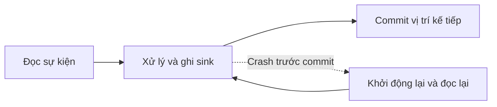

# Chương 27 — Streaming Fundamentals

> Scala **3.9.0** · JDK **21** · fs2-core **3.13.0** · Cats Effect **3.7.1** · munit **1.2.4** · munit-cats-effect **2.2.0**. Kiểm chứng 17/10/2026: đã biên dịch & chạy bằng Scala CLI, 10 test lab + 7 test lời giải pass, bật `-Werror`; Claude đã review **ĐẠT** và chạy `sbt.bat -batch test` lab **10/10 pass**, theo [review T13](../.team/reviews/T13-ch27-28-review.md).

## 1. Mục tiêu học tập

Sau chương này, bạn có thể phân biệt batch và stream processing; chọn event time hoặc processing time theo câu hỏi nghiệp vụ; tự tính watermark và xác định dữ liệu đến muộn. Bạn sẽ viết cửa sổ tumbling, sliding, session; giải thích trạng thái nào cần nhớ; tái hiện mất/lặp đơn hàng khi crash; đo việc nguồn bị chặn bởi backpressure.

Lab là mô hình **một JVM**, không phải một streaming engine phân tán. Nó giúp nhìn thấy quy tắc trước khi dùng Kafka ở Ch28 và engine ở các chương sau.

## 2. Kiến thức tiên quyết

- [Ch19](../08-data-processing/ch19-scala-data-processing.md): click events, dedup, fingerprint và giới hạn bộ nhớ của `seen`.
- [Ch20](../08-data-processing/ch20-functional-data-transformation.md): phép gộp kết hợp, giao hoán và tổng `BigInt`.
- [Ch16B](../07-concurrency/ch16b-cats-effect.md): `IO`, `Ref`, `Deferred`, vòng đời fiber và fs2 `Stream`.
- Collections, case class, `Either`, enum. Các hàm tính cửa sổ là hàm thuần; phần đo dùng Cats Effect.

## 3. Lý thuyết

### 3.1. Batch, stream và event-driven architecture

Một báo cáo click cuối ngày có đầu vào hữu hạn: đó là **batch processing**, xử lý một tập dữ liệu đã chốt. Cảnh báo đơn hàng mới cần kết quả liên tục khi sự kiện tới: đó là **stream processing**, xử lý đầu vào có thể không bao giờ kết thúc. Stream vẫn có thể đọc một file hữu hạn; dùng `Stream` không tự biến bài toán thành hệ thống thời gian thực.

**Event-driven architecture**, kiến trúc hướng sự kiện, tổ chức các thành phần quanh sự kiện như `OrderPaid`: dịch vụ thanh toán phát sự kiện, báo cáo và giao hàng phản ứng riêng. Mục đích là giảm phụ thuộc trực tiếp giữa các thành phần; đổi lại phải xử lý giao lặp, thứ tự và khả năng quan sát. Sự kiện nên diễn tả điều **đã xảy ra**, có ID và thời điểm; lệnh `PayOrder` là yêu cầu thực hiện, không đồng nghĩa với `OrderPaid`.

Bạn có thể chọn gọi HTTP đồng bộ nếu người gọi cần kết quả ngay, hoặc batch SQL khi độ trễ hàng giờ là chấp nhận được. **Micro-batch** gom sự kiện thành các đợt nhỏ, đánh đổi độ trễ để đơn giản hóa việc xử lý. Không chọn streaming chỉ vì dữ liệu lớn: cần cân cả yêu cầu độ trễ và chi phí vận hành.

**Stateless** nghĩa là một kết quả chỉ phụ thuộc sự kiện hiện tại, như đổi mã quốc gia. **Stateful** nghĩa là phải nhớ dữ liệu trước, như tổng tiền đơn, cửa sổ đếm click hoặc ID đã thấy. Lỗi phổ biến là chỉ tính bộ nhớ buffer, quên trạng thái nghiệp vụ.

### 3.2. Hai chiếc đồng hồ và thứ tự

**Event time** là thời điểm hành động xảy ra ở nguồn. **Processing time** là thời điểm bộ xử lý nhận/xử lý sự kiện. Điện thoại mất mạng có thể gửi click cũ cùng với click mới; thứ tự nhận không phải thứ tự xảy ra. Trong lab, số thời gian là **giây tính từ mốc giả định 0**, không phải ngày lịch. Dùng cùng đơn vị cho timestamp, độ rộng cửa sổ và độ trễ.

`Arrival(event, processedAt)` giữ cả hai thời gian. Khi phát lại cùng sự kiện vào ngày khác, event time giữ nguyên, processing time đổi. Vì vậy, báo cáo "click xảy ra trong khoảng nào" thường dùng event time; đo tải consumer "trong phút vừa xử lý" dùng processing time. Processing time đơn giản, không cần chờ sự kiện cũ, nhưng báo cáo thay đổi khi replay. Event time phản ánh nghiệp vụ tốt hơn nhưng cần quy tắc đến muộn và trạng thái chờ.

Không có thứ tự tổng thể miễn phí giữa nhiều nguồn. Nếu hai thao tác trên cùng đơn phải theo thứ tự nghiệp vụ, cần thêm sequence/version do nguồn cấp; timestamp có thể trùng hoặc sai đồng hồ. Sắp xếp toàn bộ đầu vào vô hạn sẽ không bao giờ hoàn thành. Với ngày báo cáo thực, dùng `Instant` và múi giờ đã định như Ch19; không chia epoch theo 24 giờ rồi coi đó là ngày Việt Nam.

### 3.3. Watermark và late events

Muốn chốt một cửa sổ, ta cần biết nên đợi dữ liệu cũ bao lâu. **Watermark** là dấu tiến độ event time của bộ xử lý; nó là một chính sách về mức độ chấp nhận đến trễ, không chứng minh rằng mạng sẽ không gửi dữ liệu cũ nữa.

Lab chọn quy tắc cụ thể, cho **một nguồn**:

1. Trước khi nhận sự kiện mới, nếu `eventTime < watermark_cũ`, phân loại `Late`, giữ nguyên trạng thái. Bằng watermark vẫn được nhận.
2. Với sự kiện hợp lệ, mới và không xung đột ID: `maxSeen = max(maxSeen, eventTime)`, `watermark_mới = maxSeen - delay`.
3. Cộng sự kiện vào cửa sổ, phát và xóa cửa sổ có `end <= watermark_mới`.
4. Xóa fingerprint có `eventTime < watermark_mới`. Sự kiện cũ quay lại sau đó được phân loại muộn.

Ở đây `delay` là độ trễ dùng để tạo watermark; **không có khoảng allowed lateness bổ sung sau watermark**. Quy ước `<` và `[start,end)` được ghi rõ để kiểm thử biên; đừng đem nguyên dấu so sánh sang một engine khác mà chưa đọc quy ước của engine đó.

Ví dụ, `maxSeen=12`, `delay=5` cho watermark 7. Click lúc 8 vẫn nhận; click lúc 6 bị loại. Khi sự kiện lúc 21 tới, watermark thành 16 và cửa sổ `[0,10)` đóng. Watermark không lùi. Nguồn im lặng thì mô hình này **không tự tiến watermark theo đồng hồ máy**; `finish` chỉ dành cho đầu vào hữu hạn đã biết kết thúc.

Nhiều partition thường cần kết hợp tiến độ các nguồn còn hoạt động, chẳng hạn lấy watermark nhỏ nhất. Một nguồn chưa biết tiến độ có thể giữ mọi nguồn lại; loại nguồn idle cần chính sách cụ thể và phải xử lý dữ liệu cũ khi nguồn trở lại. Bài tập 3 mô hình hóa việc chọn watermark, chưa xây engine nhiều nguồn.

Tăng `delay` giảm lượng bị coi là muộn nhưng tăng độ trễ và trạng thái. Lựa chọn khác là phát kết quả tạm rồi sửa/upsert, hoặc đưa late events sang luồng riêng để đối soát batch. Lỗi thiết kế nguy hiểm: timestamp quá xa tương lai làm watermark nhảy vọt và loại dữ liệu tốt. Production cần kiểm tra độ lệch đồng hồ trước bước cập nhật watermark; lab nhận timestamp giả định đã qua kiểm tra này.

### 3.4. Ba loại cửa sổ

**Window**, cửa sổ, chia dòng vô hạn thành phạm vi hữu hạn để tổng hợp. Lab dùng khoảng nửa mở `[start,end)`: nhận đầu trái, không nhận đầu phải.

| Loại | Hoạt động | Khi dùng / ưu điểm | Đánh đổi, lựa chọn khác và lỗi dễ mắc |
|---|---|---|---|
| Tumbling | Các khoảng liền nhau không chồng; `start = floor(t/size)*size` | Báo cáo click mỗi 10 giây; mỗi sự kiện thuộc đúng một cửa sổ | Bước nhảy ở biên; dùng sliding nếu muốn nhìn khoảng gần nhất. Dùng `<= end` sẽ đếm sự kiện biên hai lần |
| Sliding | Độ rộng `size`, bước `slide`; một sự kiện có thể thuộc nhiều khoảng | Tổng tiền 20 giây gần nhất, cập nhật mỗi 10 giây | Fan-out và trạng thái lớn hơn; tổng của các cửa sổ chồng **không phải** tổng toàn bộ sự kiện |
| Session | Cùng khóa, gộp sự kiện nếu khoảng im lặng giữa chúng nhỏ hơn `gap` | Nhóm hoạt động một người dùng thành lượt truy cập | Cửa sổ không cố định; dữ liệu đến sai thứ tự có thể nối hai phiên. Dùng tumbling nếu chỉ cần báo cáo theo đồng hồ |

Quy ước session của lab: khoảng cách **bằng** `gap` mở phiên mới. Sự kiện lúc 2 và 9 với gap 10 tạo phiên `[2,19)`; lúc 20 mở phiên `[20,30)`. Hàm `sessions` là **tham chiếu batch hữu hạn**: nhóm theo khóa, sort rồi fold; không phải session engine online có watermark. Bài tập 4 cho thấy bridge event nối hai kết quả tạm, giải thích vì sao không thể append mù kết quả session đã phát.

Sliding trong lab chỉ hỗ trợ `size >= slide`, `size % slide == 0`, tối đa 10.000 cửa sổ/sự kiện và trục thời gian bắt đầu ở 0. Đây là giới hạn API có chủ đích; thời gian âm và khoảng trống giữa cửa sổ không thuộc phạm vi. Biên cửa sổ dùng `BigInt`, nên `Long.MaxValue` không làm `end` cuộn thành số âm.

### 3.5. Trạng thái và phục hồi

`State` giữ `maxSeen`, watermark, `seen: Map[eventId, Event]` và `open: Map[(key,window), Aggregate]`. `Aggregate` chứa `count,total: BigInt`. Fingerprint là toàn bộ payload nghiệp vụ: cùng ID, cùng nội dung → duplicate; cùng ID, khác key/thời gian/số tiền → conflict. ID là chuỗi opaque: không tự đổi hoa/thường. Nếu cần chuẩn hóa mã nghiệp vụ khác, dùng `Locale.ROOT` như Ch19.

`EventTime.step` trả trạng thái mới, quyết định và các kết quả **vừa** đóng. Nó không giữ mọi kết quả đã phát trong `State`; sink phải nhận chúng. Tổng `BigInt` giữ tính kết hợp/giao hoán của phép cộng từ Ch20. Kết quả chấp nhận/loại muộn vẫn phụ thuộc thứ tự đến: một phép cộng giao hoán không làm toàn bộ chính sách watermark trở nên độc lập thứ tự.

Xóa cửa sổ đã đóng giảm trạng thái theo thời gian, nhưng không đặt trần bộ nhớ: số key và số ID trong khoảng còn mở vẫn có thể tăng không giới hạn; nguồn đứng thời gian cũng làm watermark đứng. Test lời giải 5 khóa trường hợp nhiều key có cùng timestamp. Session tham chiếu giữ toàn bộ dữ liệu để sort; cũng không được gọi là bounded-memory.

Để phục hồi sau **JVM crash**, cần checkpoint/snapshot bền vững chứa cả trạng thái và vị trí nguồn tương ứng. Lưu offset mà không lưu tổng sẽ mất tổng; lưu tổng mà không quản lý replay có thể cộng lặp. Có thể dùng database hoặc state backend của engine thay cho RAM; đổi lại cần thiết kế transaction, lưu trữ và phục hồi. Lab **không triển khai checkpoint bền vững** và không đo tốc độ của engine phân tán.

### 3.6. Delivery semantics và điểm crash

**Delivery semantics** mô tả điều xảy ra khi giao lại và lỗi. Phải chỉ rõ ranh giới nguồn, commit và side effect ở sink:



- **At-most-once**: đánh dấu đã nhận trước side effect. Crash ở giữa có thể mất sự kiện; đơn giản, hợp khi chấp nhận mất một phần telemetry.
- **At-least-once**: ghi sink trước commit. Crash ở giữa sẽ giao lại; hợp với đơn hàng khi có xử lý idempotent, tức thực hiện lại cùng sự kiện không tạo thêm tác động.
- **Exactly-once** cần xác định tác động nào được bảo đảm đúng một lần và bằng cơ chế nào. Không thể suy ra từ việc consumer chỉ chạy một thread. Transaction nội bộ Kafka cũng không tự bao gồm HTTP hoặc database bên ngoài.

`Crash.run` mô phỏng đúng một điểm crash, giữ cursor và vector sink qua lần restart giả định. At-most-once bỏ `o2`; at-least-once ghi `o2` hai lần. Bật dedup theo ID cho mô phỏng sẽ chỉ ghi một lần. Nó không chứng minh RAM sống qua JVM crash: cursor/sink ở đây được harness giữ lại. Ch28 kiểm tra replay bằng broker thật và nói rõ ranh giới tương tự.

Lựa chọn thay thế là commit và side effect trong cùng transaction ở kho hỗ trợ, hoặc ghi outbox cùng transaction database rồi chuyển sự kiện ra ngoài. Đây là nội dung mở rộng; chương này không chạy outbox. Lỗi thiết kế là tuyên bố exactly-once toàn hệ thống sau khi chỉ bật một tùy chọn của client.

### 3.7. Backpressure và phép đo

Nếu nguồn nhanh hơn sink, phần dư phải nằm ở đâu đó. **Backpressure**, điều tiết ngược, làm nguồn chậm lại khi downstream chưa sẵn sàng. fs2 xử lý theo nhu cầu; `Queue.bounded[IO, Int](2)` thêm vùng đệm hữu hạn, `offer` chờ khi đầy.

`Backpressure.measure` cho producer đưa 12 phần tử vào queue. Khi bắt đầu offer thứ ba, harness chưa chạy consumer và chờ 40 ms; `thirdDone.tryGet` xác nhận offer chưa hoàn tất. Sau đó consumer lấy từng phần tử và ngủ 10 ms. Lab đo thời gian offer, số phần tử còn trong queue sau offer và số đã tiêu thụ. `background.use` quản lý fiber producer trong vòng đời phép đo.

Capacity tính theo **phần tử**, không phải byte; trạng thái xử lý và phần tử đang cầm ngoài queue vẫn tốn RAM. Chỉ số peak ở đây là giá trị `queue.size` quan sát sau offer, không phải máy đo mọi cấp phát. Harness cố ý giữ consumer chưa chạy nên quan sát được queue đầy. Các lần sleep tạo tải thử, không đại diện cho tốc độ của hệ thống thật.

Buffer vô hạn hấp thụ burst dễ nhưng có thể hết RAM; drop/overwrite giữ độ trễ thấp nhưng mất dữ liệu; ghi backlog vào Kafka chuyển áp lực sang đĩa và retention, vẫn cần giám sát. Dùng bounded queue khi nguồn có thể chờ và bạn muốn giới hạn vùng đệm. Nếu nguồn ngoài không thể chờ, phải có chính sách từ chối, drop hoặc lưu bền vững; backpressure trong JVM không tự điều tiết mọi thiết bị gửi HTTP.

## 4. Thuật ngữ tiếng Anh

| Thuật ngữ | Giải thích trong chương |
|---|---|
| Bounded / unbounded | Đầu vào có / chưa biết điểm kết thúc |
| Event time / processing time | Thời điểm nghiệp vụ / thời điểm bộ xử lý thực hiện |
| Out-of-order / late | Đến sai thứ tự / đã nằm trước watermark theo chính sách |
| Watermark / allowed lateness | Dấu tiến độ event time / khoảng cho phép cập nhật muộn bổ sung, lab không bật |
| Tumbling / sliding / session | Cửa sổ không chồng / chồng theo bước / theo khoảng im lặng |
| State / checkpoint / replay | Trạng thái nhớ / ảnh phục hồi / phát lại dữ liệu |
| Idempotent / fingerprint | Lặp không thêm tác động / nội dung dùng phân biệt gửi lại và xung đột |
| Backpressure / backlog | Điều tiết ngược / lượng việc chưa xử lý |

## 5. Ví dụ đơn giản

Hàm `Windows.tumbling(time, size)` tính biên bằng số nguyên; không đọc đồng hồ và không cần `IO`:

```scala
val start = BigInt(time) / size * size
Window(start, start + size)
```

Test `half-open tumbling boundaries and no Long overflow` kiểm tra `time=9` thuộc `[0,10)`, `time=10` thuộc `[10,20)`, và biên cuối tại `Long.MaxValue`. Trước phép chia, code đòi thời gian không âm, size dương. Đây là quy tắc gán cửa sổ; chưa có watermark hay đóng cửa sổ ở bước này.

## 6. Ví dụ thực tế (BE và DE)

**DE — click theo campaign.** `StreamingDemo.clicks` theo thứ tự nhận là `c1@2, c2@12, c3@8, c4@21, c5@4`, cùng `CMP-1`. Mỗi click tăng 1. Đặc tả golden trong test: `[0,10)` đóng với count/total 2; hai cửa sổ sau có 1; `c5` được đếm là late, không sửa kết quả cũ. Hàm `Clocks.buckets` dùng **tất cả** năm sự kiện để so hai loại đồng hồ, chưa áp dụng watermark; vì vậy bucket `[0,10)` ở phép so đồng hồ có 3. Hai kết quả trả lời hai câu hỏi khác nhau.

**BE — hoạt động đơn hàng theo người dùng.** Ba order events `o1@2=100`, `o2@9=200`, `o3@20=300`, khóa `U-1`, gap 10, tạo hai phiên. Ở đây mỗi dòng là **một sự kiện cộng tiền**, không mặc nhiên là một đơn duy nhất: một đơn có nhiều sự kiện thì phải chọn loại nghiệp vụ và grain trước khi cộng. Dùng session để phân tích lượt hoạt động, không dùng tổng này như số dư thanh toán thực tế.

## 7. Code đầy đủ

Các file nguồn có thể đọc và chạy độc lập với Kafka/Docker:

- [project.scala](streaming-lab/project.scala): phiên bản và `-deprecation -feature -Wunused:all -Werror`.
- [Clocks.scala](streaming-lab/src/main/scala/vn/scalaeng/streaming/Clocks.scala): thời điểm nhận/xử lý được truyền vào.
- [Windows.scala](streaming-lab/src/main/scala/vn/scalaeng/streaming/Windows.scala): model, ba loại cửa sổ, state và watermark.
- [Delivery.scala](streaming-lab/src/main/scala/vn/scalaeng/streaming/Delivery.scala): mô phỏng điểm crash.
- [StreamingDemo.scala](streaming-lab/src/main/scala/vn/scalaeng/streaming/StreamingDemo.scala): fs2 và phép đo bounded queue.
- [StreamingSuite.scala](streaming-lab/src/test/scala/vn/scalaeng/streaming/StreamingSuite.scala): golden, biên, conflict, eviction, crash và backpressure.
- [build.sbt](streaming-lab/build.sbt), [build.properties](streaming-lab/project/build.properties): sbt 1.12.11 cho lead chạy lại.

Từ repo root, trên PowerShell:

```powershell
$env:COURSIER_CACHE = Join-Path $PWD '.cache/coursier'
scala-cli.bat test 10-streaming/streaming-lab --server=false
scala-cli.bat run 10-streaming/streaming-lab --server=false --main-class vn.scalaeng.streaming.StreamingDemo
scala-cli.bat test solutions/ch27-code --server=false
```

Lần tải dependency đầu cần Internet; **logic test không dùng mạng hay Docker**. Cache `.cache/` đã được repo ignore. Để lưu log và tắt riêng gợi ý nâng dependency của Scala CLI:

```powershell
python 10-streaming/kafka-lab/verification/run_checks.py streaming demo ch27
```

sbt: vào `10-streaming/streaming-lab`, dùng JDK 21 rồi `sbt.bat test`. Build sbt chưa được tác giả chạy trong task này; lead kiểm chứng theo quy trình repo.

## 8. Giải thích code

`EventTime.step: (State, Event, size, delay) => Step` là chỗ duy nhất quyết định accepted/duplicate/conflict/late. Kiểm tra late dùng watermark **trước** sự kiện; sau đó mới xem fingerprint, cập nhật max và đóng cửa sổ. Duplicate/conflict không làm tiến watermark. Test so toàn bộ `Result`, gồm key, start/end, count và total, không chỉ so số dòng.

`evalMapAccumulate(State())` ghép hàm thuần với fs2: mỗi phần tử dùng state trước đó, in trace bằng `IO`, rồi truyền state mới. `finish` lấy kết quả còn mở của tập hữu hạn; nó không sửa state và không phải checkpoint. `Stream.compile.lastOrError` ở demo hợp lệ vì fixture không rỗng; pipeline tổng quát cần xử lý đầu vào rỗng riêng.

`sessions` sort theo `(eventTime,id)` trong từng key trước khi fold. Bridge event được tính đúng trong bản tham chiếu, nhưng phải giữ cả input để làm vậy. `Crash.run` dùng cursor số nguyên vì vector hữu hạn; tổng nghiệp vụ và biên thời gian dùng `BigInt` để không lặp lỗi tràn số ở Ch20.

## 9. Output mong đợi

Output dưới đây được chép từ **lần chạy thật**, không phải output dự đoán. [Log demo](streaming-lab/verification/demo.txt) giữ cả lệnh và exit code; thông số môi trường và thời gian đo có thể đổi giữa các máy.

<!-- output:demo -->
```text
JDK=21.0.12.1 processors=12
clocks: event=Vector((Window(0,10),3), (Window(10,20),1), (Window(20,30),1)) processing=Vector((Window(100,110),5))
c1: event=2 watermark=-3 Accepted closed=Vector()
c2: event=12 watermark=7 Accepted closed=Vector()
c3: event=8 watermark=7 Accepted closed=Vector()
c4: event=21 watermark=16 Accepted closed=Vector(Result(CMP-1,Window(0,10),2,2))
c5: event=4 watermark=16 Late closed=Vector()
finish=Vector(Result(CMP-1,Window(10,20),1,1), Result(CMP-1,Window(20,30),1,1)) open=2 seen=1
sliding(12,20,10)=Vector(Window(10,30), Window(0,20))
sessions=Vector(Result(U-1,Window(2,19),2,300), Result(U-1,Window(20,30),1,300))
AtMostOnce: CrashResult(3,Vector(o1, o3))
AtLeastOnce: CrashResult(3,Vector(o1, o2, o2, o3))
dedup: CrashResult(3,Vector(o1, o2, o3))
backpressure=Pressure(2,2,true,55,12)
java.lang.IllegalArgumentException: requirement failed: invalid window
```
<!-- /output:demo -->

`Pressure` lần lượt là `(capacity, peak quan sát, offer thứ ba bị chặn, maxOfferMs, consumed)`. Các cửa sổ và quyết định có thể đối chiếu chính xác; thời gian offer chỉ dùng để minh họa chờ. Test không đòi đúng số mili giây in ở đây: nó đòi offer bị chặn, queue đầy 2, tiêu thụ đủ 12 và thời gian chờ tối thiểu 30 ms.

[Log test lab](streaming-lab/verification/tests.txt): 9 test `StreamingSuite` + 1 `PressureSuite`, 0 fail. [Lời giải](../solutions/ch27-code/tests.txt): 6 test hàm thuần + 1 test IO, 0 fail. Đây là munit thật; chưa có review chéo nên chương chưa đánh dấu hoàn tất theo quy trình nhóm.

## 10. Lỗi thường gặp

**Size bằng 0.** `StreamingDemo` chủ động gọi cấu hình sai và bắt exception để in lỗi runtime thật:

```text
java.lang.IllegalArgumentException: requirement failed: invalid window
```

Kiểm tra cấu hình trước khi chạy pipeline; đừng bắt lỗi rồi coi như cửa sổ rỗng.

**Đếm muộn mà tưởng mất dữ liệu bí ẩn.** Trace cho thấy `c5` có event time 4 trong khi watermark đã là 16. Đây là quyết định chính sách, không có compiler/runtime exception. Cần metric late và luồng đối soát; không âm thầm bỏ.

**Biên phải bị đếm hai lần.** Dùng `t <= end` sai với cửa sổ nửa mở. Test gán `time=10` chỉ vào `[10,20)`; không có exception tự phát hiện.

**Chỉ so event ID, không so nội dung.** Test sửa amount của cùng ID đòi `Conflict`, state không bị cộng thêm. Fingerprint hết hạn thì bản cũ giữ nguyên event time được phân loại late; nếu ID được dùng lại với event time mới còn hợp lệ, lab có thể nhận nó lần nữa (ví dụ size=100, delay=50: `A@100 amount 10`, `B@300 amount 1`, `A@350 amount 999` đều accepted). Phát hiện xung đột chỉ có hiệu lực trong chân trời state; muốn bảo vệ ID xuyên thời gian cần store bền với chính sách retention phù hợp (Ch28 mục 3.8, Ch29). Lab không hứa phát hiện xung đột xuyên mọi thời gian.

**Cộng `Long` rồi mới đổi sang `BigInt`.** Khi đó tràn đã xảy ra. Lab đổi từng giá trị sang `BigInt` trước khi cộng; không dùng `Math.addExact` làm phép gộp nghiệp vụ vì nó không toàn phần như Ch20 giải thích.

**Dùng `.compile.toVector` cho nguồn vô hạn.** Không có kết quả cuối để trả. Demo chỉ compile vector/last trên fixture hữu hạn. Production cần sink theo từng phần tử và vòng đời dừng rõ ràng.

**Queue nhỏ nên chắc chắn không hết RAM.** Queue chỉ giới hạn vùng đệm. `seen`, key cardinality hoặc session input vẫn có thể tăng; test lời giải 5 minh họa điều đó. Đây là lỗi thiết kế, không gán một thông báo OOM giả cho nó.

## 11. Cách debug

1. Ghi `event_id`, event time, processing time và watermark **cũ/mới**; kiểm tra đơn vị giây/millis trước khi đổi delay.
2. Tách metric accepted, duplicate, conflict, late; tổng của chúng phải bằng số input. Bài tập 5 kiểm tra bảo toàn này.
3. Quan sát số cửa sổ mở, số ID, số key và byte ước lượng; đừng chỉ nhìn số phần tử queue.
4. Chạy test biên `t=start`, `t=end`, `t=watermark`; thêm bridge event cho session và một ID có payload đổi.
5. Đặt điểm crash giữa effect và commit; so sink trước/sau replay. Nếu sink chỉ ở RAM, đừng lấy kết quả đó làm chứng minh phục hồi JVM.
6. Khi nguồn chậm, kiểm tra sink chậm hay watermark đứng. Tăng buffer có thể chỉ làm backlog lớn hơn.

## 12. Bài tập (cơ bản → nâng cao)

1. **Hai đồng hồ.** Viết `clocks` trả hai cửa sổ của một event và thời điểm nhận. Replay dịch processing time thêm 100; event window phải giữ nguyên.
2. **Sliding doanh thu.** Viết tổng `BigInt` theo `(key,window)`, width 20/slide 10. Có sự kiện tại biên 20 và amount `Long.MaxValue`; giải thích vì sao cộng mọi cửa sổ làm đếm lặp.
3. **Watermark nhiều nguồn.** Mỗi nguồn gồm `(idle, watermark tùy chọn)`. Bỏ nguồn idle; một nguồn active chưa có watermark phải chặn tiến độ. Tất cả idle thì trả `None`, không bịa watermark vô hạn.
4. **Bridge session.** Tạo preview sau từng prefix đầu vào `0,18,9`, gap 10. Hai phiên tạm phải được gộp thành một. Nêu rõ chi phí lưu input của lời giải tham chiếu.
5. **Audit trạng thái.** Đếm đầy đủ bốn quyết định; thu kết quả đã đóng và peak số cửa sổ mở. Thêm 1.000 key cùng timestamp để bác bỏ khẳng định state luôn bị chặn bởi delay.
6. **Backlog và backpressure.** Tính backlog theo hai tốc độ cố định bằng `BigInt`; với nguồn 1.000/s, sink 800/s trong 60 giây, viết assertion kết quả. Chạy bounded-queue probe và kiểm tra đủ 12 sự kiện, không đặt assertion thời gian đúng tuyệt đối.

## 13. Đáp án và lời giải

Xem [lời giải có giải thích](../solutions/ch27-solutions.md), [code](../solutions/ch27-code/src/main/scala/vn/scalaeng/solutions/ch27/Exercises.scala) và [7 test](../solutions/ch27-code/src/test/scala/vn/scalaeng/solutions/ch27/ExercisesSuite.scala). Mỗi test đánh số trùng bài tập; chưa xem đáp án trước khi tự tính các trường hợp biên.

## 14. Câu hỏi kiểm tra

1. Tại sao replay cùng sự kiện lại làm processing-time report thay đổi?
2. Watermark là sự thật về mạng hay chính sách chốt dữ liệu? Điều gì xảy ra khi nguồn im lặng?
3. Vì sao event time bằng watermark vẫn được nhận trong lab, còn cửa sổ có end bằng watermark lại đóng?
4. Một tổng hợp giao hoán có làm chính sách loại late độc lập thứ tự không?
5. Sau crash giữa sink và commit, điều gì cần bền vững để dedup còn tác dụng?
6. Backpressure có giải quyết tăng số key trong state không? So sánh bounded queue với drop và backlog trên đĩa.

## 15. Mini project

Xây báo cáo click theo `(campaign, cửa sổ 10 giây)` bằng `EventTime.step`. Giữ luồng accepted/late/conflict riêng, có số đếm đối soát; đầu vào gồm duplicate, late và một timestamp tương lai bất thường. Viết bước kiểm tra skew với `now` truyền vào trước watermark, không đọc đồng hồ trong core.

Tiêu chí: golden tính tay cho toàn bộ `Result`; không cộng lại duplicate; không để event tương lai làm watermark tiến; state cửa sổ đã đóng được xóa; ghi rõ giới hạn dedup. Thêm `Queue.bounded` nối nguồn/sink và đo offer chờ khi sink chậm. Với mở rộng order events, chọn grain là một sự kiện thanh toán được chấp nhận, không đếm dòng như số đơn. Không gọi mini project này là engine có checkpoint production.

## 16. Nguồn tài liệu chính thức

Tra ngày **17/10/2026**. Nguồn về engine dùng để đối chiếu khái niệm; lab tự định nghĩa chính sách, không triển khai API Flink:

- [Apache Flink — event time, processing time và watermark](https://nightlies.apache.org/flink/flink-docs-stable/docs/concepts/time/), [window operators](https://nightlies.apache.org/flink/flink-docs-stable/docs/dev/datastream/operators/windows/).
- [FS2 — guide và model stream](https://fs2.io/), [Cats Effect — Queue](https://typelevel.org/cats-effect/docs/std/queue).
- POM chứng minh có artifact Scala 3: [fs2-core_3 3.13.0](https://repo1.maven.org/maven2/co/fs2/fs2-core_3/3.13.0/fs2-core_3-3.13.0.pom), [Cats Effect_3 3.7.1](https://repo1.maven.org/maven2/org/typelevel/cats-effect_3/3.7.1/cats-effect_3-3.7.1.pom).
- [munit_3 1.2.4](https://repo1.maven.org/maven2/org/scalameta/munit_3/1.2.4/munit_3-1.2.4.pom), [munit-cats-effect_3 2.2.0](https://repo1.maven.org/maven2/org/typelevel/munit-cats-effect_3/2.2.0/munit-cats-effect_3-2.2.0.pom). Giữ đúng bộ phiên bản repo, không tự nâng theo hint.
- [Danh mục URL/POM và SHA-256 đã tải](kafka-lab/verification/sources.txt), [script tra nguồn](kafka-lab/verification/verify_sources.py). POM là bằng chứng phiên bản; các log test là bằng chứng chạy cùng Scala 3.9.0/JDK 21.

## 17. Checklist tự đánh giá

- [ ] Giải thích được vì sao sự kiện tới sau chưa chắc là late.
- [ ] Tính đúng watermark và biên `[start,end)` mà không nhìn code.
- [ ] Chọn tumbling/sliding/session theo câu hỏi nghiệp vụ.
- [ ] Phân biệt session tham chiếu batch với session online có cập nhật kết quả.
- [ ] Giải thích trạng thái nào được xóa, trạng thái nào vẫn tăng theo cardinality.
- [ ] Tái hiện mất/lặp và nói rõ ranh giới persistence của mô phỏng.
- [ ] Đọc được phép đo backpressure và không coi nó là benchmark production.
- [ ] Chạy 10 test lab, 7 test lời giải và hoàn thành sáu bài tập.
