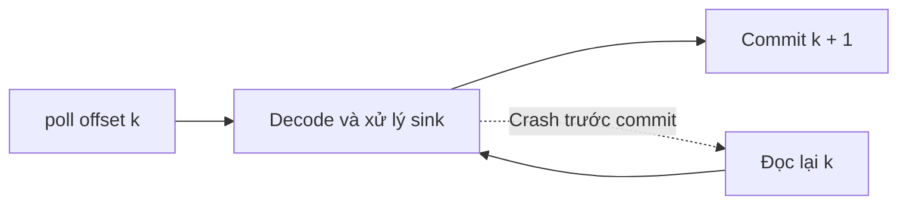

> Scala **3.9.0** · JDK **21** · kafka-clients **4.4.0** · circe-parser **0.14.17** · slf4j-nop **2.0.20** · munit **1.2.4** · embedded-kafka_3 **4.4.0** (test). Kiểm chứng 17/10/2026: đã biên dịch & chạy, 7 unit test + 1 kịch bản KRaft thật + 7 test lời giải pass; `-Werror`; chờ Claude review chéo. sbt chưa chạy.

# Chương 28 — Kafka với Scala

## 1. Mục tiêu học tập

Bạn sẽ tạo producer/consumer Scala dùng Java API của Kafka; quan sát topic, partition, offset, consumer group và rebalance bằng broker thật. Bạn sẽ phân biệt bảo đảm gửi của producer với thứ tự commit của consumer; dùng JSON có schema version, retry hữu hạn, dead-letter topic và dedup theo `event_id`; tính lag từ offset bền vững thay vì từ số dòng đang ở RAM.

Chương nối nền tảng delivery semantics của Ch27 với nguồn dữ liệu có thể replay. Đây là nền cho pipeline Ch29 và Project 4, chưa phải một deployment Kafka production.

## 2. Kiến thức tiên quyết

- [Ch27](ch27-streaming-fundamentals.md): state, replay, backpressure, điểm crash giữa effect và commit.
- [Ch19](../08-data-processing/ch19-scala-data-processing.md): JSON lỗi, fingerprint và duplicate khác conflict.
- [Ch20](../08-data-processing/ch20-functional-data-transformation.md): grain và tổng `BigInt`.
- [Ch16B](../07-concurrency/ch16b-cats-effect.md): vòng đời tài nguyên. Lab này cố ý dùng Java API đồng bộ và `Using`; khi ghép vào `IO`, các lời gọi blocking cần được bọc đúng như chương đó.
- Case class, enum, `Either`, Java collections interop qua `scala.jdk.CollectionConverters.*`.

## 3. Lý thuyết

### 3.1. Kafka giải quyết điều gì?

Nếu producer phải gọi đồng bộ mọi hệ thống báo cáo/giao hàng, một bên chậm có thể làm luồng đặt hàng chậm theo. Kafka giữ các bản ghi trong **distributed log**, nhật ký phân tán; producer ghi vào, consumer đọc theo vị trí của mình. Một hệ thống báo cáo mới có thể đọc lại dữ liệu còn được lưu.

**Topic** là tên luồng dữ liệu, chẳng hạn `orders`. Topic được chia thành **partition**, mỗi partition là một log có thứ tự. **Offset** là vị trí trong một partition, không phải ID sự kiện toàn hệ thống. Hai partition có thể cùng có offset 0. Retention và compaction có thể tạo khoảng trống; không dựa vào giả định mọi offset luôn liên tiếp.

Kafka phù hợp khi cần fan-out, backlog và replay giữa các thành phần độc lập. Nếu chỉ có một tác vụ đơn giản, queue dịch vụ hoặc HTTP có thể ít chi phí vận hành hơn. Kafka đòi quản lý đĩa, replication, quyền truy cập và theo dõi lag; nó không tự hiểu `OrderPaid` hay tự chống cộng trùng số tiền.

**Retention**, chính sách lưu dữ liệu, là cấu hình phía broker/topic; đọc xong và commit không có nghĩa xóa bản ghi. Consumer tới quá muộn có thể không còn dữ liệu để replay. Lab tạo topic tạm và không đợi hết retention; phần này là kiến thức thiết kế, chưa có thí nghiệm retention expiry.

### 3.2. Partition, key và consumer group

Key như `order_id` giúp producer mặc định chọn partition để các sự kiện cùng key vào cùng partition khi số partition và cách partitioning ổn định. Bạn cũng có thể chỉ rõ partition; lab làm vậy trong thí nghiệm để offset có thể tính tay. Tăng số partition có thể đổi ánh xạ key, nên không coi key là cam kết thứ tự xuyên mọi lần thay đổi topic.

Kafka bảo toàn thứ tự log **trong từng partition**; giữa các partition không có thứ tự tổng thể. Thứ tự log cũng không tự bằng thứ tự event time từ điện thoại. Muốn phát hiện thao tác nghiệp vụ đến sai thứ tự, thêm version/sequence theo đơn hàng và kiểm tra ở sink.

**Consumer group**, nhóm consumer có chung `group.id`, chia partition cho các thành viên đang hoạt động. Trong một group đã ổn định, một partition được giao cho một thành viên; số consumer vượt số partition sẽ có thành viên nhàn rỗi. Hai group khác nhau theo dõi offset riêng, nên cả báo cáo và giao hàng có thể đọc cùng topic.

Thành viên vào/ra làm **rebalance**, phân công lại partition. Worker cần xử lý quyền sở hữu và chỉ commit phần đã hoàn tất; không tiếp tục ghi sink từ công việc cũ sau khi mất quyền sở hữu mà không có cơ chế điều phối. Lab dùng `subscribe`, `group.protocol=classic`, `RangeAssignor`; test quan sát revoke/assign khi consumer thứ hai vào và ra. Đây không phải phép thử cooperative assignor hay consumer protocol mới.

Đối chiếu: `assign` chỉ định partition thủ công, **không tham gia phân công động**. Phép đo lag và replay trong lab dùng `assign` để cô lập offset; riêng thí nghiệm rebalance mới dùng `subscribe`. Dùng manual assign khi ứng dụng tự quản lý ownership; đừng dùng nó để tuyên bố đã thử group rebalance.

### 3.3. Chọn thư viện và xác nhận tương thích

Ngày 17/10/2026, [metadata Kafka client](https://repo1.maven.org/maven2/org/apache/kafka/kafka-clients/maven-metadata.xml) có release ổn định **4.4.0**. [POM fs2-kafka_3 4.1.3](https://repo1.maven.org/maven2/org/typelevel/fs2-kafka_3/4.1.3/fs2-kafka_3-4.1.3.pom) dùng **group mới `org.typelevel`**, phụ thuộc kafka-clients **4.3.1**, fs2-core **3.14.0**, Cats Effect **3.7.1**, có artifact `_3` thực sự.

| Lựa chọn | Lợi ích | Đánh đổi / mức kiểm chứng ở chương |
|---|---|---|
| Java `org.apache.kafka:kafka-clients:4.4.0` | API chính thức; nhìn rõ poll, partition, commit và rebalance | Tự quản lý vòng lặp/tài nguyên/thread. **Đã compile và chạy với broker 4.4.0** trên Scala 3.9.0/JDK 21; là lựa chọn của lab |
| `org.typelevel::fs2-kafka:4.1.3` | Resource/Stream và thao tác commit phối hợp trong Cats Effect | Hợp với pipeline fs2; POM chốt client 4.3.1/fs2 3.14.0. **Đã kiểm tra POM, chưa chạy wrapper** trong lab |

Không ép fs2-kafka 4.1.3 xuống fs2 3.13.0 của Ch27. Cũng không khẳng định override wrapper lên kafka-clients 4.4.0 đã tương thích chỉ từ số phiên bản; tổ hợp override đó **chưa kiểm chứng**. Hai lab là project độc lập. [sources.txt](kafka-lab/verification/sources.txt) lưu POM, URL, hash và dependency thực tế, tránh dùng coordinate cũ `com.github.fd4s` cho bản 4.1.3.

Broker test dùng `io.github.embeddedkafka::embedded-kafka:4.4.0`, kéo server `org.apache.kafka:kafka_2.13:4.4.0`. Đuôi `_2.13` này là server Kafka triển khai bằng Scala 2.13, **không đổi code học viên sang Scala 2**; thư viện harness có artifact Scala 3, và tổ hợp đã chạy thật. KRaft là chế độ Kafka tự quản lý metadata bằng quorum controller; test chạy broker/controller nhúng cùng JVM, không cần ZooKeeper hay Docker. Broker vẫn mở socket loopback và ghi log ra đĩa, không phải mock chỉ có collections.

### 3.4. Producer: acks, retries và idempotence

Producer biến key/value thành byte qua **serializer**, rồi gửi tới broker. `StringSerializer` dùng chuỗi JSON; client không tự kiểm tra nghiệp vụ trong JSON. `send` trả future; chỉ gọi `send` rồi coi là thành công sẽ bỏ sót lỗi xảy ra sau đó. `Clients.send` chờ acknowledgment bằng `.get` có timeout, truyền lỗi về caller.

| Cấu hình | Ý nghĩa / lựa chọn |
|---|---|
| `acks=0` | Không chờ broker xác nhận, độ trễ thấp nhưng không biết ghi thành công hay chưa |
| `acks=1` | Chờ leader xác nhận; leader hỏng trước khi replica theo kịp vẫn có thể mất dữ liệu |
| `acks=all` | Chờ các replica đang trong ISR theo quy tắc broker; cần kết hợp replication factor và `min.insync.replicas` |
| `enable.idempotence=true` | Client và broker phối hợp producer ID/sequence để loại bản gửi lại của cùng lần gửi ở tầng protocol |
| `retries=5` | Giới hạn retry transport; không phải retry nghiệp vụ của consumer |
| `max.in.flight.requests.per.connection=5` | Nằm trong ràng buộc của idempotent producer đã chọn |
| `delivery.timeout.ms=10000` | Budget gửi gồm chờ và retry; `request.timeout.ms=3000`; lỗi có thể tới trước nếu không retry được |

Đây là cấu hình cố định phục vụ lab, không phải bộ tuning mặc định cho mọi production. Idempotence cần broker hỗ trợ, acks all, retries dương và số request in-flight phù hợp; nó không chỉ là tiện ích Scala wrapper. `ProducerConfig` trong test xác nhận cấu hình hợp lệ và từ chối acks mâu thuẫn.

**Hai lần gọi `send` cùng `event_id` vẫn tạo hai record**: thí nghiệm gửi lại ở cấp ứng dụng cho offset 0 và 1. Idempotent producer không đọc JSON để dedup theo ID nghiệp vụ, và không tự bảo đảm sink database đúng một lần. Broker test có replication factor 1: xác nhận API và protocol chạy, chưa chứng minh chịu mất máy hay replication nhiều broker.

### 3.5. Consumer: poll, commit và điểm crash

`poll` lấy record và làm **position**, vị trí đọc hiện tại trong phiên consumer, tiến lên. **Committed offset** là vị trí tiếp theo được lưu để phục hồi; nó không tự tiến theo việc bạn đã tính tổng trong RAM. Lab tắt `enable.auto.commit` và đặt `max.poll.records=1` để dễ theo từng record.



`Clients.commit` ghi `record.offset + 1` cho **đúng topic/partition**, kèm leader epoch. Nếu poll ra cả batch, commit không tham số có thể vượt những record chưa xử lý. Khi chạy song song, chỉ commit prefix đã xử lý hoàn tất của từng partition; bài tập 3 thử record có khoảng trống offset để tránh nhầm offset với số lượng dòng.

Commit **trước** sink cho at-most-once với rủi ro mất tác động khi crash. Commit **sau** sink cho at-least-once với rủi ro lặp. Test đóng consumer tại điểm crash đã chọn rồi mở consumer mới cùng group để kiểm tra offset broker trả lại. Test không kill OS process hay làm hỏng đĩa; nó cô lập cơ chế replay sau ranh giới commit.

Nếu xử lý quá lâu không poll, consumer có thể mất tư cách thành viên và commit thất bại. Chỉ một worker trong test sở hữu một `KafkaConsumer`, vì API này không thread-safe. Code production có thể dùng queue giới hạn, pause/resume partition và điều phối commit, hoặc fs2-kafka; không bọc chung một consumer vào `parTraverse` rồi gọi poll/commit đồng thời.

### 3.6. Serialization, schema version và Schema Registry

Payload của lab có hợp đồng đơn giản:

```json
{"schema_version":1,"event_id":"event-1","order_id":"ORDER-1","amount":100}
```

Mỗi record là **một sự kiện cộng tiền**, amount là số nguyên không âm, đơn vị VND. Không mặc nhiên suy ra một record là một đơn duy nhất. `event_id` và `order_id` là định danh opaque, giữ nguyên chữ hoa/thường và khoảng trắng; chuỗi toàn khoảng trắng bị loại. Đừng dùng normalize tùy tiện làm hai ID khác nhau nhập thành một. Nếu một mã domain cần normalize, dùng quy tắc minh bạch và `Locale.ROOT`.

`Protocol.decode` dùng circe parse, kiểm tra version, ID và amount; gom lỗi trường của object thay vì chỉ giữ lỗi đầu. Trường lạ được chấp nhận cho thay đổi bổ sung; version khác 1 bị từ chối. `null` value Kafka là **tombstone**, thường dùng cho topic compacted; lab chủ động từ chối vì chưa định nghĩa nghiệp vụ xóa. JSON string `"null"` vẫn khác null value ở Kafka.

Có trường `schema_version` giúp dispatch decoder, nhưng không tự chứng minh hai schema tương thích. Bài tập 1 thêm adapter v2 và bắt buộc currency VND, không âm thầm cộng USD như VND. Thay field hoặc đơn vị tiền cần chiến lược migration/dual-read và test.

**Schema Registry** là dịch vụ quản lý schema, ID và quy tắc compatibility cho serializer/deserializer tích hợp, thường gặp với Avro/Protobuf/JSON Schema. Nó giảm việc mỗi consumer tự đoán hợp đồng; đổi lại thêm dịch vụ và quy trình evolution. Registry không phải tính năng tự xuất hiện khi thêm `schema_version`; lab dùng JSON thuần và **chưa triển khai hay chạy Schema Registry**. Với pipeline nhỏ một đội sở hữu, hợp đồng version trong repo và test có thể đủ; nhiều đội cần quản trị schema chặt hơn.

### 3.7. Retry hữu hạn, poison message và dead-letter topic

**Poison message**, record độc, là dữ liệu khiến xử lý thất bại lặp lại, như JSON bị cắt, schema không hỗ trợ hoặc cùng event ID nhưng amount khác. Retry vô hạn làm partition đứng sau record đó, lag tăng và sự kiện tốt cũng bị kẹt.

`Processor.handle` tách ba bước: decode → xử lý có retry → commit. Chỉ lỗi nghiệp vụ được phân loại `Transient` mới retry; tối đa **3 lần thử gồm lần đầu**, nghỉ 10 rồi 20 ms mặc định. `Poison` không retry; lỗi JSON không chạy handler, nên `attempts=0`. Lỗi hạ tầng không được phân loại, như `IOException` ngoài danh sách retry, được truyền lên để dừng thay vì bị nuốt và commit.

Sau thất bại đã xác định, processor gửi **dead-letter topic (DLT)**, luồng giữ record lỗi, với topic/partition/offset gốc, key, raw payload, lý do và attempts. Chỉ sau khi producer của DLT nhận acknowledgment mới commit source. DLT ghi lỗi thì source chưa commit. Nếu DLT đã ghi rồi commit source lỗi, lần replay có thể ghi DLT lần nữa; khóa `source_topic:partition:offset` giúp consumer DLT dedup. Test lời giải 6 tái hiện điều đó.

Retry tại chỗ giữ thứ tự đơn giản nhưng chặn partition trong thời gian thử. Retry topic tách chờ ra khỏi consumer, đổi lại phức tạp hơn và có thể đổi thứ tự; jitter/backoff lớn hơn cần budget rõ ràng. Không retry mọi exception và không ngủ quá `max.poll.interval.ms`. DLT là quyết định cho phép tiến source dù nghiệp vụ chưa thành công: cần người vận hành sửa lỗi và replay có kiểm soát, không chỉ đẩy lỗi đi rồi quên. Raw payload có thể chứa dữ liệu nhạy cảm; thời gian lưu/quyền DLT phải phù hợp dữ liệu thực.

### 3.8. Idempotent processing và ranh giới transaction

Muốn at-least-once không cộng tiền hai lần, sink phải nhớ event ID **cùng fingerprint đầy đủ**. `MemoryLedger` kiểm tra và cập nhật seen/tổng trong một block synchronized, dùng `BigInt` cho tổng. Cùng payload trả `Duplicate`; khác payload ném `Poison`; không sửa tổng trước khi báo conflict.

`MemoryLedger` chỉ sống trong JVM. Test giữ nguyên ledger trong harness khi mở lại consumer để mô phỏng sink còn tồn tại; **không chứng minh dedup qua JVM restart**. Snapshot ở lời giải cũng là mô hình dữ liệu, chưa ghi xuống database.

Production thường cần bảng event ID có unique key, fingerprint và cập nhật số tiền trong **cùng transaction**. Nếu ghi ID xong mà cập nhật tổng lỗi, hoặc cập nhật tổng rồi mới ghi ID, hai trạng thái có thể lệch nhau. Dùng database transaction/durable state thay RAM để có bằng chứng persistence; cần test crash/rollback riêng như các chương database đã chỉ ra.

Kafka transaction có thể gộp output Kafka với source offsets trong phạm vi Kafka khi dùng đúng transactional producer và consumer `read_committed`. Nó cần cả broker và client, không tự gộp database/HTTP. Chương này **không chạy Kafka transaction hay tuyên bố exactly-once**. Phần đã chạy là at-least-once + sink mô hình có dedup và DLT có khả năng lặp.

### 3.9. Consumer lag

Lag theo committed offset trả lời: còn bao nhiêu khoảng offset trước khi group xử lý đến cuối log? Với test không transaction, không compaction: `endOffset - committedOffset`. End offset là **vị trí kế sau cuối log**, không phải offset của record cuối. Test có 3 record offsets `0,1,2`: end 3, commit 1, lag 2.

`position` có thể đã tiến do poll trong khi xử lý chưa xong, nên dùng position sẽ đánh giá thấp backlog bền vững. Nếu chưa có committed offset, `Clients.lag` trả `None`; không tự coi là zero lag. Bài tập 2 gộp nhiều partition bằng `BigInt` và giữ thông tin chưa biết.

Khoảng trống do compaction/transaction làm chênh offset không luôn bằng số record thực còn xử lý; snapshot end/commit cũng có thể thay đổi trong lúc đo. `read_committed` còn có ranh giới last stable offset của transaction. Không áp công thức quan sát trong lab thành số tiền chưa xử lý hay số giây chậm trong mọi cluster. Muốn biết độ trễ nghiệp vụ, đo thêm tuổi event và tốc độ xử lý; tăng consumer chỉ hữu ích khi còn partition để chia.

## 4. Thuật ngữ tiếng Anh

| Thuật ngữ | Giải thích |
|---|---|
| Broker / KRaft controller | Máy chủ lưu/phục vụ log / thành phần điều phối metadata Kafka |
| Topic / partition / offset | Luồng logic / một log con có thứ tự / vị trí trong log con |
| Consumer group / rebalance | Nhóm chia partition / phân công lại khi thành viên thay đổi |
| Position / committed offset / end offset | Vị trí đọc phiên hiện tại / vị trí phục hồi đã lưu / vị trí sau cuối log |
| ISR / acks | Tập replica đang theo kịp / mức xác nhận producer yêu cầu |
| Serializer / schema evolution | Chuyển giá trị sang byte / thay đổi hợp đồng dữ liệu qua phiên bản |
| Poison / transient / DLT | Dữ liệu không xử lý được / lỗi tạm / topic giữ lỗi |
| Idempotence / transaction | Lặp không thêm tác động / nhóm thay đổi được hoàn tất như một đơn vị |
| Lag / retention / tombstone | Khoảng chậm offset / chính sách lưu / null value biểu diễn xóa theo hợp đồng |

## 5. Ví dụ đơn giản

`ProducerMain` tạo event version 1, key `ORDER-1`, gọi `Protocol.encode`, gửi vào topic và chờ metadata. Nếu không chỉ định partition, `Clients.send` để producer chọn theo key. Thí nghiệm offset truyền partition tường minh để không phụ thuộc hash trong phần golden.

`ConsumerMain` subscribe cùng topic, poll một record mỗi lần, gọi `Processor.handle` rồi commit đúng partition sau khi sink hoặc DLT đã thành công. Hai executable dùng `Using` đóng tài nguyên khi chạy xong hoặc thân xử lý ném lỗi. Chúng có giới hạn record và deadline 60 giây; chưa có service lifecycle/SIGTERM handler hay metrics endpoint.

## 6. Ví dụ thực tế (BE và DE)

**BE:** sự kiện thanh toán vào `input`. Hai record đầu có cùng event ID/payload; cả hai offset được xử lý nhưng tổng chỉ tăng một lần. Sau đó lần lượt là JSON hỏng, lỗi sink tạm thời hết lượt thử và xung đột cùng ID khác amount. Ba record sau vào `dead`, source vẫn tiến theo chính sách lỗi đã chọn.

**DE:** một topic `orders` có hai partition, mỗi partition ba record. Consumer A ban đầu nhận cả hai; B tham gia thì mỗi bên nhận một; B rời thì A nhận lại hai. Một group riêng `lag-demo` commit offset 1 của partition 0 để quan sát lag, không làm thay đổi offset group workers.

**Fixture tính tay trong code trước assertion:** `input` offsets 0/1 là duplicate, offset 2 invalid JSON, offset 3 transient hết 3 lần, offset 4 conflict. Tổng cuối 100, source committed offset 5, DLT source offsets 2/3/4 với attempts 0/3/1. Test đọc **chính DLT trên broker** để so provenance và attempts, không chỉ so callback giả.

## 7. Code đầy đủ

- [project.scala](kafka-lab/project.scala): Scala/JDK/dependency và test dependency riêng.
- [Protocol.scala](kafka-lab/src/main/scala/vn/scalaeng/kafka/Protocol.scala): JSON, validation, MemoryLedger, retry và model DLT.
- [KafkaIO.scala](kafka-lab/src/main/scala/vn/scalaeng/kafka/KafkaIO.scala): cấu hình producer/consumer, send/commit/lag, producer và consumer main.
- [ErrorDemo.scala](kafka-lab/src/main/scala/vn/scalaeng/kafka/ErrorDemo.scala): tái hiện lỗi có chủ đích.
- [CoreSuite.scala](kafka-lab/src/test/scala/vn/scalaeng/kafka/CoreSuite.scala): 7 test không cần broker.
- [BrokerSuite.scala](kafka-lab/src/test/scala/vn/scalaeng/kafka/BrokerSuite.scala): một kịch bản tích hợp có nhiều assertion trên KRaft thật.
- [build.sbt](kafka-lab/build.sbt), [build.properties](kafka-lab/project/build.properties): sbt 1.12.11 cho lead kiểm chứng.

Từ repo root:

```powershell
$env:COURSIER_CACHE = Join-Path $PWD '.cache/coursier'
scala-cli.bat test 10-streaming/kafka-lab --server=false
scala-cli.bat test solutions/ch28-code --server=false
scala-cli.bat run 10-streaming/kafka-lab --server=false --main-class vn.scalaeng.kafka.ErrorDemo
```

Không đặt `RUN_KAFKA_IT` thì 7 unit test chạy, kịch bản broker tự `assume` bỏ qua. Tải dependency lần đầu cần Internet; test core không mở Kafka/network/Docker. Broker cần loopback socket và quyền ghi thư mục tạm, không cần dịch vụ Kafka đã cài. Cách tái lập đúng cấu hình đã chạy, kèm cache/temp trong phạm vi repo và log:

```powershell
python 10-streaming/kafka-lab/verification/run_checks.py kafka broker errors ch28
```

Chạy broker thủ công qua Scala CLI tương đương:

```powershell
$env:RUN_KAFKA_IT = '1'
$tmpPath = Join-Path $PWD '.cache/t13-tmp'
New-Item -ItemType Directory -Force $tmpPath | Out-Null
scala-cli.bat test 10-streaming/kafka-lab --server=false --test-only '*BrokerSuite' --java-opt "-Djava.io.tmpdir=$tmpPath"
Remove-Item Env:RUN_KAFKA_IT
```

Broker dùng port động và được đóng khi test kết thúc. Nếu máy cấm mở socket, test broker **fail**, không âm thầm skip khi đã opt-in; báo lỗi đó cho lead. Chỉ `assume` vì chưa yêu cầu chạy tích hợp. Không nhầm compile test với đã chạy broker.

Với một broker riêng đang chạy, tạo trước topic nguồn/DLT (lab không tự tạo topic trong consumer), rồi dùng CLI:

```powershell
scala-cli.bat run 10-streaming/kafka-lab --server=false --main-class vn.scalaeng.kafka.ProducerMain -- localhost:9092 cli
scala-cli.bat run 10-streaming/kafka-lab --server=false --main-class vn.scalaeng.kafka.ConsumerMain -- localhost:9092 cli cli-dead cli-group 1
```

Hai main này **đã chạy trong test nhúng**, dùng bootstrap động của fixture; các lệnh với `localhost:9092` là cách dùng với broker bên ngoài, chưa chạy vào một dịch vụ cổng 9092 trên máy biên soạn. Đừng trỏ vào cluster thật để thử fixture.

sbt: vào `10-streaming/kafka-lab`, dùng JDK 21, chạy `sbt.bat test`; bật `RUN_KAFKA_IT=1` để chạy thêm tích hợp. Build sbt fork test, tạo temp trong `.cache/`; **chưa chạy bằng sbt** trong task này.

## 8. Giải thích code

`Protocol.decode` bảo vệ null Kafka trước khi parse. Parse lỗi trả `Left`; với JSON hợp lệ, từng field được kiểm tra rồi gom thông báo. `.get` chỉ nằm sau nhánh xác nhận danh sách lỗi rỗng; test có thiếu field, version sai, JSON bị cắt và chuỗi escape.

`Retry.run` nhận action by-name để **thực hiện lại** từng lần, không đọc lại một kết quả thất bại đã cache. Nó chỉ bắt hai loại đã phân loại; lỗi bất ngờ truyền lên. Retry không rollback side effect đã xảy ra; handler phải idempotent hoặc có transaction riêng.

`Processor.handle` nhận ba hàm: áp dụng event, publish DLT, commit. Nhờ vậy unit test có thể làm publish hoặc commit ném lỗi đúng chỗ; integration test dùng `KafkaProducer.send().get` và `KafkaConsumer.commitSync` thật. Callback publish phải chỉ trả về khi đã có acknowledgment; đổi callback thành fire-and-forget sẽ phá bảo đảm thứ tự này.

`Member` ở test có một thread sở hữu trọn vòng đời consumer. Callback rebalance cập nhật snapshot assignment; harness đợi điều kiện với deadline thay vì giả định sleep cố định là broker đã phân công xong. Worker được đóng và kiểm tra lỗi ở cuối vòng đời. Không dùng thread này như pool chia sẻ consumer cho xử lý song song.

## 9. Output mong đợi

[Log KRaft](kafka-lab/verification/broker.txt) gồm lệnh thật, output và exit code 0. Trích các dòng nghiệp vụ của lần chạy đã kiểm chứng:

<!-- output:broker -->
```text
partitions: p0 offsets=0,1,2; p1 offsets=0,1,2
group before: A=2
group joined: A=1 B=1 revoked=1
group left: A=2
lag: end=3 committed=1 lag=2
at-most restart: first offset=1 skipped=0
at-least restart: first offset=0 sink duplicate=true total=100
pipeline: statuses=processed,processed,dead-letter,dead-letter,dead-letter attempts=3 total=100 committed=5
DLT: source_offsets=2,3,4 attempts=0,3,1
partition=0 offset=0
partition=0 offset=0 processed
handled=1 totals=Map(ORDER-1 -> 100)
```
<!-- /output:broker -->

Các dòng `partition=0 offset=0` và `handled=1` do **hai main thật** chạy trên topic `cli` trong fixture. Các dòng restart phản ánh đóng/mở consumer tại ranh giới effect/commit; ledger vẫn do harness giữ, không phải database bền vững.

[Log core](kafka-lab/verification/tests.txt): 7 test pass; test broker bỏ qua có chủ đích trong lượt mặc định. [Log broker riêng](kafka-lab/verification/broker.txt): 1/1 pass, không skip. [Log lời giải](../solutions/ch28-code/tests.txt): 7/7 pass. Tổng bài gồm 15 test thực chạy qua các lượt, không đếm lượt skip là pass. Tất cả compile với `-Werror`; hint nâng dependency của Scala CLI khác cảnh báo compiler.

## 10. Lỗi thường gặp

**Bật idempotence nhưng chọn acks=0.** `ErrorDemo` tạo `ProducerConfig` mâu thuẫn và in lỗi runtime thật:

```text
org.apache.kafka.common.config.ConfigException: Must set acks to all in order to use the idempotent producer. Otherwise we cannot guarantee idempotence.
```

Sửa cấu hình theo ràng buộc; không bắt lỗi rồi tự tắt idempotence. Các lỗi này được in từ chính client 4.4.0, không suy từ default phiên bản khác.

**Retry budget không hợp lệ và ID xung đột.** Cùng executable in:

```text
java.lang.IllegalArgumentException: requirement failed: maxAttempts must be positive
vn.scalaeng.kafka.Poison: event_id conflict: e1
```

Lỗi đầu là cấu hình khởi động; lỗi sau là dữ liệu nghiệp vụ không được cộng tiếp. [Log errors](kafka-lab/verification/errors.txt) giữ đầy đủ lần chạy.

**Nhầm `Using.resources` trả về `Try`.** Lỗi biên dịch thật khi bản nháp dùng `.get` sau thân trả `Unit`:

```text
value get is not a member of Unit
```

`Using.resources(...)` trả trực tiếp kết quả thân và ném lỗi nếu có; bỏ `.get`. `Using(resource)(...)` mới trả `Try` trong ví dụ producer. [Log compiler ban đầu](kafka-lab/verification/compiler-using-error.txt) lưu file/dòng bản nháp; source hiện tại đã sửa và compile pass.

**Các lỗi thiết kế dưới đây không tự phát sinh exception trong mọi lần chạy:**

- Commit trước effect: test restart trả offset 1, record 0 chưa tạo tác động. Không gọi đó là at-least-once.
- Commit position của cả poll trong khi mới xử lý một record: có thể bỏ qua phần còn lại. Giữ frontier riêng cho mỗi partition.
- DLT publish rồi commit dù publish lỗi: mất đường xử lý lỗi. Core test buộc DLT lỗi thì chưa commit; commit lỗi sau DLT lại có thể tạo DLT trùng.
- Chỉ dedup ID mà bỏ fingerprint: xung đột được coi là retry, giấu dữ liệu sai. Test đổi amount phải vào nhánh poison.
- Dùng ledger RAM và tuyên bố chịu được JVM restart: chưa có persistence. Tách bằng chứng consumer replay khỏi bằng chứng sink bền vững.
- Dùng `end - position` gọi là committed lag, hoặc thiếu committed mà gán 0 lag: che backlog. Giữ trạng thái chưa biết và đo theo mục tiêu rõ ràng.
- Retry mọi exception: JSON hỏng được thử mãi. Lab chỉ retry `Transient` hữu hạn; `Poison`/decode lỗi vào DLT theo hợp đồng.

## 11. Cách debug

1. Ghi topic, partition, offset và event ID ở từng bước; đừng chỉ log key. Dùng cùng bộ ba provenance để tra DLT.
2. Đối chiếu position, committed và end theo **từng partition**, kiểm tra group ID. Group khác không dùng chung tiến độ.
3. Khi lag tăng, đo thời gian xử lý/retry, tuổi event, tốc độ producer và quyền sở hữu partition trước khi tăng thread.
4. Khi rebalance, kiểm tra revoke/assign, thời gian giữa các lần poll và commit có đi trước xử lý không. Không retry commit mù bằng assignment đã cũ.
5. Khi duplicate, phân biệt transport retry của producer, ứng dụng gọi send lại, hay consumer replay sau commit lỗi. Tất cả cần event ID để quan sát nhưng cơ chế sửa khác nhau.
6. Khi decode lỗi, giữ raw/provenance và schema version; tránh biến lỗi thành amount 0 hoặc event ID giả.
7. Test không broker để cô lập logic trước. Sau đó chạy opt-in KRaft; nếu lỗi socket/startup, giữ log failure và báo chưa kiểm chứng môi trường đó.

## 12. Bài tập (cơ bản → nâng cao)

1. **Schema v2.** Thêm decoder cho version 2 có `currency`; chỉ chấp nhận VND và chuyển vào model hiện tại. Từ chối version/currency thiếu hoặc sai, không coi USD như VND.
2. **Lag nhiều partition.** Tổng lag bằng `BigInt`. Chỉ cần một partition chưa có committed offset thì tổng là `None`; thêm test tổng vượt `Long.MaxValue`.
3. **Commit frontier.** Với một partition, nhận vector `(offset, đã_xong)` theo thứ tự poll; chỉ trả vị trí sau prefix hoàn thành. Ví dụ offsets `0,2,5`, trạng thái `true,false,true` không được commit 6. Hỗ trợ khoảng trống, chặn offset trùng/giảm.
4. **Backoff.** Tạo dãy nghỉ gấp đôi có cap, không tràn `Long`. Phân biệt số retry với tổng số attempt; giới hạn kích thước cấu hình.
5. **Snapshot dedup.** Thiết kế state chứa seen + fingerprint + tổng. Mô phỏng khởi động lại từ snapshot, gửi lại không cộng tiền; ID xung đột phải trả lỗi và state giữ nguyên. Nêu rõ còn thiếu ghi database/transaction.
6. **Replay DLT và commit lỗi.** Parse `raw` trong envelope DLT, chỉ trả event khi đã sửa hợp lệ. Fault-inject commit lỗi sau publish DLT; chứng minh lần replay tạo hai DLT cùng khóa provenance. Đề xuất cách xử lý trùng ở consumer DLT.

## 13. Đáp án và lời giải

Đọc [lời giải chi tiết](../solutions/ch28-solutions.md), [code](../solutions/ch28-code/src/main/scala/vn/scalaeng/solutions/ch28/Exercises.scala), [test](../solutions/ch28-code/src/test/scala/vn/scalaeng/solutions/ch28/ExercisesSuite.scala). Sáu bài có bảy test: bài 6 tách validation replay và cửa sổ lỗi publish/commit.

## 14. Câu hỏi kiểm tra

1. Offset 0 của partition 0 và offset 0 của partition 1 có định danh cùng record không?
2. Hai consumer khác group có "giành" record của nhau không? Thêm consumer thứ ba vào group của topic hai partition giúp gì?
3. Vì sao `assign` không chứng minh rebalance? Điểm nào trong lab dùng `subscribe`?
4. `enable.idempotence=true` có loại hai lần gọi send cùng JSON không? Vì sao RF1 + acks all chưa chứng minh chịu mất máy?
5. Khi DLT thành công nhưng commit lỗi, điều gì bị lặp? Ai cần dedup?
6. Muốn cập nhật database đúng một lần, vì sao cần bền vững và atomic giữa seen ID với số tiền?
7. Schema version, Schema Registry và transaction Kafka giải quyết ba vấn đề gì khác nhau?
8. Vì sao chênh offset không luôn bằng số record còn lại trong topic compacted/transactional?

## 15. Mini project

Xây consumer `OrderPaid` cho Project 4: JSON có version, validation, sink idempotent, retry hữu hạn, DLT có provenance và báo cáo committed lag theo partition. Producer phát một tập hữu hạn gồm valid, duplicate, conflict, malformed và transient failure. Tính tay số tổng/số lỗi trước khi chạy.

Tiêu chí: test core không cần broker; test tích hợp opt-in tạo topic riêng, cleanup tài nguyên; DLT publish fail không commit; commit fail cho phép replay an toàn; báo đầy đủ số accepted/duplicate/conflict/dead; mô tả persistence thực tế. Nếu thêm database, bắt buộc test rollback và restart với state bền vững, không dùng snapshot RAM làm bằng chứng. Chưa làm Schema Registry hay transaction thì ghi rõ giới hạn đó trong README mini project.

## 16. Nguồn tài liệu chính thức

Kiểm tra **17/10/2026**:

- [Metadata kafka-clients](https://repo1.maven.org/maven2/org/apache/kafka/kafka-clients/maven-metadata.xml), [POM client 4.4.0](https://repo1.maven.org/maven2/org/apache/kafka/kafka-clients/4.4.0/kafka-clients-4.4.0.pom), [POM server 4.4.0](https://repo1.maven.org/maven2/org/apache/kafka/kafka_2.13/4.4.0/kafka_2.13-4.4.0.pom): phiên bản đã tải/chạy.
- [fs2-kafka 4.1.3 POM](https://repo1.maven.org/maven2/org/typelevel/fs2-kafka_3/4.1.3/fs2-kafka_3-4.1.3.pom), [hướng dẫn consumer](https://typelevel.org/fs2-kafka/docs/consumers): lựa chọn thay thế; wrapper chưa chạy ở lab.
- [Embedded Kafka repo](https://github.com/embeddedkafka/embedded-kafka), [artifact Scala 3 4.4.0](https://repo1.maven.org/maven2/io/github/embeddedkafka/embedded-kafka_3/4.4.0/embedded-kafka_3-4.4.0.pom): harness KRaft đã chạy.
- [KafkaConsumer JavaDoc 4.2](https://kafka.apache.org/42/javadoc/org/apache/kafka/clients/consumer/KafkaConsumer.html): đối chiếu khái niệm position, commit, group và thread safety. [Producer configs 4.2](https://kafka.apache.org/42/configuration/producer-configs/), [thiết kế Kafka](https://kafka.apache.org/42/design/design/), [topic configs](https://kafka.apache.org/42/configuration/topic-configs/). Đây là tài liệu 4.2 đang truy cập được; các cấu hình dùng trong **4.4.0** được kiểm tra bằng `ProducerConfig` và thí nghiệm thật, không coi default 4.2 là default 4.4.
- [circe-parser_3 0.14.17](https://repo1.maven.org/maven2/io/circe/circe-parser_3/0.14.17/circe-parser_3-0.14.17.pom), [munit_3 1.2.4](https://repo1.maven.org/maven2/org/scalameta/munit_3/1.2.4/munit_3-1.2.4.pom), [slf4j-nop 2.0.20](https://repo1.maven.org/maven2/org/slf4j/slf4j-nop/2.0.20/slf4j-nop-2.0.20.pom).
- [Log URL/POM + SHA-256](kafka-lab/verification/sources.txt), [script tra phiên bản](kafka-lab/verification/verify_sources.py), [script chạy kiểm chứng](kafka-lab/verification/run_checks.py). Không suy ra hỗ trợ Scala 3 chỉ vì có artifact `_2.13`.

## 17. Checklist tự đánh giá

- [ ] Đọc được topic/partition/offset và giải thích group độc lập.
- [ ] Chạy thí nghiệm rebalance `2 → 1+1 → 2` với `subscribe` thật.
- [ ] Tách rõ producer idempotence khỏi consumer commit và sink dedup.
- [ ] Decode JSON lỗi/version sai và xử lý tombstone theo hợp đồng.
- [ ] Retry hữu hạn đúng loại lỗi; DLT giữ raw và provenance; commit sau DLT ack.
- [ ] Giải thích DLT trùng sau commit lỗi và ledger RAM mất sau JVM restart.
- [ ] Tính committed lag, giữ `None` khi thiếu commit, biết giới hạn chênh offset.
- [ ] Chạy 7 unit test, 1 KRaft test có opt-in và 7 test lời giải.
- [ ] Ghi rõ Schema Registry, transaction, multi-broker và sbt chưa được kiểm chứng trong task.
