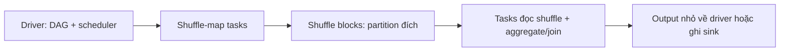

# Chương 32 — Advanced Distributed Processing

> **Phiên bản:** Scala **2.13.18** · JDK **21** · Spark **4.2.0** (`spark-sql_2.13`) · munit **1.2.4** · hadoop-bare-naked-local-fs **0.1.0** (Windows) · **Trạng thái kiểm chứng:** Đã biên dịch & chạy bằng Scala CLI ngày 17/10/2026, 18/18 test pass, 0 compiler warning; đã sửa review vòng 1; chờ Claude review lại và kiểm chứng sbt bản vòng 2.

Chương 25 tối ưu từng query; chương này giải thích **chi phí và mô hình lỗi của cả hệ phân tán**. Cùng một kết quả đơn hàng, bạn phải trả bao nhiêu byte dữ liệu di chuyển, bao nhiêu lần thực thi và bao lâu trước khi người dùng nhận được kết quả? Các thí nghiệm là Spark batch; phần liên hệ streaming nối sang Chương 27–30 ở mức khái niệm.

**Vị trí trong lộ trình:** Sau Ch22–26 (Spark), Ch27–30 (streaming) và Ch31 (kiến trúc dữ liệu). Ch32 đo chi phí thực thi và retry; Ch33 kiểm chất lượng dữ liệu; Ch34 mở rộng cách đo hiệu năng/chi phí.

## 1. Mục tiêu học tập

Sau chương này, bạn có thể:

- Lần theo driver → job → stage → task attempt; phân biệt retry task với tính lại shuffle stage.
- Giữ đúng partitioner, giải thích khi nào co-partitioned join/bucket join tránh **shuffle mới** và chi phí chuẩn bị nằm ở đâu.
- Đọc locality, shuffle write/read bytes, fetched blocks, spill và executed plan; đồng bộ listener trước khi tin số đo.
- Đo serialization của payload, closure và RDD shuffle Java/Kryo; phát hiện capture cả đối tượng không serialize được.
- Chứng minh task retry có thể ghi trùng side effect dù kết quả `collect` vẫn đúng.
- Chọn aggregation chính xác/xấp xỉ, cache/checkpoint, batch size/partition count theo hợp đồng và phép đo.

## 2. Kiến thức tiên quyết

Đọc [Ch22](../09-spark/ch22-spark-fundamentals.md) về RDD, stage và Scala 2.13; [Ch23](../09-spark/ch23-spark-sql-dataframes.md) về DataFrame/plan; [Ch24](../09-spark/ch24-batch-data-pipeline.md) về rerun và đối soát; [Ch25](../09-spark/ch25-spark-performance.md) về join/skew/memory; [Ch26](../09-spark/ch26-spark-production-engineering.md) về vận hành. Ch27–30 giải thích offset, idempotency và độ trễ streaming. Ch31 đặt ranh giới kiến trúc; chương này kiểm tra giả định thực thi bên trong mỗi Spark job.

Đây là **build Spark riêng bằng Scala 2.13**, không trộn `_3` vào classpath. Xem [compatibility matrix](../00-roadmap/04-compatibility-matrix.md). Scala 3.9 của nhánh backend không dùng để chạy lab này. Domain vẫn là đơn hàng/khách hàng; các nguồn sinh trong bộ nhớ cố tình nhỏ để quan sát cơ chế, không thay thế pipeline nghiệp vụ ở Ch24.

## 3. Lý thuyết

Các đoạn code dưới trích từ lab, dùng import/biến trong file gốc. Mục 7 có bản đầy đủ và lệnh chạy; mục 9 ghép từng chủ đề với output thật.

### 3.1. Distributed execution: dữ liệu chia được, công việc vẫn phải phối hợp

**Vấn đề và vì sao.** Tăng executor không tự làm mọi bước nhanh hơn: driver vẫn lập lịch, kết quả lớn vẫn có thể làm driver hết RAM, shuffle tạo điểm phải chờ nhau. Một đơn vị tính toán cần biết nó đọc partition nào và phụ thuộc kết quả nào.

**Cách hoạt động.** Driver xây DAG (đồ thị có hướng không chu trình). DAGScheduler chia việc thành stage; executor nhận task để tính một partition của stage. Narrow transformation có thể chạy cùng pipeline. Shuffle dependency tạo ranh giới giữa stage ghi và stage đọc shuffle.

Narrow có thể nhiều-cha/một-con như `coalesce`. Một action có thể tạo nhiều job do AQE, range sampling hay checkpoint; stage cũ có thể được dùng lại. Đừng đếm stage theo số lời gọi API.

Đoạn cuối `Measurement.measure` gửi job marker rồi chờ listener xử lý hết callback trước đó. `done` là latch được nhả trong `onJobEnd` của marker; phần đăng ký và dọn listener ở mục 8.

```scala
sc.setJobGroup(group, "Ch32 measurement")
val start = System.nanoTime()
val value = action
val elapsed = (System.nanoTime() - start) / 1000000L
sc.setJobGroup(marker, "Ch32 listener barrier")
sc.parallelize(Seq(1), 1).count()
require(done.await(timeoutSeconds, TimeUnit.SECONDS), "CH32_LISTENER_TIMEOUT: incomplete metrics")
Measurement(value, elapsed, tasks.toVector)
```

Đối chiếu output thật tại [mục 9.1](#output-3-1).



**Đo bằng gì.** `JobStart.stageIds`, `TaskEnd.stageId/stageAttemptId`, `TaskInfo.index/attemptNumber`, plan và event log. Demo join giữ partitioner có một stage với task chạy trên partition đã materialize; mất partitioner tạo thêm shuffle. Các con số cụ thể ở mục 9 chỉ thuộc input/cấu hình đó. `Exchange hashpartitioning` là shuffle; `BroadcastExchange` di chuyển bảng nhỏ nhưng **không phải shuffle Exchange**.

**Lựa chọn và khi dùng.** Một JVM đủ RAM thường đơn giản và rẻ hơn Spark cho job nhỏ; nhiều executor mở rộng dung lượng/throughput nhưng thêm serialization, scheduling và recovery. Dùng Spark khi khối lượng/công việc đòi hỏi chia máy.

**Lỗi thiết kế:** `collect` toàn bộ dữ liệu lớn về driver, suy “nhiều task = nhiều máy”, hoặc đếm mọi stage của mọi job đang chạy làm số đo cho một query.

### 3.2. Partitioning là hợp đồng phân bố, không chỉ là số partition

**Vấn đề và vì sao.** Hai RDD cùng có 4 partition chưa chắc khóa C1 nằm cùng partition; join có thể vẫn phải phân phối lại. Metadata sai còn nguy hiểm hơn mất metadata: planner có thể tin phân bố không đúng và bỏ shuffle cần thiết.

**Cách hoạt động.** `HashPartitioner(n)` dùng hash của khóa để chọn partition. Nó giữ cùng khóa ở cùng chỗ, **không bảo đảm cân bằng số dòng/byte**. `RangePartitioner` lấy mẫu để dựng ranh giới khóa; `repartitionAndSortWithinPartitions` phân phối rồi sắp trong từng partition. Lấy mẫu/range có chi phí và có thể trả ít partition hơn yêu cầu khi miền khóa quá nhỏ. RDD partitioner khác với SQL `outputPartitioning`: không suy một API bảo toàn metadata của API kia.

`mapValues` và `filter` giữ partitioner vì không đổi khóa; `map` thông thường bỏ partitioner dù lambda trả lại cùng `(k,v)`. `mapPartitions(..., preservesPartitioning=true)` là lời hứa **của lập trình viên**, chỉ đúng khi phân bố khóa vẫn hợp lệ. Không bật cờ đó sau khi sửa khóa để “tránh shuffle”.

Trong `DistributedDemo`, in metadata và miền khóa để kiểm hợp đồng phân bố trước khi suy chi phí join:

```scala
val p = new HashPartitioner(4)
val hash = DistributedLab.pairs(spark, 200L).partitionBy(p)
println(s"PARTITION hash=${hash.partitioner} mapValues=${hash.mapValues(_ + 1L).partitioner} " +
  s"filter=${hash.filter(_._1 < 10L).partitioner} map=${hash.map(identity).partitioner}")
val ranges = DistributedLab.rangePairs(DistributedLab.pairs(spark, 200L), 4)
println("RANGE " + ranges.mapPartitionsWithIndex { (index, it) =>
  val keys = it.map(_._1).toVector
  Iterator(s"$index:${keys.minOption}-${keys.maxOption}:${keys.size}")
}.collect().mkString(" "))
```

Đối chiếu output thật tại [mục 9.2](#output-3-2).

**Đo bằng gì.** In `rdd.partitioner`, `getNumPartitions`, số dòng và min/max khóa từng partition; đọc dependency/metrics của action. Range có thứ tự các miền khóa, còn hash có thể đặt khóa xa nhau cạnh nhau; range partitioning không tự cam kết thứ tự global cho mọi phép biến đổi tiếp theo.

**Lựa chọn và khi dùng.** Hash cho equijoin/aggregate; range cho xử lý miền có thứ tự; round-robin cho phân phối công việc không theo key. Chuẩn bị partitioner tốn shuffle, chỉ đáng khi tái sử dụng hoặc bước kế tiếp đòi hỏi.

**Lỗi thiết kế:** chữa khóa nóng bằng tăng `n`; bỏ metadata qua `map` rồi ngạc nhiên có shuffle; hứa giữ partitioner sau khi thay khóa.

### 3.3. Data locality: chờ dữ liệu hay chuyển dữ liệu?

**Vấn đề và vì sao.** CPU rảnh ở máy A nhưng block ở B. Chạy ngay có thể phải đọc qua mạng; chờ slot ở B có thể làm tăng độ trễ. Đây là đánh đổi giữa sử dụng tài nguyên và chi phí chuyển dữ liệu.

**Cách hoạt động.** `PROCESS_LOCAL`: task ở executor process giữ dữ liệu; `NODE_LOCAL`: cùng host nhưng khác process; `ANY`: chấp nhận nơi bất kỳ. Scheduler còn có `NO_PREF` (không ưu tiên vị trí) và `RACK_LOCAL` khi môi trường hỗ trợ. `spark.locality.wait` và các biến `.process/.node/.rack` điều chỉnh thời gian chờ trước khi nới locality. Chờ locality không có lợi khi nguồn không cho vị trí ưu tiên, ví dụ nhiều nguồn object store.

Trong `onTaskEnd` của listener, đoạn sau chạy sau khi lọc stage đúng group và kiểm metrics khác null. Nó lưu locality cùng byte đọc, đồng thời giữ riêng stage attempt và task attempt:

```scala
val m = e.taskMetrics
val r = m.shuffleReadMetrics
val w = m.shuffleWriteMetrics
tasks += TaskSample(e.stageId, e.stageAttemptId, e.taskInfo.index,
  e.taskInfo.attemptNumber, e.taskInfo.failed, e.taskInfo.taskLocality.toString,
  e.taskInfo.duration, m.executorDeserializeTime, r.localBytesRead, r.remoteBytesRead,
  r.totalBlocksFetched, r.fetchWaitTime, w.bytesWritten, w.recordsWritten,
  m.memoryBytesSpilled, m.diskBytesSpilled)
```

Đối chiếu output thật tại [mục 9.3](#output-3-3).

**Đo bằng gì.** `TaskInfo.taskLocality`, scheduler delay trong UI/event log, remote bytes, fetch wait và executor host. Lab `local[2,3]` chỉ có **một JVM, hai task thread**; cached RDD có thể cho PROCESS_LOCAL, nguồn sinh có thể NO_PREF. Demo thực tế ghi cả ANY và PROCESS_LOCAL trong khi remote bytes vẫn bằng 0: nhãn ANY không tự có nghĩa đã truyền qua host khác. Không có host thứ hai để đo NODE_LOCAL/ANY dưới tranh chấp nhiều máy hay hiệu quả thay `spark.locality.wait`. Local mode vẫn mở socket cục bộ; remote shuffle bytes bằng 0 không có nghĩa cluster không tốn mạng.

**Lựa chọn và khi dùng.** Đặt dữ liệu gần compute, tái sử dụng cache hoặc chấp nhận remote read để hạ thời gian chờ; mỗi cách đổi chi phí lưu trữ/CPU/network. Chỉnh locality wait khi có nguồn có vị trí và bằng chứng scheduler đang chờ không hợp lý.

**Lỗi thiết kế:** tăng wait cho mọi nguồn, coi locality label là số byte mạng, hoặc dùng tốc độ local để định cỡ network cluster.

### 3.4. Serialization: gửi công việc cũng phải trả tiền

**Vấn đề và vì sao.** Lambda nhìn ngắn nhưng tham chiếu `this` có thể kéo cả service, connection hoặc mảng lớn vào closure (môi trường được hàm đóng giữ). Executor cần nhận dữ liệu và logic dưới dạng byte; object graph lớn làm tăng task size, CPU và GC.

**Cách hoạt động.** Spark làm sạch rồi serialize closure. Lambda giữ owner có `Thread` sẽ lỗi vì owner không serialize được. Rút giá trị cần dùng thành biến nhỏ hoặc hàm thuần. Với cấu hình lớn chỉ đọc, cân nhắc broadcast và quản lý `destroy/unpersist`; vẫn phải trả chi phí phân phối và RAM executor.

Hai đoạn trong `DistributedLab.scala` cho thấy closure giữ dữ liệu nào và cách đo byte thô. Owner bên dưới giữ một `Thread`, vì vậy không thể serialize:

```scala
def captured(size: Int): Int => Int = {
  require(size > 0, "capture size must be positive")
  val data = Array.tabulate[Byte](size)(i => (i % 127).toByte)
  (i: Int) => data(i % data.length).toInt
}

def closureBytes(size: Int): Int =
  new JavaSerializer(new SparkConf(false)).newInstance().serialize(captured(size)).remaining()

final class NonSerializableOwner {
  private val worker = new Thread()
  def broken(input: RDD[Int]): RDD[String] = input.map(i => s"$i:${worker.getName}")
}
```

Đối chiếu output thật tại [mục 9.4](#output-3-4).

**Đo bằng gì.** Lab dùng `serialize(...).remaining()` cho 1.000 `OrderEvent` và closure giữ 16 byte/1 MiB. Đây là **byte object/closure thô**, chưa phải task sau ClosureCleaner hay wire bytes.

`SerializerDemo` chạy cùng RDD `groupByKey` trong **hai JVM/context** Java/Kryo rồi so read/write. Nén, framing và kiểu dữ liệu cũng ảnh hưởng. `executorDeserializeTime` trong TaskSample chưa cô lập toàn bộ CPU serialization.

TaskSetManager có cảnh báo task lớn ở ngưỡng khuyến nghị 1.000 KiB; demo gửi một collection Long lớn vào một partition để ghi lại **thông báo thật**. Không nhầm nó với cảnh báo DAGScheduler về large task binary do closure lớn. Đừng tăng RPC limit làm giải pháp đầu tiên cho closure capture.

**Lựa chọn và khi dùng.** Kryo thường gọn cho object RDD và có thể đăng ký class; Java thuận tiện và hỗ trợ Serializable quen thuộc. Chọn bằng workload thật. `spark.serializer` cấu hình serializer dữ liệu; Spark còn có `closureSerializer` riêng dùng JavaSerializer ([SparkEnv 4.2.0](https://github.com/apache/spark/blob/v4.2.0/core/src/main/scala/org/apache/spark/SparkEnv.scala)), nên đổi Kryo không sửa được việc capture owner không serialize được. Spark có serializer nội bộ cho một số kiểu đơn giản; DataFrame còn dùng biểu diễn hàng nội bộ, nên thay `spark.serializer` không biến mọi SQL operator sang Kryo.

**Lỗi thiết kế:** kết luận Kryo luôn nhanh từ một payload nhỏ, hoặc serialize một DB client rồi mong connection dùng được trên máy khác.

### 3.5. Network shuffle: byte, block và file là ba đại lượng khác nhau

**Vấn đề và vì sao.** Shuffle thêm ghi đĩa, đọc, có thể fetch qua mạng, giải nén và merge. Nhiều block nhỏ có thể đắt dù tổng byte không lớn; một reducer chậm kéo dài đuôi job.

**Cách hoạt động.** Map task chia output theo partition đích; reducer lấy block cần dùng. M × R là số block logic tiềm năng, có thể gồm block rỗng.

Sort shuffle thông thường có data hợp nhất và index theo map output; có thể thêm checksum/temp/spill. **Số file vật lý không bằng M × R**. Shuffle manager, push/merge và cleanup có thể đổi bố cục.

Cuối `DistributedDemo`, chụp số file đang còn giữ. Đặt snapshot này cạnh byte/block của listener ở 3.3; mỗi số trả lời một câu hỏi khác nhau:

```scala
val files = Files.walk(Paths.get(sys.env("SPARK_LOCAL_DIRS")))
try {
  val names = files.toArray.map(_.asInstanceOf[java.nio.file.Path].getFileName.toString)
  println(s"SHUFFLE_FILES retainedData=${names.count(n => n.startsWith("shuffle_") && n.endsWith(".data"))} " +
    s"retainedIndex=${names.count(n => n.startsWith("shuffle_") && n.endsWith(".index"))}")
} finally files.close()
```

Đối chiếu output thật tại [mục 9.5](#output-3-5).

**Đo bằng gì.** Listener lấy write bytes/records, local/remote read, blocks và fetch wait. File snapshot nằm trong SPARK_LOCAL_DIRS. Read/write có thể khác do retry, tái sử dụng shuffle, AQE hoặc consumer không đọc hết.

Blocks fetched không phải số request hay file. Snapshot chỉ đếm file **còn giữ lúc quan sát**. Fetch wait chưa gồm mọi chi phí network; broadcast bytes nằm ngoài shuffle metrics.

**Lựa chọn và khi dùng.** Filter/project sớm, combine cục bộ, co-partition nhiều lần sử dụng hoặc broadcast bảng thực sự nhỏ. Mỗi cách đổi RAM/CPU/storage và hợp đồng phân bố. Chấp nhận shuffle khi cần global correctness; tránh shuffle bằng cách sai key không phải tối ưu.

**Lỗi thiết kế:** chỉ nhìn elapsed time, nhầm local read với remote read, bỏ byte chuẩn bị phân vùng khỏi báo cáo tổng chi phí.

### 3.6. Skew và memory pressure: nhìn đuôi task cùng với spill

**Vấn đề và vì sao.** Task trung vị nhanh nhưng một khóa nóng giữ phần lớn dữ liệu làm cả stage chờ. Nhiều task đồng thời chia cùng RAM executor, nên tăng song song cũng có thể làm mỗi task ít bộ nhớ hơn.

**Cách hoạt động.** Unified memory quản lý execution (sort/hash/join/aggregate) và storage (cache). Execution có thể thu hồi storage vượt phần được bảo vệ. Spill ghi dữ liệu trung gian ra đĩa; cache có thể bị evict hoặc xuống đĩa theo storage level.

Heap còn có user objects/metadata; native/off-heap nằm ngoài heap. Heap chia số task không là bảo đảm bộ nhớ.

`MemoryDemo` cố tình đặt ngưỡng spill thấp rồi kiểm có spill thật. JVM được chạy với `-Xmx768m` qua script mục 7:

```scala
val spark = DistributedLab.session("Ch32 forced spill", Map("spark.shuffle.spill.numElementsForceSpillThreshold" -> "1000"))
spark.sparkContext.setLogLevel("WARN")
try {
  val input = spark.sparkContext.range(0, 50000, 1, 4).map(i => (50000L - i, i))
  val m = Measurement.measure(spark.sparkContext) { input.sortByKey(numPartitions = 4).count() }
  println(s"FORCED_SPILL rows=${m.value} ${m.summary}")
  require(m.value == 50000L && m.tasks.map(_.diskSpill).sum > 0L, "forced spill not observed")
} finally spark.stop()
```

Đối chiếu output thật tại [mục 9.6](#output-3-6).

**Đo bằng gì.** Phân bố duration/records/bytes theo **stage và partition**, peak execution memory trong UI, GC, memoryBytesSpilled/diskBytesSpilled, Storage tab và đĩa. Hai số spill khác nhau vì memory estimate là biểu diễn trong RAM, đĩa có serialization/nén và có thể spill nhiều lượt. `MemoryDemo` dùng ngưỡng spill **cưỡng bức** 1.000 phần tử và heap 768 MiB: chứng minh đường spill, không chứng minh máy thực sự thiếu RAM hay executor OOM. Không assert thời gian phải nhanh/chậm.

**Lựa chọn và khi dùng.** Giảm payload, tăng số partition khi dữ liệu đủ phân tán, giảm task concurrency, bỏ cache ít dùng, hoặc đổi chiến lược aggregate/join. Với hot key cần thay cách chia công việc (AQE/salting theo hợp đồng ở [Ch25 mục 3](../09-spark/ch25-spark-performance.md#3-lý-thuyết)); chương này không lặp lại thuật toán salting.

**Lỗi thiết kế:** cache mọi thứ, tăng memory fraction vô điều kiện, hay cho rằng thêm partition chữa được một khóa chiếm 90%.

### 3.7. Fault tolerance: lineage, cache và checkpoint

**Vấn đề và vì sao.** Cache block và shuffle output có thể mất khi executor/máy chết. Một action thành công trước đó không bảo đảm dữ liệu vẫn còn ở RAM hay upstream rẻ để chạy lại.

**Cách hoạt động.** Lineage mô tả cách dựng lại partition. Mất cache có thể tính lại partition cần dùng. Mất shuffle map output có thể cần chạy lại phần shuffle-map stage. Recovery cần nguồn còn đọc được và transformation xác định. Hãy chốt snapshot nếu nguồn thay đổi.

Trong demo, `reliable` là RDD mới có cache; `calls` đếm upstream trong thí nghiệm không retry. Đã đặt `sc.setCheckpointDir(...)` trước đoạn này:

```scala
try {
  reliable.checkpoint()
  reliable.count()
  val before = calls.value.longValue()
  reliable.unpersist(blocking = true)
  reliable.count()
  println(s"CHECKPOINT set=${reliable.isCheckpointed} upstreamDelta=${calls.value.longValue() - before}\n${reliable.toDebugString}")
} finally reliable.unpersist(blocking = true)
```

Đối chiếu output thật tại [mục 9.7](#output-3-7).

| Cơ chế | Giữ lineage? | Dữ liệu ở đâu? | Trả giá / khi dùng |
|---|---|---|---|
| RDD `cache` mặc định MEMORY_ONLY | Có | RAM executor; mất thì tính lại | Nhiều consumer dùng lại kết quả đắt |
| DataFrame `cache` mặc định MEMORY_AND_DISK | Có | RAM/đĩa executor | Tái sử dụng query; cần `unpersist` |
| Reliable RDD checkpoint | Sau materialize: cắt lineage | `setCheckpointDir`, phải là lưu trữ bền dùng chung trên cluster | Vòng lặp/lineage dài, thêm lượt ghi |
| `localCheckpoint` | Cắt lineage | Storage của executor | Rẻ hơn nhưng mất executor có thể mất đường phục hồi |

**Đo bằng gì.** Lab đếm upstream bằng accumulator trong thí nghiệm **không retry**. Hai count dùng cache; unpersist rồi count buộc tính lại. Với RDD mới, request checkpoint **trước job đầu**, materialize rồi bỏ cache. Kiểm accumulator và `ReliableCheckpointRDD`.

Accumulator trong transformation chưa phải bộ đếm nghiệp vụ exactly-once khi retry. RDD checkpoint lazy, khác `Dataset.checkpoint(eager=true)` ở Ch26 và checkpoint offset/state streaming.

**Lựa chọn và khi dùng.** Ghi dataset trung gian có schema/version để phục vụ nhiều job hoặc chốt snapshot; checkpoint thường phục vụ cắt lineage trong một ứng dụng, không thay data product có hợp đồng.

**Lỗi thiết kế:** chọn đường local làm checkpoint bền cho cluster, bỏ cache trước khi checkpoint hoàn tất, hoặc coi cache là backup.

### 3.8. Retry behavior: task output đúng vẫn có thể ghi trùng

**Vấn đề và vì sao.** Executor ghi HTTP/DB thành công rồi task mất ACK hoặc ném lỗi. Scheduler chỉ thấy task chưa thành công, nên chạy lại cả partition. Spark không có transaction bao quanh side effect tùy ý của bạn.

**Cách hoạt động.** `local[N,F]` có N task thread, tối đa F lần task thất bại trước abort; `local[N]` mặc định F=1. Lab dùng `local[2,3]`. Partition 0 append rồi ném lỗi ở attempt 0; attempt 1 append lại và thành công. `collect` chỉ trả output thành công, journal giữ cả hai lần ghi event 100. Mỗi partition một file để tránh chen dòng. Đây là sink quan sát trong **một JVM**, chưa phải sink cluster.

Trong `retry`, `dir` là thư mục journal tạm. Đoạn này nằm trong action được `Measurement.measure` bao quanh. Append xảy ra trước lỗi:

```scala
spark.sparkContext.parallelize(Seq(100L, 200L), 2).mapPartitions { it =>
  val ctx = TaskContext.get()
  val data = it.toVector
  val text = data.map(id => s"$id,${ctx.attemptNumber()}\n").mkString
  Files.write(Paths.get(dir, s"part-${ctx.partitionId()}.csv"), text.getBytes(UTF_8),
    StandardOpenOption.CREATE, StandardOpenOption.APPEND)
  if (ctx.partitionId() == 0 && ctx.attemptNumber() == 0)
    throw new IllegalStateException("CH32_AFTER_EXTERNAL_APPEND")
  data.iterator
}.collect().toVector
```

Đối chiếu output thật tại [mục 9.8](#output-3-8).

Retry task không đồng nghĩa retry stage: lỗi task thường chỉ tạo attempt mới của cùng partition/stage attempt. `FetchFailed` do mất shuffle output có thể làm DAGScheduler đánh dấu map output mất và chạy lại stage liên quan; `spark.stage.maxConsecutiveAttempts` giới hạn thất bại stage liên tiếp, khác `spark.task.maxFailures` trên cluster. Không suy `local[N,F]` kiểm chứng executor death, network partition, speculation hay recovery shuffle stage. Các tình huống đó **chưa kiểm chứng trong lab**.

**Đo bằng gì.** Đọc exception thật, `TaskInfo.attemptNumber`, `stageAttemptId`, failed flag; đối soát journal với output. Demo cho một failed task attempt, retry thành công, cùng stageAttempt=0. Không dùng accumulator để đếm side effect của failed attempt vì cập nhật có thể bị bỏ/nhân đôi theo ngữ cảnh.

**Lựa chọn và khi dùng.** Transformation thuần là lựa chọn đầu tiên. Với sink bên ngoài: khóa idempotency bằng event ID ổn định và transaction gắn dedup với business write; hoặc sink/commit protocol có bảo đảm phù hợp. Upsert chỉ an toàn khi thao tác có ngữ nghĩa thay thế đúng; `balance += amount` vẫn không idempotent. Tắt retry giảm khả năng phục hồi, cũng không giải quyết rerun job hay speculation ở cấu hình khác.

**Lỗi thiết kế:** lấy taskAttemptId làm business ID (mỗi retry khác nhau), đánh đồng kết quả Spark không trùng với side effect exactly-once; xem thêm Ch30.

### 3.9. Distributed joins: co-partitioning và bucketing phải được chứng minh

**Vấn đề và vì sao.** Ghép fact và dimension thường đắt vì đưa cùng khóa đến cùng nơi. Nếu đã có cách phân bố thích hợp thì lặp shuffle là phí; nếu chưa có mà cố né shuffle thì sai.

**Cách hoạt động.** Hai pair RDD được `partitionBy` cùng `HashPartitioner(4)` rồi materialize có thể join bằng narrow dependencies. Demo dùng `mapValues` giữ metadata; đổi thành `map(identity)` làm mất metadata và sinh shuffle lại. “Không shuffle” ở đây là **join không thêm shuffle**: hai shuffle chuẩn bị được trả trước. Nếu chỉ dùng một lần, chi phí chuẩn bị có thể không đáng.

SQL bucketing ghi file theo hash bucket và lưu metadata trong catalog. Lab ghi hai bảng external cùng key/bốn bucket, đọc qua **catalog**, dùng merge hint và tắt AQE/automatic broadcast. `collect` và plan thuộc cùng query.

Metadata phù hợp có thể đáp ứng distribution; scan vẫn tốn I/O và có thể sort trong partition. Đọc `spark.read.parquet(path)` mất metadata catalog. Tên file bucket chưa đủ để planner bỏ shuffle; mục 10 có plan đối chứng.

Trong `bucketJoin`, `a/b` là tên bảng UUID; `finally` drop metadata. `readViaPath=false` đọc qua catalog, còn `true` giúp quan sát việc mất metadata bucket:

```scala
spark.range(0, 200, 1, 4).select(col("id").as("order_id"), (col("id") % 20).as("customer_id"))
  .write.format("parquet").option("path", root.resolve("orders").toString)
  .bucketBy(4, "customer_id").sortBy("customer_id").saveAsTable(a)
spark.range(20).select(col("id").as("customer_id"))
  .write.format("parquet").option("path", root.resolve("customers").toString)
  .bucketBy(4, "customer_id").sortBy("customer_id").saveAsTable(b)
val left = if (readViaPath) spark.read.parquet(root.resolve("orders").toString) else spark.table(a)
val right = if (readViaPath) spark.read.parquet(root.resolve("customers").toString) else spark.table(b)
execute(left.hint("merge").join(right.hint("merge"), Seq("customer_id")))
```

Đối chiếu output thật tại [mục 9.9](#output-3-9).

**Đo bằng gì.** `rdd.partitioner`; plan sau action có `SortMergeJoin`, `FileScan ... Bucketed: true`, `SelectedBucketsCount`; có/không `Exchange hashpartitioning`; TaskMetrics của action. Số bucket giống nhau mà khác key/type/hash contract không tạo co-partitioning. Không suy `bucketBy` luôn được planner sử dụng; tính năng/cấu hình/catalog/điều kiện query đều ảnh hưởng.

**Lựa chọn và khi dùng.** Broadcast dimension nhỏ, shuffle theo nhu cầu cho query ít lặp, hoặc thiết kế lưu trữ phù hợp nhiều consumer. Bucketing trả giá write/metadata/small files và ràng buộc layout; có ích khi nhiều join lặp lại cùng key.

**Lỗi thiết kế:** bỏ qua uniqueness dimension gây nhân doanh thu, lấy 4 partition làm bằng chứng co-partitioned, hay chỉ kiểm số dòng thay vì multiset khi đổi thuật toán. Lab dimension duy nhất 20 khóa; bài tập 2 cố tình dùng hai phía trùng khóa để thấy phép nhân cardinality.

### 3.10. Aggregation strategies: ít byte hơn nhưng vẫn đúng hợp đồng

**Vấn đề và vì sao.** Muốn tổng tiền theo khách, chuyển mọi dòng qua mạng rồi cộng là lãng phí. Nhưng không phải aggregate nào cũng gộp một trạng thái nhỏ được, và xấp xỉ không thích hợp cho mọi báo cáo.

**Cách hoạt động.** `reduceByKey` gộp cục bộ trước shuffle (map-side combine). `groupByKey` giữ các giá trị theo key để bạn xử lý cả nhóm. Với sum, ưu tiên trạng thái tổng. Đo cả shuffle **records** vì nén có thể làm chênh lệch byte khó đoán.

SQL dùng cùng tư duy: `partial_count`/`partial_sum` trước Exchange, HashAggregate final sau Exchange. Nếu distribution đã đáp ứng, Exchange có thể vắng mặt.

`DistributedDemo` chạy cùng input, so kết quả rồi mới đọc số đo. Biến `p` là `HashPartitioner(4)`:

```scala
val pairs = DistributedLab.pairs(spark)
val combined = Measurement.measure(sc) { pairs.reduceByKey(p, _ + _).collect().toVector.sortBy(_._1) }
val grouped = Measurement.measure(sc) {
  pairs.groupByKey(p).mapValues(_.sum).collect().toVector.sortBy(_._1)
}
require(combined.value == grouped.value)
println(s"COMBINE ${combined.summary}")
println(s"GROUP ${grouped.summary}")
```

Đối chiếu output thật tại [mục 9.10](#output-3-10).

Hàm gộp cần kết hợp được theo cách Spark chia partition. Cộng Long chỉ đúng trong miền không overflow; cộng Double không kết hợp chính xác bit-for-bit. Bài tập dùng **BigInt** cho tổng RDD ở biên Long, thay vì hứa mọi sum giống nhau. Tính average phải mang `(sum,count)` rồi chia cuối, không lấy trung bình các trung bình không cùng trọng số.

`count_distinct(customer_id)` trả số chính xác (bỏ NULL); `approx_count_distinct(..., 0.05)` dùng HyperLogLog++ với relative standard deviation (độ lệch chuẩn tương đối) được cấu hình. RSD không phải giới hạn cứng “mọi input sai tối đa 5%”. Cả hai phải được **chạy**, đo kết quả, sai số quan sát, thời gian, shuffle bytes và plan của cùng nguồn. Sketch thường giới hạn trạng thái hơn exact set, nhưng không cam kết nhanh hơn cho input nhỏ; RSD thấp hơn làm tăng tài nguyên.

**Đo bằng gì.** Lab so golden tổng của 20 key, writeRecords/bytes, partial/final plan, exact và approx trên 20.000 khách duy nhất trong 120.000 dòng. Không lấy `df.count()` của query khác để minh họa plan của `df.collect()`.

**Lựa chọn và khi dùng.** Exact cho thanh toán/đối soát; approx cho dashboard khi hợp đồng cho phép sai số thống kê; giữ nhóm đầy đủ khi cần ngữ nghĩa không tóm thành trạng thái nhỏ.

**Lỗi thiết kế:** groupByKey cho sum đơn giản, countDistinct sau salting không hợp nhất đúng tập hợp, hoặc assert sai số một lượt phải dưới RSD.

### 3.11. Throughput và latency: một lô to có thể hoàn tất sớm hơn nhưng trả kết quả đầu muộn hơn

**Vấn đề và vì sao.** Mỗi job/task có overhead; chia quá nhỏ trả kết quả sớm nhưng tốn lập lịch. Lô quá lớn chờ gom dữ liệu lâu, tăng memory và thời gian trước lần publish đầu.

**Cách hoạt động.** `batches` gửi job tuần tự trên input có sẵn, mỗi record chạy checksum CPU nhân tạo. Fold số dòng/checksum để dùng kết quả thật. Đây chưa phải workload đại diện cho production.

`firstMs` là lúc **batch đầu hoàn tất** từ submission; `totalMs` là lúc xử lý đủ dòng. Throughput = rows/giây. Chưa đo time-to-first-record hay p99 event latency. Lab chỉ có hai slot; thêm partition có thể tốn scheduling hơn lợi ích song song.

Phần driver của `batches` dùng `foldLeft` để tích lũy trạng thái bất biến. `cpuChecksum` giữ vòng lặp CPU cục bộ 2.048 bước; overflow checksum là số học modulo, không dùng cho tiền:

```scala
val start = System.nanoTime()
val initial = BatchRun(0L, batch, partitions, 0L, 0L, 0, 0L)
val completed = (0 until total by batch).foldLeft(initial) { (acc, offset) =>
  val until = math.min(total.toLong, offset.toLong + batch.toLong)
  val result = spark.sparkContext.range(offset.toLong, until, 1L, partitions)
    .map(i => (1L, cpuChecksum(i)))
    .fold((0L, 0L)) { case ((n1, c1), (n2, c2)) => (n1 + n2, c1 ^ c2) }
  val first = if (acc.jobs == 0) (System.nanoTime() - start) / 1000000L else acc.firstMs
  acc.copy(rows = acc.rows + result._1, firstMs = first,
    jobs = acc.jobs + 1, checksum = acc.checksum ^ result._2)
}
completed.copy(totalMs = (System.nanoTime() - start) / 1000000L)
```

Đối chiếu output thật tại [mục 9.11](#output-3-11).

**Đo bằng gì.** Warm-up Spark riêng và warm-up checksum 2.000 dòng, bốn cấu hình trên cùng 60.000 dòng, cả batch cuối không đủ size cũng phải được xử lý; in jobs, rows, firstMs, totalMs và checksum. Một lượt mỗi cấu hình, cùng thứ tự, không kiểm soát tải nền của toàn máy; muốn chọn production phải lặp/hoán đổi thứ tự, báo median/p95, input bytes, CPU/GC, sink commit, và thời gian chờ nguồn. Không assert thứ hạng thời gian trong unit test.

**Lựa chọn và khi dùng.** Micro-batch (Ch29) gom record, khấu hao scheduling/commit và dễ tận dụng SQL batch; phải cộng thời gian chờ trigger/lấp lô và xử lý backlog vào event latency. Record-at-a-time xử lý từng record khi đến, có thể giảm chờ gom nhưng vẫn có buffering, network shuffle, checkpoint, state và backpressure. Dùng mô hình đáp ứng SLO (service-level objective — mục tiêu mức dịch vụ) với chi phí chấp nhận được; không đồng nhất record-at-a-time với “0 latency”.

**Lỗi thiết kế:** tối đa throughput dù vi phạm SLO, so batch processing time với end-to-end streaming latency, hay chọn partition count chỉ từ số CPU trên máy tác giả.

## 4. Thuật ngữ tiếng Anh

| Thuật ngữ | Nghĩa trong chương |
|---|---|
| Partition / partitioner | Phần dữ liệu / hợp đồng ánh xạ key → phần dữ liệu |
| Stage boundary | Ranh giới thực thi do shuffle dependency; không phải mỗi transformation |
| Task attempt / stage attempt | Một lần thử task / một lần thử stage; hai bộ đếm khác nhau |
| Data locality | Mức gần giữa slot chạy task và nơi giữ dữ liệu |
| Closure capture | Trạng thái bên ngoài bị hàm giữ lại, có thể phải serialize |
| Shuffle block / fetch | Phần map output cho một reduce partition / thao tác lấy block |
| Map-side combine | Gộp trạng thái cục bộ trước khi chuyển dữ liệu |
| Lineage / checkpoint | Cách tính lại / dữ liệu materialize để cắt chuỗi phụ thuộc |
| Idempotency | Thực hiện lặp lại có cùng hiệu ứng nghiệp vụ như một lần |
| Throughput / latency | Khối lượng trên đơn vị thời gian / thời gian chờ kết quả theo định nghĩa cụ thể |

## 5. Ví dụ đơn giản

Đọc `DistributedLab.joined` rồi quan sát `JOIN lostPartitioner=false/true` khi chạy demo:

```scala
val p = new HashPartitioner(4)
val facts = pairs(spark, 2000L).partitionBy(p).persist()
val dim = spark.sparkContext.parallelize((0L until 20L).map(k => k -> s"C$k"), 2)
  .partitionBy(p).persist()
try {
  facts.count()
  dim.count() // shuffle chuẩn bị và materialize nằm ngoài phép đo consumer
  val left = if (lost) facts.map { case (k, v) => (k, v) } else facts.mapValues(_ + 0L)
  Measurement.measure(spark.sparkContext) { left.join(dim, p).collect().toVector }
} finally {
  facts.unpersist(blocking = true)
  dim.unpersist(blocking = true)
}
```

Đây là thân hàm `joined` trong [DistributedLab.scala](distributed-lab/src/main/scala/vn/scalaeng/distributed/DistributedLab.scala); `lost` chọn giữ hay bỏ metadata. Hai phía đều materialize trước phép đo và được unpersist trong `finally`. Lab đối soát multiset bằng vector đã sắp, giữ được duplicates. Thử tăng số lần dùng lại trước khi quyết định có khấu hao được chi phí chuẩn bị không.

## 6. Ví dụ thực tế (DE và liên hệ BE)

Một platform tính báo cáo đơn hàng theo khách mỗi ngày và phục vụ dashboard số khách đang hoạt động:

1. Snapshot fact/dimension theo ngày chạy; kiểm dimension duy nhất customer_id trước join (Ch24/33). Không dùng số task làm điều kiện dữ liệu đúng.
2. Fact được nhiều job cùng ngày dùng lại: so tổng chi phí shuffle chuẩn bị + storage với chi phí shuffle ở mỗi consumer. Co-partition/bucket chỉ đáng khi thực sự được planner sử dụng.
3. Tổng tiền dùng exact aggregation với miền số được kiểm soát; dashboard unique customer được phép dùng sketch nếu business chấp nhận RSD. Giữ hai contract riêng.
4. Transformation không gọi API cộng tiền. Nếu publish kết quả ra BE service, dùng business event ID ổn định và sink transaction/idempotency; retry Spark không rollback HTTP.
5. Ghi metrics theo run/date, giữ event log khi cần chẩn đoán. Khi task đuôi kéo dài, so skew, GC/spill, remote fetch và scheduler delay trước khi thêm máy.

Mini project ở mục 15 yêu cầu một decision record nối các quan sát này với SLO. Lab không triển khai DB/HTTP sink và không tuyên bố đã kiểm thử giao dịch bên ngoài.

## 7. Code đầy đủ

- [project.scala](distributed-lab/project.scala), [build.sbt](distributed-lab/build.sbt), [build.properties](distributed-lab/project/build.properties): build riêng Scala 2.13.18, JDK 21, sbt 1.12.11, munit 1.2.4, đầy đủ 15 `--add-opens` theo Spark launcher.
- [DistributedLab.scala](distributed-lab/src/main/scala/vn/scalaeng/distributed/DistributedLab.scala): session, nguồn, join, bucketing, serializer, journal và batch.
- [Measurement.scala](distributed-lab/src/main/scala/vn/scalaeng/distributed/Measurement.scala): listener, TaskSample và rào đồng bộ.
- [DistributedDemo.scala](distributed-lab/src/main/scala/vn/scalaeng/distributed/DistributedDemo.scala): DistributedDemo, MemoryDemo, SerializerDemo.
- [DistributedSuite.scala](distributed-lab/src/test/scala/vn/scalaeng/distributed/DistributedSuite.scala): correctness, plan, retry, checkpoint và regression listener.
- [verify.ps1](distributed-lab/verify.ps1): chạy test/demo/forced spill/hai serializer, log vào `.cache/t19/`.
- [Lời giải có code/test](../solutions/ch32-code/): bảy bài; dùng lại source main của lab bằng directive, không sao chép mã thực thi.

Từ **gốc repo** trên Windows, chạy lần lượt để tránh tự tạo tải benchmark song song:

```powershell
powershell.exe -NoProfile -ExecutionPolicy Bypass -File 11-data-platform/distributed-lab/verify.ps1 -Mode tests
powershell.exe -NoProfile -ExecutionPolicy Bypass -File 11-data-platform/distributed-lab/verify.ps1 -Mode demo
powershell.exe -NoProfile -ExecutionPolicy Bypass -File 11-data-platform/distributed-lab/verify.ps1 -Mode memory
powershell.exe -NoProfile -ExecutionPolicy Bypass -File 11-data-platform/distributed-lab/verify.ps1 -Mode serializers
```

Hoặc `-Mode all` để chạy tuần tự tất cả. `ExecutionPolicy Bypass` chỉ áp dụng tiến trình này. Script gọi `scala-cli.bat test` cho lab/lời giải, `scala-cli.bat run ... --main-class ...` cho các demo; **mọi lệnh dùng `--server=false`**. COURSIER_CACHE là `<repo>/.cache/coursier`; TEMP/TMP/java.io.tmpdir, workspace, SPARK_LOCAL_DIRS và warehouse đều trong `<repo>/.cache/t19/` đã ignore. Script không xóa dữ liệu cũ; mỗi checkpoint/journal/table data dùng tên temp mới. Không cần mạng sau khi đủ dependency cache; không dùng Docker/Kafka/PostgreSQL. Scala CLI vẫn có thể kiểm tra metadata phiên bản khi chạy.

Ví dụ test tay (thay đường dẫn tuyệt đối cho máy bạn, tạo thư mục tmp/local trước):

```powershell
$env:COURSIER_CACHE = "$PWD/.cache/coursier"
$env:SPARK_LOCAL_DIRS = "$PWD\.cache\t19\local"
$env:TEMP = "$PWD\.cache\t19\tmp"
$env:TMP = $env:TEMP
scala-cli.bat test 11-data-platform/distributed-lab --server=false --workspace .cache/t19/manual-build --java-opt=-Djava.io.tmpdir=C:/Users/VuTT/zero_to_hero_scala/.cache/t19/tmp --java-opt=-Dspark.sql.warehouse.dir=file:///C:/Users/VuTT/zero_to_hero_scala/.cache/t19/warehouse
```

Scala 2.13 dùng `-Wunused:_` tương đương bật mọi nhóm unused; `-Wunused:all` là cách viết của nhánh Scala 3. Lab thêm `-deprecation -feature -Xlint:_`. Không tắt compiler warning để đạt chuẩn. Hint nâng munit và WARN thiếu native Hadoop khác compiler warning; dependency vẫn chốt 1.2.4 theo repo. BareLocalFileSystem giải quyết đường ghi file Hadoop trên Windows thiếu winutils trong lab này, không bảo đảm mọi đường native Hadoop đều được thay thế. Linux/macOS và sbt chưa chạy ở lượt tác giả. Review vòng 1 của Claude ghi sbt 11/11 pass; lead cần chạy lại sau sửa vòng 2.

Session đặt `spark.sql.artifact.isolation.enabled=false` khi khởi tạo: lab dùng chung classpath, không cần tách artifact theo session. Đây là cấu hình giảm đường tạo classloader/socket loopback khi chạy nhiều query trên Windows; xem [Ch24 mục 10](../09-spark/ch24-batch-data-pipeline.md#10-lỗi-thường-gặp-thật). Vòng này kiểm test/demo với isolation tắt; chưa đo lại số socket hay tái hiện cạn cổng. Định nghĩa cấu hình nằm trong [SQLConf Spark 4.2.0](https://github.com/apache/spark/blob/v4.2.0/sql/catalyst/src/main/scala/org/apache/spark/sql/internal/SQLConf.scala).

## 8. Giải thích code

`Measurement.measure` gắn UUID job group và lưu local properties cũ. Listener chỉ nhận TaskEnd thuộc stage của JobStart đúng group. Hai callback dưới xác định stage cần đo và job marker cần chờ:

```scala
override def onJobStart(e: SparkListenerJobStart): Unit = {
  val id = Option(e.properties).map(_.getProperty("spark.jobGroup.id")).orNull
  if (id == group) stages ++= e.stageIds
  if (id == marker) markers += e.jobId
}
override def onJobEnd(e: SparkListenerJobEnd): Unit = {
  if (markers(e.jobId)) done.countDown()
}
```

Sau action đồng bộ, helper gửi marker khác group trên cùng thread rồi chờ như code 3.1. `JobEnd` của marker trên **shared listener queue** là rào FIFO: callback TaskEnd trước đó đã xong. Latch chờ tối đa 60 giây; timeout báo lỗi thay vì trả số đo thiếu. Marker không cộng vào elapsedMs/task sample. `finally` khôi phục properties và gỡ listener kể cả action ném lỗi.

Test chủ động giữ callback listener bằng latch để chứng minh helper chưa trả về, rồi nhả và kiểm chỉ đủ hai task. Test khác đổi group cho job ngoài phép đo và kiểm không đếm lẫn; kiểm restoration khi action lỗi. Helper dành cho action đồng bộ trong thread gọi, không cho Future chưa join, stage được chia sẻ concurrent phức tạp hay event queue bị drop. Trong production listener phải nhẹ; cảnh báo drop event làm lượt đo không hợp lệ.

`summary` cộng byte/spill/blocks của mọi attempt có TaskMetrics (gồm attempt lỗi), đếm stage ID riêng, lưu stageAttempt ở từng sample để soi retry. Giá trị tổng task duration không phải wall-clock vì task chồng lấp. Khi action ném lỗi, helper dọn rồi ném tiếp, không trả metrics của job lỗi. Phần retry trong lab có attempt lỗi nhưng **action cuối thành công**, nên nhận đủ metrics qua rào.

`bucketJoin` dùng tên bảng UUID, path external nằm trong thư mục temp, drop metadata trong `finally`; không dùng Hive metastore ngoài. `execute` collect và in executedPlan của **chính biến DataFrame đó**. Session tắt AQE để cô lập layout; nếu bật lại AQE, phải tách final/initial sections và kiểm actual final plan như Ch25. `BatchRun` xử lý lô cuối bằng min trên Long để tránh mất phần dư và overflow cộng Int.

## 9. Output mong đợi

Các dòng dưới lấy từ [evidence vòng 2](distributed-lab/evidence/README.md), ngày **17/10/2026**. Scala CLI: **18 pass / 0 fail / 0 ignored**, **0 compiler warning**. WARN Hadoop, task size/plan và ERROR retry cố ý là log runtime. Stage/expression ID, path, file còn giữ và thời gian có thể đổi.

```text
ENV spark=4.2.0 scala=2.13.18 java=21.0.12.1 cpu=12 master=local[2,3] heap=8547991552 artifactIsolation=false
```

```text
Test run vn.scalaeng.distributed.DistributedSuite finished: 0 failed, 0 ignored, 11 total 27.308s
Test run vn.scalaeng.distributed.solutions.ExercisesSuite finished: 0 failed, 0 ignored, 7 total 19.044s
```

Một lượt mỗi cấu hình, chưa kiểm soát tải nền. Remote shuffle bytes đều **0**; read bên dưới là local read. Setup partitionBy/materialization và ghi bảng bucket nằm ngoài consumer:

| Thí nghiệm | ms | Stage / task attempt | Read / write (byte) | Shuffle write records |
|---|---:|---:|---:|---:|
| RDD join giữ partitioner | 215 | 1 / 4 | 0 / 0 | 0 |
| RDD join mất partitioner | 123 | 2 / 8 | 868 / 868 | 2000 |
| SQL bucket qua catalog | 1332 | 1 / 4 | 0 / 0 | 0 |
| SQL bucket đọc path | 601 | 3 / 8 | 2286 / 2286 | 220 |
| RDD reduceByKey | 265 | 2 / 8 | 1264 / 1264 | 80 |
| RDD groupByKey + sum | 334 | 2 / 8 | 7608 / 7608 | 60000 |
| SQL groupBy count | 857 | 2 / 8 | 418038 / 418038 | 80000 |
| SQL exact distinct | 659 | 3 / 9 | 412138 / 412138 | 80004 |
| SQL approx distinct RSD=0.05 | 505 | 2 / 5 | 1872 / 1872 | 4 |

Join giữ partitioner mất **215 ms**, còn mất metadata chỉ **123 ms** trong lượt này. Với 2.000 dòng, chi phí lập lịch/khởi tạo task có thể lấn chi phí shuffle; một lượt chưa tách được ảnh hưởng đó khỏi warm-up và tải nền. Bằng chứng về công việc phát sinh là **1/4 so với 2/8 stage/task attempt, 0 so với 868 byte shuffle**, không phải thứ hạng ms. Muốn so thời gian, chạy lặp N lần sau warm-up, đổi thứ tự và báo trung vị; xem Ch34. Tương tự, consumer đọc bucket qua catalog/path chưa đủ để xếp hạng tốc độ hai layout.

<a id="output-3-1"></a>

### 9.1. Stage và rào listener (3.1)

```text
JOIN lostPartitioner=false rows=2000 ms=215 stages=1 attempts=4 failed=0 read=0 remote=0 write=0 records=0 blocks=0 fetchWaitMs=0 spillMem=0 spillDisk=0 locality=PROCESS_LOCAL
JOIN lostPartitioner=true rows=2000 ms=123 stages=2 attempts=8 failed=0 read=868 remote=0 write=868 records=2000 blocks=4 fetchWaitMs=0 spillMem=0 spillDisk=0 locality=PROCESS_LOCAL
```

Marker không nằm trong số task/stage ở trên. Test giữ callback bằng latch kiểm helper chưa trả về trước khi listener xử lý xong; xem mục 8 và `DistributedSuite`.

<a id="output-3-2"></a>

### 9.2. Metadata partitioner và range (3.2)

```text
PARTITION hash=Some(org.apache.spark.HashPartitioner@4) mapValues=Some(org.apache.spark.HashPartitioner@4) filter=Some(org.apache.spark.HashPartitioner@4) map=None
RANGE 0:Some(0)-Some(4):50 1:Some(5)-Some(9):50 2:Some(10)-Some(14):50 3:Some(15)-Some(19):50
```

`map=None` dù key thực tế không đổi. Bốn miền range của input này được sắp; không suy mọi transformation sau đó giữ thứ tự global.

<a id="output-3-3"></a>

### 9.3. Locality cùng remote bytes (3.3)

```text
COMBINE ms=265 stages=2 attempts=8 failed=0 read=1264 remote=0 write=1264 records=80 blocks=16 fetchWaitMs=0 spillMem=0 spillDisk=0 locality=ANY,PROCESS_LOCAL
BUCKET rows=200 ms=1332 stages=1 attempts=4 failed=0 read=0 remote=0 write=0 records=0 blocks=0 fetchWaitMs=0 spillMem=0 spillDisk=0 locality=PROCESS_LOCAL
```

ANY và PROCESS_LOCAL đều đi cùng remote=0 trong một JVM. Chưa có bằng chứng về remote fetch hay locality wait trên cluster.

<a id="output-3-4"></a>

### 9.4. Closure, payload và serializer (3.4)

```text
SERIALIZER java=27653 kryo=20504
CLOSURE small=649 captured1MiB=1049209
CAPTURE_ERROR org.apache.spark.SparkException: Task not serializable
CAPTURE_ERROR java.io.NotSerializableException: vn.scalaeng.distributed.NonSerializableOwner
```

Cảnh báo task size thật, từ collection Long lớn trong một partition:

```text
15:18:57 WARN TaskSetManager: Stage 49 contains a task of very large size (1415 KiB). The maximum recommended task 
size is 1000 KiB.
```

Hai JVM/context riêng, cùng 20.000 `OrderEvent` và 20 key:

| Serializer | ms | Read / write (byte) | Shuffle write records |
|---|---:|---:|---:|
| Java | 1901 | 152536 / 152536 | 20000 |
| Kryo | 2432 | 167527 / 167527 | 20000 |

Payload Kryo nhỏ hơn Java nhưng shuffle Kryo của workload này **lớn hơn** Java. Byte thô khác byte shuffle có framing/nén. Một lượt cold JVM chưa đủ suy thứ hạng tốc độ chung.

<a id="output-3-5"></a>

### 9.5. Shuffle records, bytes, blocks và file (3.5)

```text
GROUP ms=334 stages=2 attempts=8 failed=0 read=7608 remote=0 write=7608 records=60000 blocks=16 fetchWaitMs=0 spillMem=0 spillDisk=0 locality=ANY,PROCESS_LOCAL
SHUFFLE_FILES retainedData=4 retainedIndex=4
```

Records, blocks fetched và file còn giữ là ba số khác nhau. Snapshot file không đếm tổng file đã từng tạo; cleanup có thể xóa output cũ.

<a id="output-3-6"></a>

### 9.6. Spill cưỡng bức (3.6)

```text
FORCED_SPILL rows=50000 ms=3163 stages=3 attempts=12 failed=0 read=402661 remote=0 write=402661 records=50000 blocks=7 fetchWaitMs=0 spillMem=3756672 spillDisk=387454 locality=ANY,PROCESS_LOCAL
```

Heap 768 MiB, ngưỡng cưỡng bức 1.000 phần tử. Đây là bằng chứng đường spill đã chạy, chưa phải OOM hay thiếu RAM tự nhiên.

<a id="output-3-7"></a>

### 9.7. Cache so với reliable checkpoint (3.7)

```text
CACHE calls=100
RECOMPUTE calls=200
CHECKPOINT set=true upstreamDelta=0
```

Sau unpersist, cache phải tính lại upstream. RDD checkpoint đã materialize có upstreamDelta=0; transcript đầy đủ còn có `ReliableCheckpointRDD`.

<a id="output-3-8"></a>

### 9.8. Journal và từng task attempt (3.8)

```text
RETRY output=100,200 journal=100,0;100,1;200,0 ms=45 stages=1 attempts=3 failed=1 read=0 remote=0 write=0 records=0 blocks=0 fetchWaitMs=0 spillMem=0 spillDisk=0 locality=PROCESS_LOCAL
ATTEMPT stage=56 stageAttempt=0 partition=0 taskAttempt=0 failed=true
ATTEMPT stage=56 stageAttempt=0 partition=0 taskAttempt=1 failed=false
```

Output có hai event đúng nhưng journal có ba lần append. Task attempt tăng từ 0 lên 1, stageAttempt vẫn bằng 0.

<a id="output-3-9"></a>

### 9.9. Bucket join qua catalog (3.9)

```text
BUCKET rows=200 ms=1332 stages=1 attempts=4 failed=0 read=0 remote=0 write=0 records=0 blocks=0 fetchWaitMs=0 spillMem=0 spillDisk=0 locality=PROCESS_LOCAL
+- *(3) SortMergeJoin [customer_id#6L], [customer_id#7L], Inner
   :        +- FileScan parquet spark_catalog.default.ch32_orders_7df47e72c820463f91634cd8a4f845eb[order_id#5L,customer_id#6L] Batched: true, Bucketed: true, DataFilters: [isnotnull(customer_id#6L)], Format: Parquet, Location: InMemoryFileIndex(1 paths)[file:/C:/Users/VuTT/zero_to_hero_scala/.cache/t19/tmp/ch32-buckets1352..., PartitionFilters: [], PushedFilters: [IsNotNull(customer_id)], ReadSchema: struct<order_id:bigint,customer_id:bigint>, SelectedBucketsCount: 4 out of 4
            +- FileScan parquet spark_catalog.default.ch32_customers_7df47e72c820463f91634cd8a4f845eb[customer_id#7L] Batched: true, Bucketed: true, DataFilters: [isnotnull(customer_id#7L)], Format: Parquet, Location: InMemoryFileIndex(1 paths)[file:/C:/Users/VuTT/zero_to_hero_scala/.cache/t19/tmp/ch32-buckets1352..., PartitionFilters: [], PushedFilters: [IsNotNull(customer_id)], ReadSchema: struct<customer_id:bigint>, SelectedBucketsCount: 4 out of 4
```

Hai scan có `Bucketed: true`, bốn bucket; plan đầy đủ không Exchange, vẫn có Sort trong partition. Nhánh đọc path và Exchange thật ở mục 10.

<a id="output-3-10"></a>

### 9.10. Combine, partial/final và exact/approx (3.10)

```text
COMBINE ms=265 stages=2 attempts=8 failed=0 read=1264 remote=0 write=1264 records=80 blocks=16 fetchWaitMs=0 spillMem=0 spillDisk=0 locality=ANY,PROCESS_LOCAL
GROUP ms=334 stages=2 attempts=8 failed=0 read=7608 remote=0 write=7608 records=60000 blocks=16 fetchWaitMs=0 spillMem=0 spillDisk=0 locality=ANY,PROCESS_LOCAL
```

Cùng tổng từng key nhưng shuffle records là **80 so với 60.000**. Plan SQL groupBy count của chính query đã collect:

```text
*(2) HashAggregate(keys=[customer_id#31L], functions=[count(1)], output=[customer_id#31L, count#32L])
+- Exchange hashpartitioning(customer_id#31L, 4), ENSURE_REQUIREMENTS, [plan_id=277]
   +- *(1) HashAggregate(keys=[customer_id#31L], functions=[partial_count(1)], output=[customer_id#31L, count#36L])
      +- *(1) Project [(id#30L % 20000) AS customer_id#31L]
         +- *(1) Range (0, 120000, step=1, splits=4)
```

```text
DISTINCT exact=20000 ms=659 stages=3 attempts=9 failed=0 read=412138 remote=0 write=412138 records=80004 blocks=20 fetchWaitMs=0 spillMem=0 spillDisk=0 locality=ANY,PROCESS_LOCAL
DISTINCT approx=19522 relativeError=0.0239 ms=505 stages=2 attempts=5 failed=0 read=1872 remote=0 write=1872 records=4 blocks=4 fetchWaitMs=0 spillMem=0 spillDisk=0 locality=ANY,PROCESS_LOCAL
```

Exact=**20.000**, approx=**19.522**, sai số quan sát **2,39%**. RSD=0.05 chưa phải hard bound. Plan exact có hai Exchange (hash key rồi SinglePartition); approx chuyển sketch qua SinglePartition. Xem transcript đầy đủ.

<a id="output-3-11"></a>

### 9.11. Batch đầu so với tổng thời gian (3.11)

```text
BATCH size=6000 partitions=2 rows=60000 jobs=10 firstMs=32 totalMs=286 checksum=-8654025316253842092
BATCH size=30000 partitions=2 rows=60000 jobs=2 firstMs=72 totalMs=145 checksum=-8654025316253842092
BATCH size=6000 partitions=8 rows=60000 jobs=10 firstMs=32 totalMs=429 checksum=-8654025316253842092
BATCH size=30000 partitions=8 rows=60000 jobs=2 firstMs=84 totalMs=173 checksum=-8654025316253842092
```

Đã warm-up checksum 2.000 dòng ngoài bảng. Mỗi cấu hình xử lý 60.000 dòng, checksum **-8654025316253842092**. Throughput dưới đây được **tính** bằng rows×1000/totalMs rồi làm tròn:

| Batch size | Partition | Job | Hoàn tất batch đầu (ms) | Tổng (ms) | Dòng/s tính được |
|---|---:|---:|---:|---:|---:|
| 6000 | 2 | 10 | 32 | 286 | 209790 |
| 30000 | 2 | 2 | 72 | 145 | 413793 |
| 6000 | 8 | 10 | 32 | 429 | 139860 |
| 30000 | 8 | 2 | 84 | 173 | 346821 |

Trong lượt này, lô lớn giảm tổng processing time nhưng batch đầu hoàn tất muộn hơn ở cả hai partition count. Tám partition trên hai slot tốn tổng thời gian hơn hai partition. Đây là quan sát của CPU nhân tạo và thứ tự chạy hiện tại. Cần đo lặp trên workload thật, cộng chờ nguồn/trigger/commit trước khi suy event latency.

## 10. Lỗi thường gặp

Các thông báo dưới đây là lỗi/cảnh báo cố ý kích hoạt bởi code lab, không phải test suite thất bại. Xem transcript demo trong evidence cho chuỗi nguyên nhân đầy đủ.

- **Capture owner không Serializable:** demo bắt `org.apache.spark.SparkException` với message `Task not serializable`. Kiểm owner/lambda và `Caused by java.io.NotSerializableException`; rút giá trị nhỏ/hàm thuần thay vì capture Thread/service.
- **Side effect chạy hai lần:** runtime ném `java.lang.IllegalStateException: CH32_AFTER_EXTERNAL_APPEND` sau append đầu tiên. Job vẫn hoàn tất nhờ retry; kiểm cả journal, không chỉ output thành công. Đây là lỗi ứng dụng cố ý, không giả lập executor chết.
- **Task quá lớn:** xem nguyên văn WARN TaskSetManager tại mục 9/evidence. Chia dữ liệu đầu vào và giảm closure; không mặc định tăng RPC limit. Cảnh báo task size không tự có nghĩa heap OOM.
- **Cache không phải checkpoint:** test đầu khi biên soạn từng gọi checkpoint sau khi RDD đã chạy; assertion `input.isCheckpointed` thất bại. Bản cuối yêu cầu checkpoint trên RDD mới trước job đầu, rồi materialize và kiểm ReliableCheckpointRDD. Không biến lỗi assertion này thành thông báo lỗi của Spark. Không có transcript production executor loss trong chương.

**Đọc bucket qua path làm xuất hiện shuffle.** Đây là lỗi kỳ vọng về hiệu năng, không phải exception. `bucketJoin(..., readViaPath=true)` vẫn trả cùng 200 dòng, nhưng đọc Parquet trực tiếp mất metadata catalog. Dưới đây là summary và hai dòng Exchange **nguyên văn** của executed plan sau collect:

```text
BUCKET_PATH rows=200 ms=601 stages=3 attempts=8 failed=0 read=2286 remote=0 write=2286 records=220 blocks=9 fetchWaitMs=0 spillMem=0 spillDisk=0 locality=ANY,PROCESS_LOCAL
   :  +- Exchange hashpartitioning(customer_id#21L, 4), ENSURE_REQUIREMENTS, [plan_id=221]
      +- Exchange hashpartitioning(customer_id#22L, 4), ENSURE_REQUIREMENTS, [plan_id=230]
```

Đọc lại bằng `spark.table(...)` để planner thấy metadata bucket; so với mục 9.9. Chỉ bỏ Exchange khi plan và kết quả xác nhận layout phù hợp.

Các lỗi cluster như `FetchFailed` chỉ được giải thích theo tài liệu/mã nguồn, **chưa tái hiện trong lab**; không có thông báo runtime giả cho các tình huống ấy.

## 11. Cách debug

1. Ghi run ID, input snapshot, Scala/JDK/Spark và SparkConf; xác định action thực sự chạy. Giữ cùng DataFrame khi đọc plan sau action.
2. Chọn stage chậm trong UI/event log; phân biệt waiting, task execution và fetch wait. So phân bố task trong cùng stage, không gộp stage map/reduce vào một median để đo skew.
3. Với shuffle, đối chiếu local/remote bytes, write records, blocks, spill và GC. Không thấy shuffle mới có thể vì dữ liệu đã prepare/cache; tính cả chi phí đó khi chọn kiến trúc.
4. Với retry, truy `stageId/stageAttempt/partition/taskAttempt`, root cause và sink journal/business key. Task retry liên tục trên cùng dữ liệu lỗi cần sửa dữ liệu/code; thêm retry chỉ lặp side effect.
5. Kiểm listener timeout/drop events trước khi tin bảng số. Khi cần lịch sử sau job, cấu hình event log trên storage thích hợp và History Server theo Ch26; lab không tự bật server.
6. Chỉ sau khi đúng kết quả và đủ metric mới đổi một tham số; warm-up, chạy lặp và hoán đổi thứ tự. Kiểm trên cluster thật trước khi định cỡ network, memory hay locality wait.

## 12. Bài tập (cơ bản → nâng cao)

1. **Giữ partitioner:** viết `doubleValues`, kiểm metadata và giá trị; bổ sung input rỗng. Giải thích vì sao không bật `preservesPartitioning` khi đổi khóa.
2. **Prepare và join:** viết `prepare(input,n)`, persist/materialize rồi self-join với nhánh doubleValues cùng partitioner. Đo không có shuffle mới; tính golden cardinality khi mỗi key có năm dòng ở mỗi phía. Từ chối n≤0.
3. **Combine đúng khi vượt Long:** tổng amount theo customer bằng BigInt + reduceByKey. Test Long.MaxValue+1, Long.MinValue+Long.MaxValue+1, input rỗng, nhiều partition. Vì sao dùng groupByKey sẽ mang thêm payload?
4. **Audit retry:** chạy `DistributedLab.retry`, viết hàm trả business IDs bị append trùng từ journal, kiểm output thành công không trùng nhưng journal có ID=100 hai lần. Nêu thiết kế transaction idempotency cho DB; không gọi hàm audit là exactly-once sink.
5. **Reliable checkpoint:** nhận RDD mới chưa có job, persist, request checkpoint, count, unpersist; chứng minh lần đọc sau giữ nguyên dữ liệu và không gọi upstream. Nêu yêu cầu storage khi chuyển sang cluster và khác localCheckpoint.
6. **Exact/approx contract:** viết `cardinality(input,approximate)`; test trùng/NULL/rỗng. Chạy nguồn 120.000 dòng của demo, báo sai số quan sát, bytes và plan; giải thích RSD=0.05 không là giới hạn cứng và vì sao không dùng sketch cho thanh toán.
7. **Throughput/SLO:** viết hàm rows/s trả None nếu thời gian 0 ms, từ chối số âm; kiểm batch cuối có phần dư. Lập bảng first batch completion và total processing cho hai batch size × hai partition count, nêu thời gian chưa đo khi đưa lên streaming.

## 13. Đáp án và lời giải

Xem [ch32-solutions.md](../solutions/ch32-solutions.md), [Exercises.scala](../solutions/ch32-code/src/main/scala/vn/scalaeng/distributed/solutions/Exercises.scala) và [ExercisesSuite.scala](../solutions/ch32-code/src/test/scala/vn/scalaeng/distributed/solutions/ExercisesSuite.scala). Mỗi bài có test munit riêng, dùng Spark thật, không cần dịch vụ ngoài. Script `verify.ps1 -Mode tests` chạy cả suite lab và suite lời giải.

## 14. Câu hỏi kiểm tra

1. Hai RDD có cùng số partition có đủ để join không shuffle không? Cần hợp đồng nào và chi phí chuẩn bị đã ở đâu?
2. Vì sao coalesce có thể nhiều-cha/một-con mà vẫn narrow? Vì sao BroadcastExchange không tính là shuffle Exchange?
3. `local[2,3]` đã chứng minh những gì về retry và chưa chứng minh những gì về executor death? stageAttempt=0 và taskAttempt=1 nói gì?
4. Vì sao `collect` có hai record đúng nhưng HTTP endpoint vẫn có thể nhận ba lần gọi?
5. Byte closure thô, byte shuffle sau nén, block fetched và file data khác nhau thế nào?
6. Cache bị evict khác reliable checkpoint mất file ra sao? Có thể đổi input snapshot trong lúc recovery không?
7. Khi nào approx distinct hợp lệ? RSD khác hard error bound thế nào?
8. Bảng firstMs/totalMs của batch lab còn thiếu gì để đánh giá p99 event latency?

Gợi ý tự chấm: mỗi câu cần nêu điều kiện, cách quan sát và một phản ví dụ; câu trả lời chỉ có “nhanh hơn/ít shuffle hơn” chưa đủ.

## 15. Mini project — Decision record cho báo cáo khách hàng

Xây một entry point trong bản sao lab của bạn, tạo fact 1 triệu event có event_id/customer_id/amount và dimension key duy nhất. Yêu cầu hai output: tổng tiền chính xác theo khách và unique customer ước lượng cho dashboard. Bản nộp gồm code, test golden trên fixture nhỏ và một decision record tiếng Việt.

Chạy hai layout (shuffle theo nhu cầu / chuẩn bị partitioner dùng lại ba lần), ghi **cả setup lẫn consumer**; kiểm multiset kết quả và tổng BigInt hoặc Decimal theo contract. Tiêm một task failure sau side effect vào journal để giải thích rủi ro. Chọn batch size/partition count theo mục tiêu giả định “publish batch đầu ≤2 giây” trên máy của bạn; nếu không đạt phải ghi chưa đạt, không sửa số đo. Báo CPU, master, dữ liệu, warm-up, nhiều lượt và giới hạn local. Không cần DB/cluster; đề xuất thí nghiệm tiếp theo về executor loss/locality/remote fetch, ghi rõ chưa chạy.

Tiêu chí nghiệm thu: test độc lập cho dữ liệu đúng, metric đồng bộ, snapshot input rõ, không dùng set làm mất duplicates khi đối soát, không dùng benchmark timing làm assertion unit test, không tuyên bố exactly-once từ journal audit. Đây là bài mở rộng, implementation tham khảo của chương chỉ bao phủ các khối ở lab và bảy lời giải, chưa phải mini project production.

## 16. Nguồn tài liệu chính thức

Kiểm tra ngày **17/10/2026**; phiên bản dependency được đọc trực tiếp từ POM Maven Central, HTTP 200 trong [dependency-poms.json](distributed-lab/evidence/dependency-poms.json).

- [Spark 4.2.0 RDD guide](https://spark.apache.org/docs/4.2.0/rdd-programming-guide.html): execution, closure, shuffle, persistence, shared variables.
- [RDD.checkpoint API](https://spark.apache.org/docs/4.2.0/api/scala/org/apache/spark/rdd/RDD.html): request trước job đầu; materialize, cache và reliable/local checkpoint.
- [PairRDDFunctions API](https://spark.apache.org/docs/4.2.0/api/scala/org/apache/spark/rdd/PairRDDFunctions.html): partitionBy, reduceByKey/groupByKey và join.
- [Spark tuning](https://spark.apache.org/docs/4.2.0/tuning.html): Java/Kryo, memory và locality.
- [Spark configuration](https://spark.apache.org/docs/4.2.0/configuration.html): local/task/stage retry, locality wait và memory settings.
- [Monitoring](https://spark.apache.org/docs/4.2.0/monitoring.html), [TaskMetrics source](https://github.com/apache/spark/blob/v4.2.0/core/src/main/scala/org/apache/spark/executor/TaskMetrics.scala): task/shuffle/spill metrics, event log.
- [SQL performance](https://spark.apache.org/docs/4.2.0/sql-performance-tuning.html), [DataFrameWriter.bucketBy](https://spark.apache.org/docs/4.2.0/api/scala/org/apache/spark/sql/DataFrameWriter.html), [functions API](https://spark.apache.org/docs/4.2.0/api/scala/org/apache/spark/sql/functions$.html): distribution, join và approx_count_distinct.
- Mã nguồn Spark 4.2.0: [TaskSetManager](https://github.com/apache/spark/blob/v4.2.0/core/src/main/scala/org/apache/spark/scheduler/TaskSetManager.scala) (warning task size), [DAGScheduler](https://github.com/apache/spark/blob/v4.2.0/core/src/main/scala/org/apache/spark/scheduler/DAGScheduler.scala) (fetch failure), [AsyncEventQueue](https://github.com/apache/spark/blob/v4.2.0/core/src/main/scala/org/apache/spark/scheduler/AsyncEventQueue.scala) (callback bất đồng bộ), [IndexShuffleBlockResolver](https://github.com/apache/spark/blob/v4.2.0/core/src/main/scala/org/apache/spark/shuffle/IndexShuffleBlockResolver.scala) (data/index), [JavaModuleOptions](https://github.com/apache/spark/blob/v4.2.0/launcher/src/main/java/org/apache/spark/launcher/JavaModuleOptions.java).
- POM: [Spark SQL 4.2.0](https://repo1.maven.org/maven2/org/apache/spark/spark-sql_2.13/4.2.0/spark-sql_2.13-4.2.0.pom), [Scala 2.13.18](https://repo1.maven.org/maven2/org/scala-lang/scala-library/2.13.18/scala-library-2.13.18.pom), [munit 1.2.4](https://repo1.maven.org/maven2/org/scalameta/munit_2.13/1.2.4/munit_2.13-1.2.4.pom), [BareLocalFileSystem 0.1.0](https://repo1.maven.org/maven2/com/globalmentor/hadoop-bare-naked-local-fs/0.1.0/hadoop-bare-naked-local-fs-0.1.0.pom), [sbt 1.12.11](https://repo1.maven.org/maven2/org/scala-sbt/sbt/1.12.11/sbt-1.12.11.pom); [GlobalMentor README](https://github.com/globalmentor/hadoop-bare-naked-local-fs).

## 17. Checklist tự đánh giá

- [ ] Tôi phân biệt logical operation, shuffle dependency, job/stage/task và từng attempt.
- [ ] Tôi kiểm partitioner/plan/metrics trước khi nói join không thêm shuffle, và tính cả setup.
- [ ] Tôi không suy network/locality cluster từ local mode một JVM.
- [ ] Tôi đo payload/closure/RDD shuffle riêng và hiểu giới hạn của từng phép đo.
- [ ] Tôi đối soát side effect với business IDs sau retry, không chỉ nhìn output thành công.
- [ ] Tôi phân biệt cache, reliable/local checkpoint và checkpoint offset/state streaming.
- [ ] Tôi chọn exact/approx theo hợp đồng, kiểm overflow và không hiểu RSD thành bảo đảm cứng.
- [ ] Tôi chạy lab/lời giải, giải thích số đo của mình và nêu rõ phần chưa kiểm chứng trên cluster.
